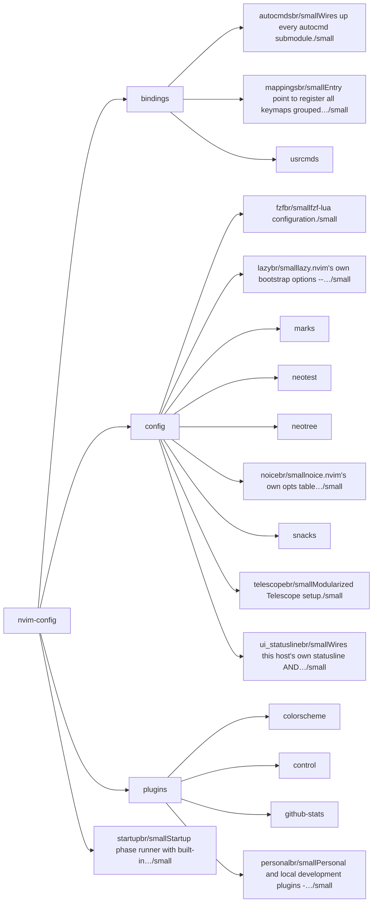
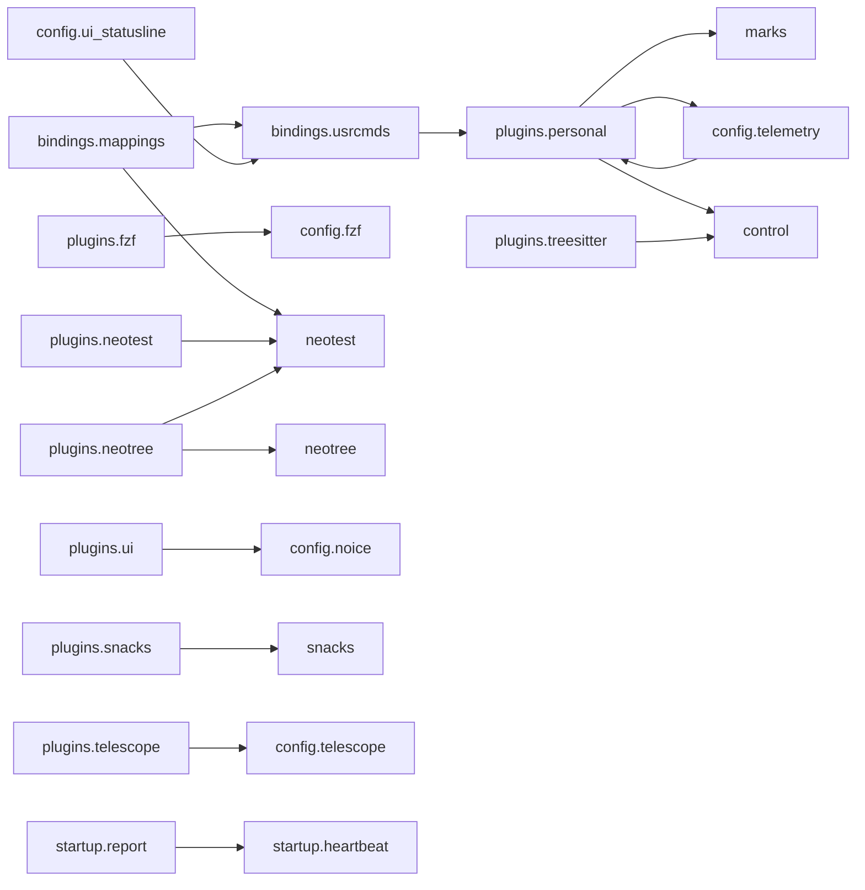

# nvim-config — module map

> **Generated** by `docmap`. Do not edit by hand — run `:DocMap`
> (or `nvim --headless -l scripts/gen_map.lua`) to regenerate.

**38 modules** · 310 namespaces · 120 helper files

The [interactive map](index.html) has filtering, full descriptions and
source links; this page is the version the code host renders directly.

## Namespaces

## Dependencies

Which parts of the tree require which, rolled up to the second level.
The [interactive map](index.html)'s **Deps** view has this per module,
in both directions, with load-time and lazy requires told apart.

## Modules

| Module | Description | Fns | Docs |
|---|---|---|---|
| `bindings` |  |  |  |
| &nbsp;&nbsp;`bindings.autocmds` | Wires up every autocmd submodule. |  | [README](../../lua/bindings/autocmds/README.md) · [src](../../lua/bindings/autocmds/init.lua) |
| &nbsp;&nbsp;&nbsp;&nbsp;`bindings.autocmds.general` | Centralized, toggleable autocmd suite with safe defaults and idempotent setup. | 1 | [README](../../lua/bindings/autocmds/general/README.md) · [src](../../lua/bindings/autocmds/general/init.lua) |
| &nbsp;&nbsp;&nbsp;&nbsp;`bindings.autocmds.git` | Orchestrates all Git-related autocommands by delegating to submodules. | 1 | [README](../../lua/bindings/autocmds/git/README.md) · [src](../../lua/bindings/autocmds/git/init.lua) |
| &nbsp;&nbsp;&nbsp;&nbsp;`bindings.autocmds.text` | Text-focused autocommands with feature flags. | 2 | [README](../../lua/bindings/autocmds/text/README.md) · [src](../../lua/bindings/autocmds/text/init.lua) |
| &nbsp;&nbsp;`bindings.mappings` | Entry point to register all keymaps grouped by topic. | 1 | [README](../../lua/bindings/mappings/README.md) · [src](../../lua/bindings/mappings/init.lua) |
| &nbsp;&nbsp;&nbsp;&nbsp;`utils` |  |  |  |
| &nbsp;&nbsp;&nbsp;&nbsp;&nbsp;&nbsp;`bindings.mappings.utils.window_zoom` | Toggle maximize current window and restore previous layout sizes. | 4 | [README](../../lua/bindings/mappings/utils/window_zoom/README.md) · [src](../../lua/bindings/mappings/utils/window_zoom/init.lua) |
| &nbsp;&nbsp;`bindings.usrcmds` |  |  | [README](../../lua/bindings/usrcmds/README.md) · [src](../../lua/bindings/usrcmds/init.lua) |
| &nbsp;&nbsp;&nbsp;&nbsp;`bindings.usrcmds.autocmd_docs` | `bindings/autocmd/` and `bindings/usercmd/` markdown from what `lib.nvim.bindings.autocmd` actually registered this session. | 2 | [src](../../lua/bindings/usrcmds/autocmd_docs/init.lua) |
| &nbsp;&nbsp;&nbsp;&nbsp;`bindings.usrcmds.bindings_audit` | `:LibKeymapConflicts` and `:BindingsRuntimeChecklist` — cross-registry checks over whatever this session actually loaded: keymap action vs. | 1 | [src](../../lua/bindings/usrcmds/bindings_audit/init.lua) |
| &nbsp;&nbsp;&nbsp;&nbsp;`bindings.usrcmds.bindings_explorer` | `:Bindings` — the composer verb + route table over the BINDINGS corpus (extern cheatsheets under docs/NOTES/ExternPlugins/Bindings + each personal plugin's… | 19 | [README](../../lua/bindings/usrcmds/bindings_explorer/README.md) · [src](../../lua/bindings/usrcmds/bindings_explorer/init.lua) |
| &nbsp;&nbsp;&nbsp;&nbsp;&nbsp;&nbsp;`doc` |  |  |  |
| &nbsp;&nbsp;&nbsp;&nbsp;&nbsp;&nbsp;`docs` |  |  |  |
| &nbsp;&nbsp;&nbsp;&nbsp;`bindings.usrcmds.cdx` | The templates live in `docs/NOTES/CDX/templates/PROMPT/` of this config and are pasted into Claude Code by hand all day, so this saves the detour through a… | 10 | [src](../../lua/bindings/usrcmds/cdx/init.lua) |
| &nbsp;&nbsp;&nbsp;&nbsp;`bindings.usrcmds.clipboard` | The report and handover folders under `docs/ROADMAP/` are pasted into Claude Code prompts, shells and file dialogs all day, so this saves the detour through a… | 9 | [src](../../lua/bindings/usrcmds/clipboard/init.lua) |
| &nbsp;&nbsp;&nbsp;&nbsp;`bindings.usrcmds.context_open` | `M-o` / `M-O` / `:ContextOpen` -- one dispatcher unifying "open the thing under the cursor" across gopath.nvim (gF), markdown.nvim (TableView), images.nvim,… | 5 | [README](../../lua/bindings/usrcmds/context_open/README.md) · [src](../../lua/bindings/usrcmds/context_open/init.lua) |
| &nbsp;&nbsp;&nbsp;&nbsp;`bindings.usrcmds.execute` | Text in a buffer is often a command: a note that says `` `:set wrap` ``, a README block with `git status`, a line of Lua. | 6 | [README](../../lua/bindings/usrcmds/execute/README.md) · [src](../../lua/bindings/usrcmds/execute/init.lua) |
| &nbsp;&nbsp;&nbsp;&nbsp;`bindings.usrcmds.learn_plan_viewer` | `:LearnPlanViewer [week N]` — standalone viewer for the CLI-Lernplan week pages (`docs/ROADMAP/CLI_Lernplan/week-NN.md`). | 6 | [src](../../lua/bindings/usrcmds/learn_plan_viewer/init.lua) |
| &nbsp;&nbsp;&nbsp;&nbsp;`bindings.usrcmds.native_repos` | Sister of `:MyPlugins` for the native apps (tasks-desktop, rules-desktop, ai-desktop, takt, docmap-desktop, appkit; the list is… | 17 | [README](../../lua/bindings/usrcmds/native_repos/README.md) · [src](../../lua/bindings/usrcmds/native_repos/init.lua) |
| &nbsp;&nbsp;&nbsp;&nbsp;`bindings.usrcmds.plugin_repos` | source mode of the personal plugin list — plus an interactive picker, a dashboard and the wkdbook task commands. | 20 | [README](../../lua/bindings/usrcmds/plugin_repos/README.md) · [src](../../lua/bindings/usrcmds/plugin_repos/init.lua) |
| &nbsp;&nbsp;&nbsp;&nbsp;`bindings.usrcmds.profile` | Without an argument it shows the active profile and where it came from. | 1 | [src](../../lua/bindings/usrcmds/profile/init.lua) |
| &nbsp;&nbsp;&nbsp;&nbsp;`bindings.usrcmds.telemetry_nvim_config` | aliases for `:RATelemetry setup nvim-config` / `:RATelemetry full nvim-config`. | 1 | [README](../../lua/bindings/usrcmds/telemetry_nvim_config/README.md) · [src](../../lua/bindings/usrcmds/telemetry_nvim_config/init.lua) |
| `config` |  |  |  |
| &nbsp;&nbsp;`config.fzf` | fzf-lua configuration. | 1 | [README](../../lua/config/fzf/README.md) · [src](../../lua/config/fzf/init.lua) |
| &nbsp;&nbsp;`config.lazy` | lazy.nvim's own bootstrap options -- `defaults.lazy = true`, plus a long comment on why remote-managed personal plugins need special handling (dir-mode… | 1 | [README](../../lua/config/lazy/README.md) · [src](../../lua/config/lazy/init.lua) |
| &nbsp;&nbsp;`marks` |  |  |  |
| &nbsp;&nbsp;`neotest` |  |  |  |
| &nbsp;&nbsp;&nbsp;&nbsp;`config.neotest.actions` | Centralized Neotest actions usable by keymaps, usercommands and menus. | 10 | [README](../../lua/config/neotest/actions/README.md) · [src](../../lua/config/neotest/actions/init.lua) |
| &nbsp;&nbsp;&nbsp;&nbsp;`adapters` |  |  |  |
| &nbsp;&nbsp;&nbsp;&nbsp;`autocmds` |  |  |  |
| &nbsp;&nbsp;&nbsp;&nbsp;`config.neotest.commands` | User commands for Neotest based on shared actions. | 1 | [README](../../lua/config/neotest/commands/README.md) · [src](../../lua/config/neotest/commands/init.lua) |
| &nbsp;&nbsp;&nbsp;&nbsp;`consumers` |  |  |  |
| &nbsp;&nbsp;&nbsp;&nbsp;`config.neotest.core` | Core configuration and utilities for neotest integration | 5 | [README](../../lua/config/neotest/core/README.md) · [src](../../lua/config/neotest/core/init.lua) |
| &nbsp;&nbsp;&nbsp;&nbsp;`docs` |  |  |  |
| &nbsp;&nbsp;&nbsp;&nbsp;`config.neotest.highlights` | Neotest highlight groups setup | 1 | [README](../../lua/config/neotest/highlights/README.md) · [src](../../lua/config/neotest/highlights/init.lua) |
| &nbsp;&nbsp;&nbsp;&nbsp;`init` |  |  |  |
| &nbsp;&nbsp;&nbsp;&nbsp;&nbsp;&nbsp;`checks` |  |  |  |
| &nbsp;&nbsp;&nbsp;&nbsp;`config.neotest.keymaps` | Neotest keymaps using centralized actions. | 1 | [README](../../lua/config/neotest/keymaps/README.md) · [src](../../lua/config/neotest/keymaps/init.lua) |
| &nbsp;&nbsp;&nbsp;&nbsp;`config.neotest.neotree` | Neo-tree integration for Neotest actions. | 3 | [README](../../lua/config/neotest/neotree/README.md) · [src](../../lua/config/neotest/neotree/init.lua) |
| &nbsp;&nbsp;&nbsp;&nbsp;`config.neotest.telescope` | Telescope picker for Neotest actions. | 1 | [README](../../lua/config/neotest/telescope/README.md) · [src](../../lua/config/neotest/telescope/init.lua) |
| &nbsp;&nbsp;&nbsp;&nbsp;`utils` |  |  |  |
| &nbsp;&nbsp;&nbsp;&nbsp;`config.neotest.whichkey` | which-key group label for the Neotest prefix. | 1 | [README](../../lua/config/neotest/whichkey/README.md) · [src](../../lua/config/neotest/whichkey/init.lua) |
| &nbsp;&nbsp;`neotree` |  |  | [README](../../lua/config/neotree/README.md) |
| &nbsp;&nbsp;&nbsp;&nbsp;`config.neotree.event_handlers` | Neo-tree unified event handlers configuration |  | [README](../../lua/config/neotree/event_handlers/README.md) · [src](../../lua/config/neotree/event_handlers/init.lua) |
| &nbsp;&nbsp;&nbsp;&nbsp;`config.neotree.keymaps` | Centralized, buffer-local Neo-tree keymaps that override defaults consistently. |  | [README](../../lua/config/neotree/keymaps/README.md) · [src](../../lua/config/neotree/keymaps/init.lua) |
| &nbsp;&nbsp;&nbsp;&nbsp;&nbsp;&nbsp;`config.neotree.keymaps.filesystem` | Entry point that merges all filesystem keymap modules into a single mapping table. |  | [README](../../lua/config/neotree/keymaps/filesystem/README.md) · [src](../../lua/config/neotree/keymaps/filesystem/init.lua) |
| &nbsp;&nbsp;`config.noice` | noice.nvim's own opts table (cmdline/lsp/messages/popupmenu/presets/ routes/views/notify), assembled here rather than inline in the plugin spec. |  | [README](../../lua/config/noice/README.md) · [src](../../lua/config/noice/init.lua) |
| &nbsp;&nbsp;`snacks` |  |  |  |
| &nbsp;&nbsp;&nbsp;&nbsp;`config.snacks.mappings` | Keymap definitions for folke/snacks.nvim. | 1 | [README](../../lua/config/snacks/mappings/README.md) · [src](../../lua/config/snacks/mappings/init.lua) |
| &nbsp;&nbsp;`config.telescope` | Modularized Telescope setup. | 4 | [README](../../lua/config/telescope/README.md) · [src](../../lua/config/telescope/init.lua) |
| &nbsp;&nbsp;&nbsp;&nbsp;`file_browser` |  |  |  |
| &nbsp;&nbsp;`config.ui_statusline` | Wires this host's own statusline AND tabline into ui.nvim, at UIReady. | 1 | [src](../../lua/config/ui_statusline/init.lua) |
| `plugins` |  |  |  |
| &nbsp;&nbsp;`colorscheme` |  |  |  |
| &nbsp;&nbsp;`control` |  |  |  |
| &nbsp;&nbsp;`github-stats` |  |  |  |
| &nbsp;&nbsp;&nbsp;&nbsp;`data` |  |  |  |
| &nbsp;&nbsp;&nbsp;&nbsp;&nbsp;&nbsp;`StefanBartl_buffer-ctx.nvim` |  |  |  |
| &nbsp;&nbsp;&nbsp;&nbsp;&nbsp;&nbsp;&nbsp;&nbsp;`clones` |  |  |  |
| &nbsp;&nbsp;&nbsp;&nbsp;&nbsp;&nbsp;&nbsp;&nbsp;`paths` |  |  |  |
| &nbsp;&nbsp;&nbsp;&nbsp;&nbsp;&nbsp;&nbsp;&nbsp;`referrers` |  |  |  |
| &nbsp;&nbsp;&nbsp;&nbsp;&nbsp;&nbsp;&nbsp;&nbsp;`views` |  |  |  |
| &nbsp;&nbsp;&nbsp;&nbsp;&nbsp;&nbsp;`StefanBartl_cascade.nvim` |  |  |  |
| &nbsp;&nbsp;&nbsp;&nbsp;&nbsp;&nbsp;&nbsp;&nbsp;`clones` |  |  |  |
| &nbsp;&nbsp;&nbsp;&nbsp;&nbsp;&nbsp;&nbsp;&nbsp;`paths` |  |  |  |
| &nbsp;&nbsp;&nbsp;&nbsp;&nbsp;&nbsp;&nbsp;&nbsp;`referrers` |  |  |  |
| &nbsp;&nbsp;&nbsp;&nbsp;&nbsp;&nbsp;&nbsp;&nbsp;`views` |  |  |  |
| &nbsp;&nbsp;&nbsp;&nbsp;&nbsp;&nbsp;`StefanBartl_cmdlog.nvim` |  |  |  |
| &nbsp;&nbsp;&nbsp;&nbsp;&nbsp;&nbsp;&nbsp;&nbsp;`clones` |  |  |  |
| &nbsp;&nbsp;&nbsp;&nbsp;&nbsp;&nbsp;&nbsp;&nbsp;`paths` |  |  |  |
| &nbsp;&nbsp;&nbsp;&nbsp;&nbsp;&nbsp;&nbsp;&nbsp;`referrers` |  |  |  |
| &nbsp;&nbsp;&nbsp;&nbsp;&nbsp;&nbsp;&nbsp;&nbsp;`views` |  |  |  |
| &nbsp;&nbsp;&nbsp;&nbsp;&nbsp;&nbsp;`StefanBartl_color_my_ascii.nvim` |  |  |  |
| &nbsp;&nbsp;&nbsp;&nbsp;&nbsp;&nbsp;&nbsp;&nbsp;`clones` |  |  |  |
| &nbsp;&nbsp;&nbsp;&nbsp;&nbsp;&nbsp;&nbsp;&nbsp;`paths` |  |  |  |
| &nbsp;&nbsp;&nbsp;&nbsp;&nbsp;&nbsp;&nbsp;&nbsp;`referrers` |  |  |  |
| &nbsp;&nbsp;&nbsp;&nbsp;&nbsp;&nbsp;&nbsp;&nbsp;`views` |  |  |  |
| &nbsp;&nbsp;&nbsp;&nbsp;&nbsp;&nbsp;`StefanBartl_debugging.nvim` |  |  |  |
| &nbsp;&nbsp;&nbsp;&nbsp;&nbsp;&nbsp;&nbsp;&nbsp;`clones` |  |  |  |
| &nbsp;&nbsp;&nbsp;&nbsp;&nbsp;&nbsp;&nbsp;&nbsp;`paths` |  |  |  |
| &nbsp;&nbsp;&nbsp;&nbsp;&nbsp;&nbsp;&nbsp;&nbsp;`referrers` |  |  |  |
| &nbsp;&nbsp;&nbsp;&nbsp;&nbsp;&nbsp;&nbsp;&nbsp;`views` |  |  |  |
| &nbsp;&nbsp;&nbsp;&nbsp;&nbsp;&nbsp;`StefanBartl_diff.nvim` |  |  |  |
| &nbsp;&nbsp;&nbsp;&nbsp;&nbsp;&nbsp;&nbsp;&nbsp;`clones` |  |  |  |
| &nbsp;&nbsp;&nbsp;&nbsp;&nbsp;&nbsp;&nbsp;&nbsp;`paths` |  |  |  |
| &nbsp;&nbsp;&nbsp;&nbsp;&nbsp;&nbsp;&nbsp;&nbsp;`referrers` |  |  |  |
| &nbsp;&nbsp;&nbsp;&nbsp;&nbsp;&nbsp;&nbsp;&nbsp;`views` |  |  |  |
| &nbsp;&nbsp;&nbsp;&nbsp;&nbsp;&nbsp;`StefanBartl_docmap.nvim` |  |  |  |
| &nbsp;&nbsp;&nbsp;&nbsp;&nbsp;&nbsp;&nbsp;&nbsp;`clones` |  |  |  |
| &nbsp;&nbsp;&nbsp;&nbsp;&nbsp;&nbsp;&nbsp;&nbsp;`paths` |  |  |  |
| &nbsp;&nbsp;&nbsp;&nbsp;&nbsp;&nbsp;&nbsp;&nbsp;`referrers` |  |  |  |
| &nbsp;&nbsp;&nbsp;&nbsp;&nbsp;&nbsp;&nbsp;&nbsp;`views` |  |  |  |
| &nbsp;&nbsp;&nbsp;&nbsp;&nbsp;&nbsp;`StefanBartl_documentation.nvim` |  |  |  |
| &nbsp;&nbsp;&nbsp;&nbsp;&nbsp;&nbsp;&nbsp;&nbsp;`clones` |  |  |  |
| &nbsp;&nbsp;&nbsp;&nbsp;&nbsp;&nbsp;&nbsp;&nbsp;`paths` |  |  |  |
| &nbsp;&nbsp;&nbsp;&nbsp;&nbsp;&nbsp;&nbsp;&nbsp;`referrers` |  |  |  |
| &nbsp;&nbsp;&nbsp;&nbsp;&nbsp;&nbsp;&nbsp;&nbsp;`views` |  |  |  |
| &nbsp;&nbsp;&nbsp;&nbsp;&nbsp;&nbsp;`StefanBartl_emojis.nvim` |  |  |  |
| &nbsp;&nbsp;&nbsp;&nbsp;&nbsp;&nbsp;&nbsp;&nbsp;`clones` |  |  |  |
| &nbsp;&nbsp;&nbsp;&nbsp;&nbsp;&nbsp;&nbsp;&nbsp;`paths` |  |  |  |
| &nbsp;&nbsp;&nbsp;&nbsp;&nbsp;&nbsp;&nbsp;&nbsp;`referrers` |  |  |  |
| &nbsp;&nbsp;&nbsp;&nbsp;&nbsp;&nbsp;&nbsp;&nbsp;`views` |  |  |  |
| &nbsp;&nbsp;&nbsp;&nbsp;&nbsp;&nbsp;`StefanBartl_fileops.nvim` |  |  |  |
| &nbsp;&nbsp;&nbsp;&nbsp;&nbsp;&nbsp;&nbsp;&nbsp;`clones` |  |  |  |
| &nbsp;&nbsp;&nbsp;&nbsp;&nbsp;&nbsp;&nbsp;&nbsp;`paths` |  |  |  |
| &nbsp;&nbsp;&nbsp;&nbsp;&nbsp;&nbsp;&nbsp;&nbsp;`referrers` |  |  |  |
| &nbsp;&nbsp;&nbsp;&nbsp;&nbsp;&nbsp;&nbsp;&nbsp;`views` |  |  |  |
| &nbsp;&nbsp;&nbsp;&nbsp;&nbsp;&nbsp;`StefanBartl_filetree.nvim` |  |  |  |
| &nbsp;&nbsp;&nbsp;&nbsp;&nbsp;&nbsp;&nbsp;&nbsp;`clones` |  |  |  |
| &nbsp;&nbsp;&nbsp;&nbsp;&nbsp;&nbsp;&nbsp;&nbsp;`paths` |  |  |  |
| &nbsp;&nbsp;&nbsp;&nbsp;&nbsp;&nbsp;&nbsp;&nbsp;`referrers` |  |  |  |
| &nbsp;&nbsp;&nbsp;&nbsp;&nbsp;&nbsp;&nbsp;&nbsp;`views` |  |  |  |
| &nbsp;&nbsp;&nbsp;&nbsp;&nbsp;&nbsp;`StefanBartl_github_stats.nvim` |  |  |  |
| &nbsp;&nbsp;&nbsp;&nbsp;&nbsp;&nbsp;&nbsp;&nbsp;`clones` |  |  |  |
| &nbsp;&nbsp;&nbsp;&nbsp;&nbsp;&nbsp;&nbsp;&nbsp;`paths` |  |  |  |
| &nbsp;&nbsp;&nbsp;&nbsp;&nbsp;&nbsp;&nbsp;&nbsp;`referrers` |  |  |  |
| &nbsp;&nbsp;&nbsp;&nbsp;&nbsp;&nbsp;&nbsp;&nbsp;`views` |  |  |  |
| &nbsp;&nbsp;&nbsp;&nbsp;&nbsp;&nbsp;`StefanBartl_gopath.nvim` |  |  |  |
| &nbsp;&nbsp;&nbsp;&nbsp;&nbsp;&nbsp;&nbsp;&nbsp;`clones` |  |  |  |
| &nbsp;&nbsp;&nbsp;&nbsp;&nbsp;&nbsp;&nbsp;&nbsp;`paths` |  |  |  |
| &nbsp;&nbsp;&nbsp;&nbsp;&nbsp;&nbsp;&nbsp;&nbsp;`referrers` |  |  |  |
| &nbsp;&nbsp;&nbsp;&nbsp;&nbsp;&nbsp;&nbsp;&nbsp;`views` |  |  |  |
| &nbsp;&nbsp;&nbsp;&nbsp;&nbsp;&nbsp;`StefanBartl_hover.nvim` |  |  |  |
| &nbsp;&nbsp;&nbsp;&nbsp;&nbsp;&nbsp;&nbsp;&nbsp;`clones` |  |  |  |
| &nbsp;&nbsp;&nbsp;&nbsp;&nbsp;&nbsp;&nbsp;&nbsp;`paths` |  |  |  |
| &nbsp;&nbsp;&nbsp;&nbsp;&nbsp;&nbsp;&nbsp;&nbsp;`referrers` |  |  |  |
| &nbsp;&nbsp;&nbsp;&nbsp;&nbsp;&nbsp;&nbsp;&nbsp;`views` |  |  |  |
| &nbsp;&nbsp;&nbsp;&nbsp;&nbsp;&nbsp;`StefanBartl_insights.nvim` |  |  |  |
| &nbsp;&nbsp;&nbsp;&nbsp;&nbsp;&nbsp;&nbsp;&nbsp;`clones` |  |  |  |
| &nbsp;&nbsp;&nbsp;&nbsp;&nbsp;&nbsp;&nbsp;&nbsp;`paths` |  |  |  |
| &nbsp;&nbsp;&nbsp;&nbsp;&nbsp;&nbsp;&nbsp;&nbsp;`referrers` |  |  |  |
| &nbsp;&nbsp;&nbsp;&nbsp;&nbsp;&nbsp;&nbsp;&nbsp;`views` |  |  |  |
| &nbsp;&nbsp;&nbsp;&nbsp;&nbsp;&nbsp;`StefanBartl_language.nvim` |  |  |  |
| &nbsp;&nbsp;&nbsp;&nbsp;&nbsp;&nbsp;&nbsp;&nbsp;`clones` |  |  |  |
| &nbsp;&nbsp;&nbsp;&nbsp;&nbsp;&nbsp;&nbsp;&nbsp;`paths` |  |  |  |
| &nbsp;&nbsp;&nbsp;&nbsp;&nbsp;&nbsp;&nbsp;&nbsp;`referrers` |  |  |  |
| &nbsp;&nbsp;&nbsp;&nbsp;&nbsp;&nbsp;&nbsp;&nbsp;`views` |  |  |  |
| &nbsp;&nbsp;&nbsp;&nbsp;&nbsp;&nbsp;`StefanBartl_lib.nvim` |  |  |  |
| &nbsp;&nbsp;&nbsp;&nbsp;&nbsp;&nbsp;&nbsp;&nbsp;`clones` |  |  |  |
| &nbsp;&nbsp;&nbsp;&nbsp;&nbsp;&nbsp;&nbsp;&nbsp;`paths` |  |  |  |
| &nbsp;&nbsp;&nbsp;&nbsp;&nbsp;&nbsp;&nbsp;&nbsp;`referrers` |  |  |  |
| &nbsp;&nbsp;&nbsp;&nbsp;&nbsp;&nbsp;&nbsp;&nbsp;`views` |  |  |  |
| &nbsp;&nbsp;&nbsp;&nbsp;&nbsp;&nbsp;`StefanBartl_lsp.nvim` |  |  |  |
| &nbsp;&nbsp;&nbsp;&nbsp;&nbsp;&nbsp;&nbsp;&nbsp;`clones` |  |  |  |
| &nbsp;&nbsp;&nbsp;&nbsp;&nbsp;&nbsp;&nbsp;&nbsp;`paths` |  |  |  |
| &nbsp;&nbsp;&nbsp;&nbsp;&nbsp;&nbsp;&nbsp;&nbsp;`referrers` |  |  |  |
| &nbsp;&nbsp;&nbsp;&nbsp;&nbsp;&nbsp;&nbsp;&nbsp;`views` |  |  |  |
| &nbsp;&nbsp;&nbsp;&nbsp;&nbsp;&nbsp;`StefanBartl_markdown.nvim` |  |  |  |
| &nbsp;&nbsp;&nbsp;&nbsp;&nbsp;&nbsp;&nbsp;&nbsp;`clones` |  |  |  |
| &nbsp;&nbsp;&nbsp;&nbsp;&nbsp;&nbsp;&nbsp;&nbsp;`paths` |  |  |  |
| &nbsp;&nbsp;&nbsp;&nbsp;&nbsp;&nbsp;&nbsp;&nbsp;`referrers` |  |  |  |
| &nbsp;&nbsp;&nbsp;&nbsp;&nbsp;&nbsp;&nbsp;&nbsp;`views` |  |  |  |
| &nbsp;&nbsp;&nbsp;&nbsp;&nbsp;&nbsp;`StefanBartl_mdview.nvim` |  |  |  |
| &nbsp;&nbsp;&nbsp;&nbsp;&nbsp;&nbsp;&nbsp;&nbsp;`clones` |  |  |  |
| &nbsp;&nbsp;&nbsp;&nbsp;&nbsp;&nbsp;&nbsp;&nbsp;`paths` |  |  |  |
| &nbsp;&nbsp;&nbsp;&nbsp;&nbsp;&nbsp;&nbsp;&nbsp;`referrers` |  |  |  |
| &nbsp;&nbsp;&nbsp;&nbsp;&nbsp;&nbsp;&nbsp;&nbsp;`views` |  |  |  |
| &nbsp;&nbsp;&nbsp;&nbsp;&nbsp;&nbsp;`StefanBartl_migrate.nvim` |  |  |  |
| &nbsp;&nbsp;&nbsp;&nbsp;&nbsp;&nbsp;&nbsp;&nbsp;`clones` |  |  |  |
| &nbsp;&nbsp;&nbsp;&nbsp;&nbsp;&nbsp;&nbsp;&nbsp;`paths` |  |  |  |
| &nbsp;&nbsp;&nbsp;&nbsp;&nbsp;&nbsp;&nbsp;&nbsp;`referrers` |  |  |  |
| &nbsp;&nbsp;&nbsp;&nbsp;&nbsp;&nbsp;&nbsp;&nbsp;`views` |  |  |  |
| &nbsp;&nbsp;&nbsp;&nbsp;&nbsp;&nbsp;`StefanBartl_nvim-cmdlog` |  |  |  |
| &nbsp;&nbsp;&nbsp;&nbsp;&nbsp;&nbsp;&nbsp;&nbsp;`clones` |  |  |  |
| &nbsp;&nbsp;&nbsp;&nbsp;&nbsp;&nbsp;&nbsp;&nbsp;`paths` |  |  |  |
| &nbsp;&nbsp;&nbsp;&nbsp;&nbsp;&nbsp;&nbsp;&nbsp;`referrers` |  |  |  |
| &nbsp;&nbsp;&nbsp;&nbsp;&nbsp;&nbsp;&nbsp;&nbsp;`views` |  |  |  |
| &nbsp;&nbsp;&nbsp;&nbsp;&nbsp;&nbsp;`StefanBartl_nvim-containers` |  |  |  |
| &nbsp;&nbsp;&nbsp;&nbsp;&nbsp;&nbsp;&nbsp;&nbsp;`clones` |  |  |  |
| &nbsp;&nbsp;&nbsp;&nbsp;&nbsp;&nbsp;&nbsp;&nbsp;`paths` |  |  |  |
| &nbsp;&nbsp;&nbsp;&nbsp;&nbsp;&nbsp;&nbsp;&nbsp;`referrers` |  |  |  |
| &nbsp;&nbsp;&nbsp;&nbsp;&nbsp;&nbsp;&nbsp;&nbsp;`views` |  |  |  |
| &nbsp;&nbsp;&nbsp;&nbsp;&nbsp;&nbsp;`StefanBartl_open.nvim` |  |  |  |
| &nbsp;&nbsp;&nbsp;&nbsp;&nbsp;&nbsp;&nbsp;&nbsp;`clones` |  |  |  |
| &nbsp;&nbsp;&nbsp;&nbsp;&nbsp;&nbsp;&nbsp;&nbsp;`paths` |  |  |  |
| &nbsp;&nbsp;&nbsp;&nbsp;&nbsp;&nbsp;&nbsp;&nbsp;`referrers` |  |  |  |
| &nbsp;&nbsp;&nbsp;&nbsp;&nbsp;&nbsp;&nbsp;&nbsp;`views` |  |  |  |
| &nbsp;&nbsp;&nbsp;&nbsp;&nbsp;&nbsp;`StefanBartl_pdfport.nvim` |  |  |  |
| &nbsp;&nbsp;&nbsp;&nbsp;&nbsp;&nbsp;&nbsp;&nbsp;`clones` |  |  |  |
| &nbsp;&nbsp;&nbsp;&nbsp;&nbsp;&nbsp;&nbsp;&nbsp;`paths` |  |  |  |
| &nbsp;&nbsp;&nbsp;&nbsp;&nbsp;&nbsp;&nbsp;&nbsp;`referrers` |  |  |  |
| &nbsp;&nbsp;&nbsp;&nbsp;&nbsp;&nbsp;&nbsp;&nbsp;`views` |  |  |  |
| &nbsp;&nbsp;&nbsp;&nbsp;&nbsp;&nbsp;`StefanBartl_pickers.nvim` |  |  |  |
| &nbsp;&nbsp;&nbsp;&nbsp;&nbsp;&nbsp;&nbsp;&nbsp;`clones` |  |  |  |
| &nbsp;&nbsp;&nbsp;&nbsp;&nbsp;&nbsp;&nbsp;&nbsp;`paths` |  |  |  |
| &nbsp;&nbsp;&nbsp;&nbsp;&nbsp;&nbsp;&nbsp;&nbsp;`referrers` |  |  |  |
| &nbsp;&nbsp;&nbsp;&nbsp;&nbsp;&nbsp;&nbsp;&nbsp;`views` |  |  |  |
| &nbsp;&nbsp;&nbsp;&nbsp;&nbsp;&nbsp;`StefanBartl_project-insight.nvim` |  |  |  |
| &nbsp;&nbsp;&nbsp;&nbsp;&nbsp;&nbsp;&nbsp;&nbsp;`clones` |  |  |  |
| &nbsp;&nbsp;&nbsp;&nbsp;&nbsp;&nbsp;&nbsp;&nbsp;`paths` |  |  |  |
| &nbsp;&nbsp;&nbsp;&nbsp;&nbsp;&nbsp;&nbsp;&nbsp;`referrers` |  |  |  |
| &nbsp;&nbsp;&nbsp;&nbsp;&nbsp;&nbsp;&nbsp;&nbsp;`views` |  |  |  |
| &nbsp;&nbsp;&nbsp;&nbsp;&nbsp;&nbsp;`StefanBartl_recommender.nvim` |  |  |  |
| &nbsp;&nbsp;&nbsp;&nbsp;&nbsp;&nbsp;&nbsp;&nbsp;`clones` |  |  |  |
| &nbsp;&nbsp;&nbsp;&nbsp;&nbsp;&nbsp;&nbsp;&nbsp;`paths` |  |  |  |
| &nbsp;&nbsp;&nbsp;&nbsp;&nbsp;&nbsp;&nbsp;&nbsp;`referrers` |  |  |  |
| &nbsp;&nbsp;&nbsp;&nbsp;&nbsp;&nbsp;&nbsp;&nbsp;`views` |  |  |  |
| &nbsp;&nbsp;&nbsp;&nbsp;&nbsp;&nbsp;`StefanBartl_replacer.nvim` |  |  |  |
| &nbsp;&nbsp;&nbsp;&nbsp;&nbsp;&nbsp;&nbsp;&nbsp;`clones` |  |  |  |
| &nbsp;&nbsp;&nbsp;&nbsp;&nbsp;&nbsp;&nbsp;&nbsp;`paths` |  |  |  |
| &nbsp;&nbsp;&nbsp;&nbsp;&nbsp;&nbsp;&nbsp;&nbsp;`referrers` |  |  |  |
| &nbsp;&nbsp;&nbsp;&nbsp;&nbsp;&nbsp;&nbsp;&nbsp;`views` |  |  |  |
| &nbsp;&nbsp;&nbsp;&nbsp;&nbsp;&nbsp;`StefanBartl_reposcope.nvim` |  |  |  |
| &nbsp;&nbsp;&nbsp;&nbsp;&nbsp;&nbsp;&nbsp;&nbsp;`clones` |  |  |  |
| &nbsp;&nbsp;&nbsp;&nbsp;&nbsp;&nbsp;&nbsp;&nbsp;`paths` |  |  |  |
| &nbsp;&nbsp;&nbsp;&nbsp;&nbsp;&nbsp;&nbsp;&nbsp;`referrers` |  |  |  |
| &nbsp;&nbsp;&nbsp;&nbsp;&nbsp;&nbsp;&nbsp;&nbsp;`views` |  |  |  |
| &nbsp;&nbsp;&nbsp;&nbsp;&nbsp;&nbsp;`StefanBartl_sandbox.nvim` |  |  |  |
| &nbsp;&nbsp;&nbsp;&nbsp;&nbsp;&nbsp;&nbsp;&nbsp;`clones` |  |  |  |
| &nbsp;&nbsp;&nbsp;&nbsp;&nbsp;&nbsp;&nbsp;&nbsp;`paths` |  |  |  |
| &nbsp;&nbsp;&nbsp;&nbsp;&nbsp;&nbsp;&nbsp;&nbsp;`referrers` |  |  |  |
| &nbsp;&nbsp;&nbsp;&nbsp;&nbsp;&nbsp;&nbsp;&nbsp;`views` |  |  |  |
| &nbsp;&nbsp;&nbsp;&nbsp;&nbsp;&nbsp;`WKDSteve_buffer-ctx.nvim` |  |  |  |
| &nbsp;&nbsp;&nbsp;&nbsp;&nbsp;&nbsp;&nbsp;&nbsp;`clones` |  |  |  |
| &nbsp;&nbsp;&nbsp;&nbsp;&nbsp;&nbsp;&nbsp;&nbsp;`paths` |  |  |  |
| &nbsp;&nbsp;&nbsp;&nbsp;&nbsp;&nbsp;&nbsp;&nbsp;`referrers` |  |  |  |
| &nbsp;&nbsp;&nbsp;&nbsp;&nbsp;&nbsp;&nbsp;&nbsp;`views` |  |  |  |
| &nbsp;&nbsp;&nbsp;&nbsp;&nbsp;&nbsp;`WKDSteve_cascade.nvim` |  |  |  |
| &nbsp;&nbsp;&nbsp;&nbsp;&nbsp;&nbsp;&nbsp;&nbsp;`clones` |  |  |  |
| &nbsp;&nbsp;&nbsp;&nbsp;&nbsp;&nbsp;&nbsp;&nbsp;`paths` |  |  |  |
| &nbsp;&nbsp;&nbsp;&nbsp;&nbsp;&nbsp;&nbsp;&nbsp;`referrers` |  |  |  |
| &nbsp;&nbsp;&nbsp;&nbsp;&nbsp;&nbsp;&nbsp;&nbsp;`views` |  |  |  |
| &nbsp;&nbsp;&nbsp;&nbsp;&nbsp;&nbsp;`WKDSteve_cmdlog.nvim` |  |  |  |
| &nbsp;&nbsp;&nbsp;&nbsp;&nbsp;&nbsp;&nbsp;&nbsp;`clones` |  |  |  |
| &nbsp;&nbsp;&nbsp;&nbsp;&nbsp;&nbsp;&nbsp;&nbsp;`paths` |  |  |  |
| &nbsp;&nbsp;&nbsp;&nbsp;&nbsp;&nbsp;&nbsp;&nbsp;`referrers` |  |  |  |
| &nbsp;&nbsp;&nbsp;&nbsp;&nbsp;&nbsp;&nbsp;&nbsp;`views` |  |  |  |
| &nbsp;&nbsp;&nbsp;&nbsp;&nbsp;&nbsp;`WKDSteve_color_my_ascii.nvim` |  |  |  |
| &nbsp;&nbsp;&nbsp;&nbsp;&nbsp;&nbsp;&nbsp;&nbsp;`clones` |  |  |  |
| &nbsp;&nbsp;&nbsp;&nbsp;&nbsp;&nbsp;&nbsp;&nbsp;`paths` |  |  |  |
| &nbsp;&nbsp;&nbsp;&nbsp;&nbsp;&nbsp;&nbsp;&nbsp;`referrers` |  |  |  |
| &nbsp;&nbsp;&nbsp;&nbsp;&nbsp;&nbsp;&nbsp;&nbsp;`views` |  |  |  |
| &nbsp;&nbsp;&nbsp;&nbsp;&nbsp;&nbsp;`WKDSteve_debugging.nvim` |  |  |  |
| &nbsp;&nbsp;&nbsp;&nbsp;&nbsp;&nbsp;&nbsp;&nbsp;`clones` |  |  |  |
| &nbsp;&nbsp;&nbsp;&nbsp;&nbsp;&nbsp;&nbsp;&nbsp;`paths` |  |  |  |
| &nbsp;&nbsp;&nbsp;&nbsp;&nbsp;&nbsp;&nbsp;&nbsp;`referrers` |  |  |  |
| &nbsp;&nbsp;&nbsp;&nbsp;&nbsp;&nbsp;&nbsp;&nbsp;`views` |  |  |  |
| &nbsp;&nbsp;&nbsp;&nbsp;&nbsp;&nbsp;`WKDSteve_diff.nvim` |  |  |  |
| &nbsp;&nbsp;&nbsp;&nbsp;&nbsp;&nbsp;&nbsp;&nbsp;`clones` |  |  |  |
| &nbsp;&nbsp;&nbsp;&nbsp;&nbsp;&nbsp;&nbsp;&nbsp;`paths` |  |  |  |
| &nbsp;&nbsp;&nbsp;&nbsp;&nbsp;&nbsp;&nbsp;&nbsp;`referrers` |  |  |  |
| &nbsp;&nbsp;&nbsp;&nbsp;&nbsp;&nbsp;&nbsp;&nbsp;`views` |  |  |  |
| &nbsp;&nbsp;&nbsp;&nbsp;&nbsp;&nbsp;`WKDSteve_docmap.nvim` |  |  |  |
| &nbsp;&nbsp;&nbsp;&nbsp;&nbsp;&nbsp;&nbsp;&nbsp;`clones` |  |  |  |
| &nbsp;&nbsp;&nbsp;&nbsp;&nbsp;&nbsp;&nbsp;&nbsp;`paths` |  |  |  |
| &nbsp;&nbsp;&nbsp;&nbsp;&nbsp;&nbsp;&nbsp;&nbsp;`referrers` |  |  |  |
| &nbsp;&nbsp;&nbsp;&nbsp;&nbsp;&nbsp;&nbsp;&nbsp;`views` |  |  |  |
| &nbsp;&nbsp;&nbsp;&nbsp;&nbsp;&nbsp;`WKDSteve_emojis.nvim` |  |  |  |
| &nbsp;&nbsp;&nbsp;&nbsp;&nbsp;&nbsp;&nbsp;&nbsp;`clones` |  |  |  |
| &nbsp;&nbsp;&nbsp;&nbsp;&nbsp;&nbsp;&nbsp;&nbsp;`paths` |  |  |  |
| &nbsp;&nbsp;&nbsp;&nbsp;&nbsp;&nbsp;&nbsp;&nbsp;`referrers` |  |  |  |
| &nbsp;&nbsp;&nbsp;&nbsp;&nbsp;&nbsp;&nbsp;&nbsp;`views` |  |  |  |
| &nbsp;&nbsp;&nbsp;&nbsp;&nbsp;&nbsp;`WKDSteve_fileops.nvim` |  |  |  |
| &nbsp;&nbsp;&nbsp;&nbsp;&nbsp;&nbsp;&nbsp;&nbsp;`clones` |  |  |  |
| &nbsp;&nbsp;&nbsp;&nbsp;&nbsp;&nbsp;&nbsp;&nbsp;`paths` |  |  |  |
| &nbsp;&nbsp;&nbsp;&nbsp;&nbsp;&nbsp;&nbsp;&nbsp;`referrers` |  |  |  |
| &nbsp;&nbsp;&nbsp;&nbsp;&nbsp;&nbsp;&nbsp;&nbsp;`views` |  |  |  |
| &nbsp;&nbsp;&nbsp;&nbsp;&nbsp;&nbsp;`WKDSteve_filetree.nvim` |  |  |  |
| &nbsp;&nbsp;&nbsp;&nbsp;&nbsp;&nbsp;&nbsp;&nbsp;`clones` |  |  |  |
| &nbsp;&nbsp;&nbsp;&nbsp;&nbsp;&nbsp;&nbsp;&nbsp;`paths` |  |  |  |
| &nbsp;&nbsp;&nbsp;&nbsp;&nbsp;&nbsp;&nbsp;&nbsp;`referrers` |  |  |  |
| &nbsp;&nbsp;&nbsp;&nbsp;&nbsp;&nbsp;&nbsp;&nbsp;`views` |  |  |  |
| &nbsp;&nbsp;&nbsp;&nbsp;&nbsp;&nbsp;`WKDSteve_github_stats.nvim` |  |  |  |
| &nbsp;&nbsp;&nbsp;&nbsp;&nbsp;&nbsp;&nbsp;&nbsp;`clones` |  |  |  |
| &nbsp;&nbsp;&nbsp;&nbsp;&nbsp;&nbsp;&nbsp;&nbsp;`paths` |  |  |  |
| &nbsp;&nbsp;&nbsp;&nbsp;&nbsp;&nbsp;&nbsp;&nbsp;`referrers` |  |  |  |
| &nbsp;&nbsp;&nbsp;&nbsp;&nbsp;&nbsp;&nbsp;&nbsp;`views` |  |  |  |
| &nbsp;&nbsp;&nbsp;&nbsp;&nbsp;&nbsp;`WKDSteve_gopath.nvim` |  |  |  |
| &nbsp;&nbsp;&nbsp;&nbsp;&nbsp;&nbsp;&nbsp;&nbsp;`clones` |  |  |  |
| &nbsp;&nbsp;&nbsp;&nbsp;&nbsp;&nbsp;&nbsp;&nbsp;`paths` |  |  |  |
| &nbsp;&nbsp;&nbsp;&nbsp;&nbsp;&nbsp;&nbsp;&nbsp;`referrers` |  |  |  |
| &nbsp;&nbsp;&nbsp;&nbsp;&nbsp;&nbsp;&nbsp;&nbsp;`views` |  |  |  |
| &nbsp;&nbsp;&nbsp;&nbsp;&nbsp;&nbsp;`WKDSteve_hover.nvim` |  |  |  |
| &nbsp;&nbsp;&nbsp;&nbsp;&nbsp;&nbsp;&nbsp;&nbsp;`clones` |  |  |  |
| &nbsp;&nbsp;&nbsp;&nbsp;&nbsp;&nbsp;&nbsp;&nbsp;`paths` |  |  |  |
| &nbsp;&nbsp;&nbsp;&nbsp;&nbsp;&nbsp;&nbsp;&nbsp;`referrers` |  |  |  |
| &nbsp;&nbsp;&nbsp;&nbsp;&nbsp;&nbsp;&nbsp;&nbsp;`views` |  |  |  |
| &nbsp;&nbsp;&nbsp;&nbsp;&nbsp;&nbsp;`WKDSteve_insights.nvim` |  |  |  |
| &nbsp;&nbsp;&nbsp;&nbsp;&nbsp;&nbsp;&nbsp;&nbsp;`clones` |  |  |  |
| &nbsp;&nbsp;&nbsp;&nbsp;&nbsp;&nbsp;&nbsp;&nbsp;`paths` |  |  |  |
| &nbsp;&nbsp;&nbsp;&nbsp;&nbsp;&nbsp;&nbsp;&nbsp;`referrers` |  |  |  |
| &nbsp;&nbsp;&nbsp;&nbsp;&nbsp;&nbsp;&nbsp;&nbsp;`views` |  |  |  |
| &nbsp;&nbsp;&nbsp;&nbsp;&nbsp;&nbsp;`WKDSteve_language.nvim` |  |  |  |
| &nbsp;&nbsp;&nbsp;&nbsp;&nbsp;&nbsp;&nbsp;&nbsp;`clones` |  |  |  |
| &nbsp;&nbsp;&nbsp;&nbsp;&nbsp;&nbsp;&nbsp;&nbsp;`paths` |  |  |  |
| &nbsp;&nbsp;&nbsp;&nbsp;&nbsp;&nbsp;&nbsp;&nbsp;`referrers` |  |  |  |
| &nbsp;&nbsp;&nbsp;&nbsp;&nbsp;&nbsp;&nbsp;&nbsp;`views` |  |  |  |
| &nbsp;&nbsp;&nbsp;&nbsp;&nbsp;&nbsp;`WKDSteve_lib.nvim` |  |  |  |
| &nbsp;&nbsp;&nbsp;&nbsp;&nbsp;&nbsp;&nbsp;&nbsp;`clones` |  |  |  |
| &nbsp;&nbsp;&nbsp;&nbsp;&nbsp;&nbsp;&nbsp;&nbsp;`paths` |  |  |  |
| &nbsp;&nbsp;&nbsp;&nbsp;&nbsp;&nbsp;&nbsp;&nbsp;`referrers` |  |  |  |
| &nbsp;&nbsp;&nbsp;&nbsp;&nbsp;&nbsp;&nbsp;&nbsp;`views` |  |  |  |
| &nbsp;&nbsp;&nbsp;&nbsp;&nbsp;&nbsp;`WKDSteve_lsp.nvim` |  |  |  |
| &nbsp;&nbsp;&nbsp;&nbsp;&nbsp;&nbsp;&nbsp;&nbsp;`clones` |  |  |  |
| &nbsp;&nbsp;&nbsp;&nbsp;&nbsp;&nbsp;&nbsp;&nbsp;`paths` |  |  |  |
| &nbsp;&nbsp;&nbsp;&nbsp;&nbsp;&nbsp;&nbsp;&nbsp;`referrers` |  |  |  |
| &nbsp;&nbsp;&nbsp;&nbsp;&nbsp;&nbsp;&nbsp;&nbsp;`views` |  |  |  |
| &nbsp;&nbsp;&nbsp;&nbsp;&nbsp;&nbsp;`WKDSteve_markdown.nvim` |  |  |  |
| &nbsp;&nbsp;&nbsp;&nbsp;&nbsp;&nbsp;&nbsp;&nbsp;`clones` |  |  |  |
| &nbsp;&nbsp;&nbsp;&nbsp;&nbsp;&nbsp;&nbsp;&nbsp;`paths` |  |  |  |
| &nbsp;&nbsp;&nbsp;&nbsp;&nbsp;&nbsp;&nbsp;&nbsp;`referrers` |  |  |  |
| &nbsp;&nbsp;&nbsp;&nbsp;&nbsp;&nbsp;&nbsp;&nbsp;`views` |  |  |  |
| &nbsp;&nbsp;&nbsp;&nbsp;&nbsp;&nbsp;`WKDSteve_mdview.nvim` |  |  |  |
| &nbsp;&nbsp;&nbsp;&nbsp;&nbsp;&nbsp;&nbsp;&nbsp;`clones` |  |  |  |
| &nbsp;&nbsp;&nbsp;&nbsp;&nbsp;&nbsp;&nbsp;&nbsp;`paths` |  |  |  |
| &nbsp;&nbsp;&nbsp;&nbsp;&nbsp;&nbsp;&nbsp;&nbsp;`referrers` |  |  |  |
| &nbsp;&nbsp;&nbsp;&nbsp;&nbsp;&nbsp;&nbsp;&nbsp;`views` |  |  |  |
| &nbsp;&nbsp;&nbsp;&nbsp;&nbsp;&nbsp;`WKDSteve_open.nvim` |  |  |  |
| &nbsp;&nbsp;&nbsp;&nbsp;&nbsp;&nbsp;&nbsp;&nbsp;`clones` |  |  |  |
| &nbsp;&nbsp;&nbsp;&nbsp;&nbsp;&nbsp;&nbsp;&nbsp;`paths` |  |  |  |
| &nbsp;&nbsp;&nbsp;&nbsp;&nbsp;&nbsp;&nbsp;&nbsp;`referrers` |  |  |  |
| &nbsp;&nbsp;&nbsp;&nbsp;&nbsp;&nbsp;&nbsp;&nbsp;`views` |  |  |  |
| &nbsp;&nbsp;&nbsp;&nbsp;&nbsp;&nbsp;`WKDSteve_pdfport.nvim` |  |  |  |
| &nbsp;&nbsp;&nbsp;&nbsp;&nbsp;&nbsp;&nbsp;&nbsp;`clones` |  |  |  |
| &nbsp;&nbsp;&nbsp;&nbsp;&nbsp;&nbsp;&nbsp;&nbsp;`paths` |  |  |  |
| &nbsp;&nbsp;&nbsp;&nbsp;&nbsp;&nbsp;&nbsp;&nbsp;`referrers` |  |  |  |
| &nbsp;&nbsp;&nbsp;&nbsp;&nbsp;&nbsp;&nbsp;&nbsp;`views` |  |  |  |
| &nbsp;&nbsp;&nbsp;&nbsp;&nbsp;&nbsp;`WKDSteve_pickers.nvim` |  |  |  |
| &nbsp;&nbsp;&nbsp;&nbsp;&nbsp;&nbsp;&nbsp;&nbsp;`clones` |  |  |  |
| &nbsp;&nbsp;&nbsp;&nbsp;&nbsp;&nbsp;&nbsp;&nbsp;`paths` |  |  |  |
| &nbsp;&nbsp;&nbsp;&nbsp;&nbsp;&nbsp;&nbsp;&nbsp;`referrers` |  |  |  |
| &nbsp;&nbsp;&nbsp;&nbsp;&nbsp;&nbsp;&nbsp;&nbsp;`views` |  |  |  |
| &nbsp;&nbsp;&nbsp;&nbsp;&nbsp;&nbsp;`WKDSteve_recommender.nvim` |  |  |  |
| &nbsp;&nbsp;&nbsp;&nbsp;&nbsp;&nbsp;&nbsp;&nbsp;`clones` |  |  |  |
| &nbsp;&nbsp;&nbsp;&nbsp;&nbsp;&nbsp;&nbsp;&nbsp;`paths` |  |  |  |
| &nbsp;&nbsp;&nbsp;&nbsp;&nbsp;&nbsp;&nbsp;&nbsp;`referrers` |  |  |  |
| &nbsp;&nbsp;&nbsp;&nbsp;&nbsp;&nbsp;&nbsp;&nbsp;`views` |  |  |  |
| &nbsp;&nbsp;&nbsp;&nbsp;&nbsp;&nbsp;`WKDSteve_replacer.nvim` |  |  |  |
| &nbsp;&nbsp;&nbsp;&nbsp;&nbsp;&nbsp;&nbsp;&nbsp;`clones` |  |  |  |
| &nbsp;&nbsp;&nbsp;&nbsp;&nbsp;&nbsp;&nbsp;&nbsp;`paths` |  |  |  |
| &nbsp;&nbsp;&nbsp;&nbsp;&nbsp;&nbsp;&nbsp;&nbsp;`referrers` |  |  |  |
| &nbsp;&nbsp;&nbsp;&nbsp;&nbsp;&nbsp;&nbsp;&nbsp;`views` |  |  |  |
| &nbsp;&nbsp;&nbsp;&nbsp;&nbsp;&nbsp;`WKDSteve_reposcope.nvim` |  |  |  |
| &nbsp;&nbsp;&nbsp;&nbsp;&nbsp;&nbsp;&nbsp;&nbsp;`clones` |  |  |  |
| &nbsp;&nbsp;&nbsp;&nbsp;&nbsp;&nbsp;&nbsp;&nbsp;`paths` |  |  |  |
| &nbsp;&nbsp;&nbsp;&nbsp;&nbsp;&nbsp;&nbsp;&nbsp;`referrers` |  |  |  |
| &nbsp;&nbsp;&nbsp;&nbsp;&nbsp;&nbsp;&nbsp;&nbsp;`views` |  |  |  |
| &nbsp;&nbsp;&nbsp;&nbsp;&nbsp;&nbsp;`WKDSteve_sandbox.nvim` |  |  |  |
| &nbsp;&nbsp;&nbsp;&nbsp;&nbsp;&nbsp;&nbsp;&nbsp;`clones` |  |  |  |
| &nbsp;&nbsp;&nbsp;&nbsp;&nbsp;&nbsp;&nbsp;&nbsp;`paths` |  |  |  |
| &nbsp;&nbsp;&nbsp;&nbsp;&nbsp;&nbsp;&nbsp;&nbsp;`referrers` |  |  |  |
| &nbsp;&nbsp;&nbsp;&nbsp;&nbsp;&nbsp;&nbsp;&nbsp;`views` |  |  |  |
| &nbsp;&nbsp;`plugins.personal` | Personal and local development plugins - the SPEC ENTRY POINT. |  | [README](../../lua/plugins/personal/README.md) · [src](../../lua/plugins/personal/init.lua) |
| &nbsp;&nbsp;&nbsp;&nbsp;`core` |  |  |  |
| &nbsp;&nbsp;&nbsp;&nbsp;`specs` |  |  |  |
| `startup` | Startup phase runner with built-in measurement. | 9 | [README](../../lua/startup/README.md) · [src](../../lua/startup/init.lua) |

## Drift

2 errors · 470 warnings · 98 info

| Severity | Check | Message |
|---|---|---|
| error | `missing-module-tag` | lua/config/blink_path_guard.lua has no ---@module annotation |
| error | `missing-module-tag` | lua/config/neotree/job_handle_close.lua has no ---@module annotation |
| warn | `dead-readme-link` | docs/ROADMAP/CLI_Lernplan/Lernplan_CLI.md links to 'CLI_Lernplan/week-01.md' which does not exist |
| warn | `dead-readme-link` | docs/ROADMAP/CLI_Lernplan/Lernplan_CLI.md links to 'LONG_RUN/learn-cli.nvim.md' which does not exist |
| warn | `dead-readme-link` | docs/ROADMAP/Rust-Apps-Lernplan.md links to 'Lernplan.md' which does not exist |
| warn | `dead-readme-link` | docs/ROADMAP/Rust-Apps-Lernplan.md links to 'Kompetenzmatrix.md' which does not exist |
| warn | `dead-readme-link` | docs/ROADMAP/reports/design-pattern-index-2026-10-31.md links to 'ctx' which does not exist |
| warn | `dead-readme-link` | docs/ROADMAP/reports/design-pattern-index-2026-10-31.md links to 'value' which does not exist |
| warn | `dead-readme-link` | docs/ROADMAP/reports/startup/startup-und-config-optimierung-analyse-konzept-2026-09-26.md links to '../../NOTES/ARCHITECTURE/startup.md' which does not exist |
| warn | `dead-readme-link` | docs/ROADMAP/reports/startup/startup-und-config-optimierung-analyse-konzept-2026-09-26.md links to '../../../scripts/startup-probe/README.md' which does not exist |
| warn | `dead-readme-link` | lua/bindings/usrcmds/plugin_repos/README.md links to '../../../../TESTS/tasks/tasks_frecency_spec.lua' which does not exist |
| warn | `dead-readme-link` | lua/bindings/usrcmds/plugin_repos/README.md links to '../../../../TESTS/tasks/tasks_dash_refresh_spec.lua' which does not exist |
| warn | `dead-readme-link` | lua/bindings/usrcmds/plugin_repos/README.md links to '../../../../TESTS/tasks/tasks_dash_picker_spec.lua' which does not exist |
| warn | `dead-readme-link` | lua/bindings/usrcmds/plugin_repos/README.md links to '../../../../TESTS/tasks/tasks_routes_spec.lua' which does not exist |
| warn | `dead-readme-link` | lua/bindings/usrcmds/plugin_repos/README.md links to '../../../../TESTS/tasks/tasks_dash_spec.lua' which does not exist |
| warn | `dead-readme-link` | lua/bindings/usrcmds/plugin_repos/README.md links to '../../../../TESTS/tasks/tasks_dash_watch_spec.lua' which does not exist |
| warn | `doc-references-missing` | docs/BINDINGS.md:186 references 'bindings.mappings.terminal', but bindings.mappings has no 'terminal' |
| warn | `doc-references-missing` | docs/NOTES/ExternPlugins/Bindings/Keymaps/Neotest.md:11 references 'config.neotest.keymaps.keymaps', but config.neotest.keymaps has no 'keymaps' |
| warn | `doc-references-missing` | docs/NOTES/ExternPlugins/Bindings/Keymaps/NeoTree.md:312 references 'config.neotree.keymaps.tests', but config.neotree.keymaps has no 'tests' |
| warn | `missing-summary` | lua/bindings/autocmds/general/defaults.lua has no description line |
| warn | `missing-summary` | lua/bindings/autocmds/git/defaults.lua has no description line |
| warn | `missing-summary` | lua/bindings/autocmds/text/defaults.lua has no description line |
| warn | `missing-summary` | lua/bindings/usrcmds/init.lua has no description line |
| warn | `placeholder-readme-link` | docs/LearningPaths/Kompetenzmatrix.md links to '$REPOS_DIR/Literatur/Beschaffungsliste.md', which starts with the placeholder $REPOS_DIR: no Markdown viewer expands it |
| warn | `placeholder-readme-link` | docs/LearningPaths/Lernplan.md links to '$REPOS_DIR/Literatur/01_Fundamentals/Computer_Architecture/Computer-Organization-and-Design-RISC-V-Edition_Patterson-Hennessy_nd.pdf', which starts with the placeholder $REPOS_DIR: no Markdown viewer expands it |
| warn | `placeholder-readme-link` | docs/LearningPaths/Lernplan.md links to '$REPOS_DIR/Literatur/02_Programming/C/Modern-C_Gustedt_2019.pdf', which starts with the placeholder $REPOS_DIR: no Markdown viewer expands it |
| warn | `placeholder-readme-link` | docs/LearningPaths/Lernplan.md links to '$REPOS_DIR/Literatur/02_Programming/Lua/The-Implementation-of-Lua-5-0_Ierusalimschy-etal_2005.pdf', which starts with the placeholder $REPOS_DIR: no Markdown viewer expands it |
| warn | `placeholder-readme-link` | docs/LearningPaths/Lernplan.md links to '$REPOS_DIR/Literatur/01_Fundamentals/Operating_Systems/W_Stallings_OS/Operating-Systems-Internals-and-Design-Principles_Stallings_2018_9ed.pdf', which starts with the placeholder $REPOS_DIR: no Markdown viewer expands it |
| warn | `placeholder-readme-link` | docs/LearningPaths/Lernplan.md links to '$REPOS_DIR/Literatur/Beschaffungsliste.md', which starts with the placeholder $REPOS_DIR: no Markdown viewer expands it |
| warn | `placeholder-readme-link` | docs/LearningPaths/Lernplan.md links to '$REPOS_DIR/Literatur/01_Fundamentals/Compilers_Interpreters_etc/Crafting-Interpreters_Nystrom_2021.pdf', which starts with the placeholder $REPOS_DIR: no Markdown viewer expands it |
| warn | `placeholder-readme-link` | docs/LearningPaths/Lernplan.md links to '$REPOS_DIR/Literatur-Programming/01_Fundamentals/Data_Structures_Algorithms/Introduction-to-Algorithms_Cormen-etal_2022_4ed.pdf', which starts with the placeholder $REPOS_DIR: no Markdown viewer expands it |
| warn | `placeholder-readme-link` | docs/LearningPaths/Lernplan.md links to '$REPOS_DIR/Literatur-PythonAI/07_AI_ML/AI/Artificial-Intelligence-A-Modern-Approach_Russell-Norvig_2020_4ed.pdf', which starts with the placeholder $REPOS_DIR: no Markdown viewer expands it |
| warn | `placeholder-readme-link` | docs/LearningPaths/Lernplan.md links to '$REPOS_DIR/Literatur/01_Fundamentals/Data_Structures_Algorithms/Data-Structures-and-Algorithm-Analysis-in-C_Weiss_1997_2ed.pdf', which starts with the placeholder $REPOS_DIR: no Markdown viewer expands it |
| warn | `placeholder-readme-link` | docs/LearningPaths/Lernplan.md links to '$REPOS_DIR/Literatur/Deutsch/Java/Testgetriebene-Entwicklung-mit-JUnit-und-FIT_Westphal_2006.pdf', which starts with the placeholder $REPOS_DIR: no Markdown viewer expands it |
| warn | `placeholder-readme-link` | docs/LearningPaths/Lernplan.md links to '$REPOS_DIR/Literatur-PythonAI/07_AI_ML/Machine_Learning/Probability-for-Statistics-and-Machine-Learning_DasGupta_2011.pdf', which starts with the placeholder $REPOS_DIR: no Markdown viewer expands it |
| warn | `placeholder-readme-link` | docs/LearningPaths/Lernplan.md links to '$REPOS_DIR/Literatur/01_Fundamentals/Networking_Protocols/Computer-Networks_Tanenbaum-Wetherall_2011_5ed.pdf', which starts with the placeholder $REPOS_DIR: no Markdown viewer expands it |
| warn | `placeholder-readme-link` | docs/LearningPaths/Lernplan.md links to '$REPOS_DIR/Literatur/01_Fundamentals/Operating_Systems/Linux/System_Programming/The-Linux-Programming-Interface_Kerrisk_2010.pdf', which starts with the placeholder $REPOS_DIR: no Markdown viewer expands it |
| warn | `placeholder-readme-link` | docs/LearningPaths/Lernplan.md links to '$REPOS_DIR/Literatur-Programming/02_Programming/CSharp/The-Art-of-Unit-Testing-with-Examples-in-CSharp_Osherove_2014_2ed.pdf', which starts with the placeholder $REPOS_DIR: no Markdown viewer expands it |
| warn | `placeholder-readme-link` | docs/LearningPaths/Lernplan.md links to '$REPOS_DIR/Literatur/02_Programming/SICP/Struktur-und-Interpretation-von-Computerprogrammen_Abelson-Sussman_2001_4ed.pdf', which starts with the placeholder $REPOS_DIR: no Markdown viewer expands it |
| warn | `placeholder-readme-link` | docs/LearningPaths/Lernplan.md links to '$REPOS_DIR/Literatur-PythonAI/02_Programming/Python/Programming-and-Mathematical-Thinking-A-Gentle-Introduction-to-Discrete-Math-Featuring-Python_Stavely_2014.pdf', which starts with the placeholder $REPOS_DIR: no Markdown viewer expands it |
| warn | `placeholder-readme-link` | docs/LearningPaths/Phasen/Mathe-und-Theorie-Spur.md links to '$REPOS_DIR/Literatur-PythonAI/07_AI_ML/Machine_Learning/Mathematics-for-Machine-Learning_Deisenroth-etal_2020.pdf#page=178', which starts with the placeholder $REPOS_DIR: no Markdown viewer expands it |
| warn | `placeholder-readme-link` | docs/LearningPaths/Phasen/Mathe-und-Theorie-Spur.md links to '$REPOS_DIR/Literatur-PythonAI/07_AI_ML/Machine_Learning/Mathematics-for-Machine-Learning_Deisenroth-etal_2020.pdf#page=189', which starts with the placeholder $REPOS_DIR: no Markdown viewer expands it |
| warn | `placeholder-readme-link` | docs/LearningPaths/Phasen/Mathe-und-Theorie-Spur.md links to '$REPOS_DIR/Literatur-Programming/01_Fundamentals/Data_Structures_Algorithms/Information-Theory-Inference-and-Learning-Algorithms_MacKay_2005.pdf#page=36', which starts with the placeholder $REPOS_DIR: no Markdown viewer expands it |
| warn | `placeholder-readme-link` | docs/LearningPaths/Phasen/Mathe-und-Theorie-Spur.md links to '$REPOS_DIR/Literatur-PythonAI/07_AI_ML/Machine_Learning/Mathematics-for-Machine-Learning_Deisenroth-etal_2020.pdf#page=203', which starts with the placeholder $REPOS_DIR: no Markdown viewer expands it |
| warn | `placeholder-readme-link` | docs/LearningPaths/Phasen/Mathe-und-Theorie-Spur.md links to '$REPOS_DIR/Literatur-PythonAI/07_AI_ML/Machine_Learning/Probability-for-Statistics-and-Machine-Learning_DasGupta_2011.pdf#page=22', which starts with the placeholder $REPOS_DIR: no Markdown viewer expands it |
| warn | `placeholder-readme-link` | docs/LearningPaths/Phasen/Mathe-und-Theorie-Spur.md links to '$REPOS_DIR/Literatur-Programming/01_Fundamentals/Data_Structures_Algorithms/An-Introduction-to-the-Analysis-of-Algorithms_Sedgewick-Flajolet_2013_2ed.pdf#page=49', which starts with the placeholder $REPOS_DIR: no Markdown viewer expands it |
| warn | `placeholder-readme-link` | docs/LearningPaths/Phasen/Mathe-und-Theorie-Spur.md links to '$REPOS_DIR/Literatur-Programming/01_Fundamentals/Data_Structures_Algorithms/Introduction-to-Algorithms_Cormen-etal_2022_4ed.pdf#page=1536', which starts with the placeholder $REPOS_DIR: no Markdown viewer expands it |
| warn | `placeholder-readme-link` | docs/LearningPaths/Phasen/Mathe-und-Theorie-Spur.md links to '$REPOS_DIR/Literatur-PythonAI/07_AI_ML/Machine_Learning/Mathematics-for-Machine-Learning_Deisenroth-etal_2020.pdf#page=231', which starts with the placeholder $REPOS_DIR: no Markdown viewer expands it |
| warn | `placeholder-readme-link` | docs/LearningPaths/Phasen/Mathe-und-Theorie-Spur.md links to '$REPOS_DIR/Literatur-Programming/01_Fundamentals/Data_Structures_Algorithms/Introduction-to-Algorithms_Cormen-etal_2022_4ed.pdf#page=1522', which starts with the placeholder $REPOS_DIR: no Markdown viewer expands it |
| warn | `placeholder-readme-link` | docs/LearningPaths/Phasen/Mathe-und-Theorie-Spur.md links to '$REPOS_DIR/Literatur-PythonAI/07_AI_ML/Machine_Learning/Mathematics-for-Machine-Learning_Deisenroth-etal_2020.pdf#page=171', which starts with the placeholder $REPOS_DIR: no Markdown viewer expands it |
| warn | `placeholder-readme-link` | docs/LearningPaths/Phasen/Mathe-und-Theorie-Spur.md links to '$REPOS_DIR/Literatur-Programming/01_Fundamentals/Data_Structures_Algorithms/Introduction-to-Algorithms_Cormen-etal_2022_4ed.pdf#page=1529', which starts with the placeholder $REPOS_DIR: no Markdown viewer expands it |
| warn | `placeholder-readme-link` | docs/LearningPaths/Phasen/Mathe-und-Theorie-Spur.md links to '$REPOS_DIR/Literatur-PythonAI/07_AI_ML/Machine_Learning/Probability-for-Statistics-and-Machine-Learning_DasGupta_2011.pdf#page=360', which starts with the placeholder $REPOS_DIR: no Markdown viewer expands it |
| warn | `placeholder-readme-link` | docs/LearningPaths/Phasen/Mathe-und-Theorie-Spur.md links to '$REPOS_DIR/Literatur/Top/The-Art-of-Computer-Programming-Books/The-Art-of-Computer-Programming-Vol1_Knuth_1997_3ed.pdf#page=123', which starts with the placeholder $REPOS_DIR: no Markdown viewer expands it |
| warn | `placeholder-readme-link` | docs/LearningPaths/Phasen/Mathe-und-Theorie-Spur.md links to '$REPOS_DIR/Literatur/Top/The-Art-of-Computer-Programming-Books/The-Art-of-Computer-Programming-Vol1_Knuth_1997_3ed.pdf#page=43', which starts with the placeholder $REPOS_DIR: no Markdown viewer expands it |
| warn | `placeholder-readme-link` | docs/LearningPaths/Phasen/Mathe-und-Theorie-Spur.md links to '$REPOS_DIR/Literatur-Programming/01_Fundamentals/Data_Structures_Algorithms/Linear-Algebra-Algorithms-Applications-and-Techniques_Bronson-etal_2014_3ed.pdf#page=415', which starts with the placeholder $REPOS_DIR: no Markdown viewer expands it |
| warn | `placeholder-readme-link` | docs/LearningPaths/Phasen/Mathe-und-Theorie-Spur.md links to '$REPOS_DIR/Literatur/Top/The-Art-of-Computer-Programming-Books/The-Art-of-Computer-Programming-Vol1_Knuth_1997_3ed.pdf#page=95', which starts with the placeholder $REPOS_DIR: no Markdown viewer expands it |
| warn | `placeholder-readme-link` | docs/LearningPaths/Phasen/Mathe-und-Theorie-Spur.md links to '$REPOS_DIR/Literatur-PythonAI/07_AI_ML/Machine_Learning/Mathematics-for-Machine-Learning_Deisenroth-etal_2020.pdf#page=257', which starts with the placeholder $REPOS_DIR: no Markdown viewer expands it |
| warn | `placeholder-readme-link` | docs/LearningPaths/Phasen/Mathe-und-Theorie-Spur.md links to '$REPOS_DIR/Literatur-Programming/01_Fundamentals/Data_Structures_Algorithms/An-Introduction-to-the-Analysis-of-Algorithms_Sedgewick-Flajolet_2013_2ed.pdf#page=238', which starts with the placeholder $REPOS_DIR: no Markdown viewer expands it |
| warn | `placeholder-readme-link` | docs/LearningPaths/Phasen/Mathe-und-Theorie-Spur.md links to '$REPOS_DIR/Literatur-Programming/01_Fundamentals/Data_Structures_Algorithms/An-Introduction-to-the-Analysis-of-Algorithms_Sedgewick-Flajolet_2013_2ed.pdf#page=110', which starts with the placeholder $REPOS_DIR: no Markdown viewer expands it |
| warn | `placeholder-readme-link` | docs/LearningPaths/Phasen/Mathe-und-Theorie-Spur.md links to '$REPOS_DIR/Literatur-Programming/01_Fundamentals/Data_Structures_Algorithms/An-Introduction-to-the-Analysis-of-Algorithms_Sedgewick-Flajolet_2013_2ed.pdf#page=276', which starts with the placeholder $REPOS_DIR: no Markdown viewer expands it |
| warn | `placeholder-readme-link` | docs/LearningPaths/Phasen/Mathe-und-Theorie-Spur.md links to '$REPOS_DIR/Literatur-PythonAI/07_AI_ML/Machine_Learning/Mathematics-for-Machine-Learning_Deisenroth-etal_2020.pdf#page=165', which starts with the placeholder $REPOS_DIR: no Markdown viewer expands it |
| warn | `placeholder-readme-link` | docs/LearningPaths/Phasen/Mathe-und-Theorie-Spur.md links to '$REPOS_DIR/Literatur-PythonAI/07_AI_ML/Machine_Learning/Probability-for-Statistics-and-Machine-Learning_DasGupta_2011.pdf#page=484', which starts with the placeholder $REPOS_DIR: no Markdown viewer expands it |
| warn | `placeholder-readme-link` | docs/LearningPaths/Phasen/Mathe-und-Theorie-Spur.md links to '$REPOS_DIR/Literatur-PythonAI/07_AI_ML/Machine_Learning/Probability-for-Statistics-and-Machine-Learning_DasGupta_2011.pdf#page=396', which starts with the placeholder $REPOS_DIR: no Markdown viewer expands it |
| warn | `placeholder-readme-link` | docs/LearningPaths/Phasen/Mathe-und-Theorie-Spur.md links to '$REPOS_DIR/Literatur/Top/The-Art-of-Computer-Programming-Books/The-Art-of-Computer-Programming-Vol1_Knuth_1997_3ed.pdf#page=103', which starts with the placeholder $REPOS_DIR: no Markdown viewer expands it |
| warn | `placeholder-readme-link` | docs/LearningPaths/Phasen/Mathe-und-Theorie-Spur.md links to '$REPOS_DIR/Literatur/Top/The-Art-of-Computer-Programming-Books/The-Art-of-Computer-Programming-Vol1_Knuth_1997_3ed.pdf#page=26', which starts with the placeholder $REPOS_DIR: no Markdown viewer expands it |
| warn | `placeholder-readme-link` | docs/LearningPaths/Phasen/Mathe-und-Theorie-Spur.md links to '$REPOS_DIR/Literatur-Programming/01_Fundamentals/Data_Structures_Algorithms/Information-Theory-Inference-and-Learning-Algorithms_MacKay_2005.pdf#page=81', which starts with the placeholder $REPOS_DIR: no Markdown viewer expands it |
| warn | `placeholder-readme-link` | docs/LearningPaths/Phasen/Mathe-und-Theorie-Spur.md links to '$REPOS_DIR/Literatur/Top/The-Art-of-Computer-Programming-Books/The-Art-of-Computer-Programming-Vol1_Knuth_1997_3ed.pdf#page=91', which starts with the placeholder $REPOS_DIR: no Markdown viewer expands it |
| warn | `placeholder-readme-link` | docs/LearningPaths/Phasen/Mathe-und-Theorie-Spur.md links to '$REPOS_DIR/Literatur-Programming/01_Fundamentals/Data_Structures_Algorithms/Introduction-to-Algorithms_Cormen-etal_2022_4ed.pdf#page=1343', which starts with the placeholder $REPOS_DIR: no Markdown viewer expands it |
| warn | `placeholder-readme-link` | docs/LearningPaths/Phasen/Mathe-und-Theorie-Spur.md links to '$REPOS_DIR/Literatur/01_Fundamentals/Compilers_Interpreters_etc/Crafting-Interpreters_Nystrom_2021.pdf#page=57', which starts with the placeholder $REPOS_DIR: no Markdown viewer expands it |
| warn | `placeholder-readme-link` | docs/LearningPaths/Phasen/Mathe-und-Theorie-Spur.md links to '$REPOS_DIR/Literatur/01_Fundamentals/Compilers_Interpreters_etc/Crafting-Interpreters_Nystrom_2021.pdf#page=38', which starts with the placeholder $REPOS_DIR: no Markdown viewer expands it |
| warn | `placeholder-readme-link` | docs/LearningPaths/Phasen/Mathe-und-Theorie-Spur.md links to '$REPOS_DIR/Literatur-PythonAI/07_AI_ML/Machine_Learning/Mathematics-for-Machine-Learning_Deisenroth-etal_2020.pdf#page=145', which starts with the placeholder $REPOS_DIR: no Markdown viewer expands it |
| warn | `placeholder-readme-link` | docs/LearningPaths/Phasen/Mathe-und-Theorie-Spur.md links to '$REPOS_DIR/Literatur-PythonAI/07_AI_ML/Machine_Learning/Probability-for-Statistics-and-Machine-Learning_DasGupta_2011.pdf#page=458', which starts with the placeholder $REPOS_DIR: no Markdown viewer expands it |
| warn | `placeholder-readme-link` | docs/LearningPaths/Phasen/Mathe-und-Theorie-Spur.md links to '$REPOS_DIR/Literatur-Programming/01_Fundamentals/Data_Structures_Algorithms/An-Introduction-to-the-Analysis-of-Algorithms_Sedgewick-Flajolet_2013_2ed.pdf#page=170', which starts with the placeholder $REPOS_DIR: no Markdown viewer expands it |
| warn | `placeholder-readme-link` | docs/LearningPaths/Phasen/Mathe-und-Theorie-Spur.md links to '$REPOS_DIR/Literatur-PythonAI/02_Programming/Python/Programming-and-Mathematical-Thinking-A-Gentle-Introduction-to-Discrete-Math-Featuring-Python_Stavely_2014.pdf#page=121', which starts with the placeholder $REPOS_DIR: no Markdown viewer expands it |
| warn | `placeholder-readme-link` | docs/LearningPaths/Phasen/Mathe-und-Theorie-Spur.md links to '$REPOS_DIR/Literatur-PythonAI/02_Programming/Python/Programming-and-Mathematical-Thinking-A-Gentle-Introduction-to-Discrete-Math-Featuring-Python_Stavely_2014.pdf#page=65', which starts with the placeholder $REPOS_DIR: no Markdown viewer expands it |
| warn | `placeholder-readme-link` | docs/LearningPaths/Phasen/Mathe-und-Theorie-Spur.md links to '$REPOS_DIR/Literatur-Programming/01_Fundamentals/Data_Structures_Algorithms/Algorithmic-Graph-Theory-and-Sage_Joyner-etal_2013.pdf', which starts with the placeholder $REPOS_DIR: no Markdown viewer expands it |
| warn | `placeholder-readme-link` | docs/LearningPaths/Phasen/Mathe-und-Theorie-Spur.md links to '$REPOS_DIR/Literatur-PythonAI/02_Programming/Python/Programming-and-Mathematical-Thinking-A-Gentle-Introduction-to-Discrete-Math-Featuring-Python_Stavely_2014.pdf', which starts with the placeholder $REPOS_DIR: no Markdown viewer expands it |
| warn | `placeholder-readme-link` | docs/LearningPaths/Phasen/Mathe-und-Theorie-Spur.md links to '$REPOS_DIR/Literatur-PythonAI/02_Programming/Python/Programming-and-Mathematical-Thinking-A-Gentle-Introduction-to-Discrete-Math-Featuring-Python_Stavely_2014.pdf#page=141', which starts with the placeholder $REPOS_DIR: no Markdown viewer expands it |
| warn | `placeholder-readme-link` | docs/LearningPaths/Phasen/Mathe-und-Theorie-Spur.md links to '$REPOS_DIR/Literatur-Programming/01_Fundamentals/Data_Structures_Algorithms/Introduction-to-Algorithms_Cormen-etal_2022_4ed.pdf#page=1484', which starts with the placeholder $REPOS_DIR: no Markdown viewer expands it |
| warn | `placeholder-readme-link` | docs/LearningPaths/Phasen/Mathe-und-Theorie-Spur.md links to '$REPOS_DIR/Literatur-PythonAI/02_Programming/Python/Programming-and-Mathematical-Thinking-A-Gentle-Introduction-to-Discrete-Math-Featuring-Python_Stavely_2014.pdf#page=167', which starts with the placeholder $REPOS_DIR: no Markdown viewer expands it |
| warn | `placeholder-readme-link` | docs/LearningPaths/Phasen/Mathe-und-Theorie-Spur.md links to '$REPOS_DIR/Literatur-Programming/01_Fundamentals/Data_Structures_Algorithms/Introduction-to-Algorithms_Cormen-etal_2022_4ed.pdf#page=1490', which starts with the placeholder $REPOS_DIR: no Markdown viewer expands it |
| warn | `placeholder-readme-link` | docs/LearningPaths/Phasen/Mathe-und-Theorie-Spur.md links to '$REPOS_DIR/Literatur-Programming/01_Fundamentals/Data_Structures_Algorithms/Introduction-to-Algorithms_Cormen-etal_2022_4ed.pdf#page=1493', which starts with the placeholder $REPOS_DIR: no Markdown viewer expands it |
| warn | `placeholder-readme-link` | docs/LearningPaths/Phasen/Mathe-und-Theorie-Spur.md links to '$REPOS_DIR/Literatur-Programming/01_Fundamentals/Data_Structures_Algorithms/Introduction-to-Algorithms_Cormen-etal_2022_4ed.pdf', which starts with the placeholder $REPOS_DIR: no Markdown viewer expands it |
| warn | `placeholder-readme-link` | docs/LearningPaths/Phasen/Mathe-und-Theorie-Spur.md links to '$REPOS_DIR/Literatur-PythonAI/07_AI_ML/Machine_Learning/Mathematics-for-Machine-Learning_Deisenroth-etal_2020.pdf', which starts with the placeholder $REPOS_DIR: no Markdown viewer expands it |
| warn | `placeholder-readme-link` | docs/LearningPaths/Phasen/Mathe-und-Theorie-Spur.md links to '$REPOS_DIR/Literatur-Programming/01_Fundamentals/Data_Structures_Algorithms/Algorithms-and-Complexity_Wilf_1994.pdf', which starts with the placeholder $REPOS_DIR: no Markdown viewer expands it |
| warn | `placeholder-readme-link` | docs/LearningPaths/Phasen/Mathe-und-Theorie-Spur.md links to '$REPOS_DIR/Literatur-Programming/01_Fundamentals/Data_Structures_Algorithms/An-Introduction-to-the-Analysis-of-Algorithms_Sedgewick-Flajolet_2013_2ed.pdf#page=198', which starts with the placeholder $REPOS_DIR: no Markdown viewer expands it |
| warn | `placeholder-readme-link` | docs/LearningPaths/Phasen/Mathe-und-Theorie-Spur.md links to '$REPOS_DIR/Literatur-Programming/01_Fundamentals/Data_Structures_Algorithms/Linear-Algebra-Algorithms-Applications-and-Techniques_Bronson-etal_2014_3ed.pdf', which starts with the placeholder $REPOS_DIR: no Markdown viewer expands it |
| warn | `placeholder-readme-link` | docs/LearningPaths/Phasen/Mathe-und-Theorie-Spur.md links to '$REPOS_DIR/Literatur-Programming/01_Fundamentals/Data_Structures_Algorithms/Information-Theory-Inference-and-Learning-Algorithms_MacKay_2005.pdf', which starts with the placeholder $REPOS_DIR: no Markdown viewer expands it |
| warn | `placeholder-readme-link` | docs/LearningPaths/Phasen/Mathe-und-Theorie-Spur.md links to '$REPOS_DIR/Literatur-Programming/01_Fundamentals/Data_Structures_Algorithms/An-Introduction-to-the-Analysis-of-Algorithms_Sedgewick-Flajolet_2013_2ed.pdf', which starts with the placeholder $REPOS_DIR: no Markdown viewer expands it |
| warn | `placeholder-readme-link` | docs/LearningPaths/Phasen/Mathe-und-Theorie-Spur.md links to '$REPOS_DIR/Literatur-PythonAI/07_AI_ML/Machine_Learning/Probability-for-Statistics-and-Machine-Learning_DasGupta_2011.pdf', which starts with the placeholder $REPOS_DIR: no Markdown viewer expands it |
| warn | `placeholder-readme-link` | docs/LearningPaths/Phasen/Mathe-und-Theorie-Spur.md links to '$REPOS_DIR/Literatur/Top/The-Art-of-Computer-Programming-Books/The-Art-of-Computer-Programming-Vol1_Knuth_1997_3ed.pdf', which starts with the placeholder $REPOS_DIR: no Markdown viewer expands it |
| warn | `placeholder-readme-link` | docs/LearningPaths/Phasen/Mathe-und-Theorie-Spur.md links to '$REPOS_DIR/Literatur-Programming/01_Fundamentals/Data_Structures_Algorithms/Introduction-to-Algorithms_Cormen-etal_2022_4ed.pdf#page=1497', which starts with the placeholder $REPOS_DIR: no Markdown viewer expands it |
| warn | `placeholder-readme-link` | docs/LearningPaths/Phasen/Mathe-und-Theorie-Spur.md links to '$REPOS_DIR/Literatur-Programming/01_Fundamentals/Data_Structures_Algorithms/Algorithmic-Information-Theory_Chaitin_2003.pdf', which starts with the placeholder $REPOS_DIR: no Markdown viewer expands it |
| warn | `placeholder-readme-link` | docs/LearningPaths/Phasen/Mathe-und-Theorie-Spur.md links to '$REPOS_DIR/Literatur-Programming/01_Fundamentals/Data_Structures_Algorithms/Introduction-to-Algorithms_Cormen-etal_2022_4ed.pdf#page=1469', which starts with the placeholder $REPOS_DIR: no Markdown viewer expands it |
| warn | `placeholder-readme-link` | docs/LearningPaths/Phasen/Mathe-und-Theorie-Spur.md links to '$REPOS_DIR/Literatur-PythonAI/07_AI_ML/Machine_Learning/Mathematics-for-Machine-Learning_Deisenroth-etal_2020.pdf#page=23', which starts with the placeholder $REPOS_DIR: no Markdown viewer expands it |
| warn | `placeholder-readme-link` | docs/LearningPaths/Phasen/Mathe-und-Theorie-Spur.md links to '$REPOS_DIR/Literatur-Programming/01_Fundamentals/Data_Structures_Algorithms/Linear-Algebra-Algorithms-Applications-and-Techniques_Bronson-etal_2014_3ed.pdf#page=326', which starts with the placeholder $REPOS_DIR: no Markdown viewer expands it |
| warn | `placeholder-readme-link` | docs/LearningPaths/Phasen/Mathe-und-Theorie-Spur.md links to '$REPOS_DIR/Literatur-Programming/01_Fundamentals/Data_Structures_Algorithms/Linear-Algebra-Algorithms-Applications-and-Techniques_Bronson-etal_2014_3ed.pdf#page=180', which starts with the placeholder $REPOS_DIR: no Markdown viewer expands it |
| warn | `placeholder-readme-link` | docs/LearningPaths/Phasen/Mathe-und-Theorie-Spur.md links to '$REPOS_DIR/Literatur-Programming/01_Fundamentals/Data_Structures_Algorithms/Linear-Algebra-Algorithms-Applications-and-Techniques_Bronson-etal_2014_3ed.pdf#page=99', which starts with the placeholder $REPOS_DIR: no Markdown viewer expands it |
| warn | `placeholder-readme-link` | docs/LearningPaths/Phasen/Mathe-und-Theorie-Spur.md links to '$REPOS_DIR/Literatur-PythonAI/07_AI_ML/Machine_Learning/Mathematics-for-Machine-Learning_Deisenroth-etal_2020.pdf#page=76', which starts with the placeholder $REPOS_DIR: no Markdown viewer expands it |
| warn | `placeholder-readme-link` | docs/LearningPaths/Phasen/Mathe-und-Theorie-Spur.md links to '$REPOS_DIR/Literatur-Programming/01_Fundamentals/Data_Structures_Algorithms/Introduction-to-Algorithms_Cormen-etal_2022_4ed.pdf#page=1503', which starts with the placeholder $REPOS_DIR: no Markdown viewer expands it |
| warn | `placeholder-readme-link` | docs/LearningPaths/Phasen/Mathe-und-Theorie-Spur.md links to '$REPOS_DIR/Literatur-PythonAI/07_AI_ML/Machine_Learning/Mathematics-for-Machine-Learning_Deisenroth-etal_2020.pdf#page=104', which starts with the placeholder $REPOS_DIR: no Markdown viewer expands it |
| warn | `placeholder-readme-link` | docs/LearningPaths/Phasen/Mathe-und-Theorie-Spur.md links to '$REPOS_DIR/Literatur-Programming/01_Fundamentals/Data_Structures_Algorithms/Introduction-to-Algorithms_Cormen-etal_2022_4ed.pdf#page=1475', which starts with the placeholder $REPOS_DIR: no Markdown viewer expands it |
| warn | `placeholder-readme-link` | docs/LearningPaths/Phasen/Mathe-und-Theorie-Spur.md links to '$REPOS_DIR/Literatur-Programming/01_Fundamentals/Data_Structures_Algorithms/Linear-Algebra-Algorithms-Applications-and-Techniques_Bronson-etal_2014_3ed.pdf#page=88', which starts with the placeholder $REPOS_DIR: no Markdown viewer expands it |
| warn | `placeholder-readme-link` | docs/LearningPaths/Phasen/Mathe-und-Theorie-Spur.md links to '$REPOS_DIR/Literatur-Programming/01_Fundamentals/Data_Structures_Algorithms/Linear-Algebra-Algorithms-Applications-and-Techniques_Bronson-etal_2014_3ed.pdf#page=241', which starts with the placeholder $REPOS_DIR: no Markdown viewer expands it |
| warn | `placeholder-readme-link` | docs/LearningPaths/Phasen/Mathe-und-Theorie-Spur.md links to '$REPOS_DIR/Literatur-Programming/01_Fundamentals/Data_Structures_Algorithms/Linear-Algebra-Algorithms-Applications-and-Techniques_Bronson-etal_2014_3ed.pdf#page=37', which starts with the placeholder $REPOS_DIR: no Markdown viewer expands it |
| warn | `placeholder-readme-link` | docs/LearningPaths/Phasen/Mathe-und-Theorie-Spur.md links to '$REPOS_DIR/Literatur/Top/The-Art-of-Computer-Programming-Books/The-Art-of-Computer-Programming-Vol1_Knuth_1997_3ed.pdf#page=27', which starts with the placeholder $REPOS_DIR: no Markdown viewer expands it |
| warn | `placeholder-readme-link` | docs/LearningPaths/Phasen/Mathe-und-Theorie-Spur.md links to '$REPOS_DIR/Literatur-Programming/01_Fundamentals/Data_Structures_Algorithms/Linear-Algebra-Algorithms-Applications-and-Techniques_Bronson-etal_2014_3ed.pdf#page=54', which starts with the placeholder $REPOS_DIR: no Markdown viewer expands it |
| warn | `placeholder-readme-link` | docs/LearningPaths/Phasen/Mathe-und-Theorie-Spur.md links to '$REPOS_DIR/Literatur-Programming/01_Fundamentals/Data_Structures_Algorithms/Introduction-to-Algorithms_Cormen-etal_2022_4ed.pdf#page=1514', which starts with the placeholder $REPOS_DIR: no Markdown viewer expands it |
| warn | `placeholder-readme-link` | docs/LearningPaths/Phasen/Mathe-und-Theorie-Spur.md links to '$REPOS_DIR/Literatur/Top/The-Art-of-Computer-Programming-Books/The-Art-of-Computer-Programming-Vol1_Knuth_1997_3ed.pdf#page=68', which starts with the placeholder $REPOS_DIR: no Markdown viewer expands it |
| warn | `placeholder-readme-link` | docs/LearningPaths/Phasen/Mathe-und-Theorie-Spur.md links to '$REPOS_DIR/Literatur/Beschaffungsliste.md', which starts with the placeholder $REPOS_DIR: no Markdown viewer expands it |
| warn | `placeholder-readme-link` | docs/LearningPaths/Phasen/Mathe-und-Theorie-Spur.md links to '$REPOS_DIR/Literatur-Programming/01_Fundamentals/Data_Structures_Algorithms/Linear-Algebra-Algorithms-Applications-and-Techniques_Bronson-etal_2014_3ed.pdf#page=8', which starts with the placeholder $REPOS_DIR: no Markdown viewer expands it |
| warn | `placeholder-readme-link` | docs/LearningPaths/Phasen/Mathe-und-Theorie-Spur.md links to '$REPOS_DIR/Literatur-Programming/01_Fundamentals/Data_Structures_Algorithms/An-Introduction-to-the-Analysis-of-Algorithms_Sedgewick-Flajolet_2013_2ed.pdf#page=60', which starts with the placeholder $REPOS_DIR: no Markdown viewer expands it |
| warn | `placeholder-readme-link` | docs/LearningPaths/Phasen/Phase-0-Betriebssysteme.md links to '$REPOS_DIR/Literatur/01_Fundamentals/Operating_Systems/W_Stallings_OS/Operating-Systems-Internals-and-Design-Principles_Stallings_2018_9ed.pdf#page=414', which starts with the placeholder $REPOS_DIR: no Markdown viewer expands it |
| warn | `placeholder-readme-link` | docs/LearningPaths/Phasen/Phase-0-Betriebssysteme.md links to '$REPOS_DIR/Literatur/01_Fundamentals/Operating_Systems/W_Stallings_OS/Operating-Systems-Internals-and-Design-Principles_Stallings_2018_9ed.pdf#page=431', which starts with the placeholder $REPOS_DIR: no Markdown viewer expands it |
| warn | `placeholder-readme-link` | docs/LearningPaths/Phasen/Phase-0-Betriebssysteme.md links to '$REPOS_DIR/Literatur/01_Fundamentals/Operating_Systems/W_Stallings_OS/Operating-Systems-Internals-and-Design-Principles_Stallings_2018_9ed.pdf#page=427', which starts with the placeholder $REPOS_DIR: no Markdown viewer expands it |
| warn | `placeholder-readme-link` | docs/LearningPaths/Phasen/Phase-0-Betriebssysteme.md links to '$REPOS_DIR/Literatur/01_Fundamentals/Operating_Systems/W_Stallings_OS/Operating-Systems-Internals-and-Design-Principles_Stallings_2018_9ed.pdf#page=359', which starts with the placeholder $REPOS_DIR: no Markdown viewer expands it |
| warn | `placeholder-readme-link` | docs/LearningPaths/Phasen/Phase-0-Betriebssysteme.md links to '$REPOS_DIR/Literatur/01_Fundamentals/Operating_Systems/W_Stallings_OS/Operating-Systems-Internals-and-Design-Principles_Stallings_2018_9ed.pdf#page=372', which starts with the placeholder $REPOS_DIR: no Markdown viewer expands it |
| warn | `placeholder-readme-link` | docs/LearningPaths/Phasen/Phase-0-Betriebssysteme.md links to '$REPOS_DIR/Literatur/01_Fundamentals/Operating_Systems/W_Stallings_OS/Operating-Systems-Internals-and-Design-Principles_Stallings_2018_9ed.pdf#page=389', which starts with the placeholder $REPOS_DIR: no Markdown viewer expands it |
| warn | `placeholder-readme-link` | docs/LearningPaths/Phasen/Phase-0-Betriebssysteme.md links to '$REPOS_DIR/Literatur/01_Fundamentals/Operating_Systems/W_Stallings_OS/Operating-Systems-Internals-and-Design-Principles_Stallings_2018_9ed.pdf#page=453', which starts with the placeholder $REPOS_DIR: no Markdown viewer expands it |
| warn | `placeholder-readme-link` | docs/LearningPaths/Phasen/Phase-0-Betriebssysteme.md links to '$REPOS_DIR/Literatur/01_Fundamentals/Operating_Systems/W_Stallings_OS/Operating-Systems-Internals-and-Design-Principles_Stallings_2018_9ed.pdf#page=515', which starts with the placeholder $REPOS_DIR: no Markdown viewer expands it |
| warn | `placeholder-readme-link` | docs/LearningPaths/Phasen/Phase-0-Betriebssysteme.md links to '$REPOS_DIR/Literatur/01_Fundamentals/Operating_Systems/Linux/System_Programming/The-Linux-Programming-Interface_Kerrisk_2010.pdf#page=431', which starts with the placeholder $REPOS_DIR: no Markdown viewer expands it |
| warn | `placeholder-readme-link` | docs/LearningPaths/Phasen/Phase-0-Betriebssysteme.md links to '$REPOS_DIR/Literatur/01_Fundamentals/Operating_Systems/W_Stallings_OS/Operating-Systems-Internals-and-Design-Principles_Stallings_2018_9ed.pdf#page=525', which starts with the placeholder $REPOS_DIR: no Markdown viewer expands it |
| warn | `placeholder-readme-link` | docs/LearningPaths/Phasen/Phase-0-Betriebssysteme.md links to '$REPOS_DIR/Literatur/01_Fundamentals/Operating_Systems/Linux/System_Programming/The-Linux-Programming-Interface_Kerrisk_2010.pdf#page=933', which starts with the placeholder $REPOS_DIR: no Markdown viewer expands it |
| warn | `placeholder-readme-link` | docs/LearningPaths/Phasen/Phase-0-Betriebssysteme.md links to '$REPOS_DIR/Literatur/01_Fundamentals/Operating_Systems/W_Stallings_OS/Operating-Systems-Internals-and-Design-Principles_Stallings_2018_9ed.pdf#page=356', which starts with the placeholder $REPOS_DIR: no Markdown viewer expands it |
| warn | `placeholder-readme-link` | docs/LearningPaths/Phasen/Phase-0-Betriebssysteme.md links to '$REPOS_DIR/Literatur/01_Fundamentals/Operating_Systems/W_Stallings_OS/Operating-Systems-Internals-and-Design-Principles_Stallings_2018_9ed.pdf#page=518', which starts with the placeholder $REPOS_DIR: no Markdown viewer expands it |
| warn | `placeholder-readme-link` | docs/LearningPaths/Phasen/Phase-0-Betriebssysteme.md links to '$REPOS_DIR/Literatur/01_Fundamentals/Operating_Systems/W_Stallings_OS/Operating-Systems-Internals-and-Design-Principles_Stallings_2018_9ed.pdf#page=586', which starts with the placeholder $REPOS_DIR: no Markdown viewer expands it |
| warn | `placeholder-readme-link` | docs/LearningPaths/Phasen/Phase-0-Betriebssysteme.md links to '$REPOS_DIR/Literatur/01_Fundamentals/Operating_Systems/W_Stallings_OS/Operating-Systems-Internals-and-Design-Principles_Stallings_2018_9ed.pdf#page=573', which starts with the placeholder $REPOS_DIR: no Markdown viewer expands it |
| warn | `placeholder-readme-link` | docs/LearningPaths/Phasen/Phase-0-Betriebssysteme.md links to '$REPOS_DIR/Literatur/01_Fundamentals/Operating_Systems/W_Stallings_OS/Operating-Systems-Internals-and-Design-Principles_Stallings_2018_9ed.pdf#page=581', which starts with the placeholder $REPOS_DIR: no Markdown viewer expands it |
| warn | `placeholder-readme-link` | docs/LearningPaths/Phasen/Phase-0-Betriebssysteme.md links to '$REPOS_DIR/Literatur/01_Fundamentals/Operating_Systems/W_Stallings_OS/Operating-Systems-Internals-and-Design-Principles_Stallings_2018_9ed.pdf#page=552', which starts with the placeholder $REPOS_DIR: no Markdown viewer expands it |
| warn | `placeholder-readme-link` | docs/LearningPaths/Phasen/Phase-0-Betriebssysteme.md links to '$REPOS_DIR/Literatur/01_Fundamentals/Operating_Systems/W_Stallings_OS/Operating-Systems-Internals-and-Design-Principles_Stallings_2018_9ed.pdf#page=345', which starts with the placeholder $REPOS_DIR: no Markdown viewer expands it |
| warn | `placeholder-readme-link` | docs/LearningPaths/Phasen/Phase-0-Betriebssysteme.md links to '$REPOS_DIR/Literatur/01_Fundamentals/Operating_Systems/W_Stallings_OS/Operating-Systems-Internals-and-Design-Principles_Stallings_2018_9ed.pdf#page=291', which starts with the placeholder $REPOS_DIR: no Markdown viewer expands it |
| warn | `placeholder-readme-link` | docs/LearningPaths/Phasen/Phase-0-Betriebssysteme.md links to '$REPOS_DIR/Literatur/01_Fundamentals/Operating_Systems/W_Stallings_OS/Operating-Systems-Internals-and-Design-Principles_Stallings_2018_9ed.pdf#page=310', which starts with the placeholder $REPOS_DIR: no Markdown viewer expands it |
| warn | `placeholder-readme-link` | docs/LearningPaths/Phasen/Phase-0-Betriebssysteme.md links to '$REPOS_DIR/Literatur/01_Fundamentals/Operating_Systems/W_Stallings_OS/Operating-Systems-Internals-and-Design-Principles_Stallings_2018_9ed.pdf#page=158', which starts with the placeholder $REPOS_DIR: no Markdown viewer expands it |
| warn | `placeholder-readme-link` | docs/LearningPaths/Phasen/Phase-0-Betriebssysteme.md links to '$REPOS_DIR/Literatur/01_Fundamentals/Operating_Systems/W_Stallings_OS/Operating-Systems-Internals-and-Design-Principles_Stallings_2018_9ed.pdf#page=149', which starts with the placeholder $REPOS_DIR: no Markdown viewer expands it |
| warn | `placeholder-readme-link` | docs/LearningPaths/Phasen/Phase-0-Betriebssysteme.md links to '$REPOS_DIR/Literatur/01_Fundamentals/Operating_Systems/W_Stallings_OS/Operating-Systems-Internals-and-Design-Principles_Stallings_2018_9ed.pdf#page=164', which starts with the placeholder $REPOS_DIR: no Markdown viewer expands it |
| warn | `placeholder-readme-link` | docs/LearningPaths/Phasen/Phase-0-Betriebssysteme.md links to '$REPOS_DIR/Literatur/01_Fundamentals/Operating_Systems/Linux/System_Programming/The-Linux-Programming-Interface_Kerrisk_2010.pdf#page=557', which starts with the placeholder $REPOS_DIR: no Markdown viewer expands it |
| warn | `placeholder-readme-link` | docs/LearningPaths/Phasen/Phase-0-Betriebssysteme.md links to '$REPOS_DIR/Literatur/01_Fundamentals/Operating_Systems/W_Stallings_OS/Operating-Systems-Internals-and-Design-Principles_Stallings_2018_9ed.pdf#page=177', which starts with the placeholder $REPOS_DIR: no Markdown viewer expands it |
| warn | `placeholder-readme-link` | docs/LearningPaths/Phasen/Phase-0-Betriebssysteme.md links to '$REPOS_DIR/Literatur/01_Fundamentals/Operating_Systems/Linux/System_Programming/The-Linux-Programming-Interface_Kerrisk_2010.pdf#page=575', which starts with the placeholder $REPOS_DIR: no Markdown viewer expands it |
| warn | `placeholder-readme-link` | docs/LearningPaths/Phasen/Phase-0-Betriebssysteme.md links to '$REPOS_DIR/Literatur/01_Fundamentals/Operating_Systems/W_Stallings_OS/Operating-Systems-Internals-and-Design-Principles_Stallings_2018_9ed.pdf#page=134', which starts with the placeholder $REPOS_DIR: no Markdown viewer expands it |
| warn | `placeholder-readme-link` | docs/LearningPaths/Phasen/Phase-0-Betriebssysteme.md links to '$REPOS_DIR/Literatur/01_Fundamentals/Operating_Systems/W_Stallings_OS/Operating-Systems-Internals-and-Design-Principles_Stallings_2018_9ed.pdf#page=341', which starts with the placeholder $REPOS_DIR: no Markdown viewer expands it |
| warn | `placeholder-readme-link` | docs/LearningPaths/Phasen/Phase-0-Betriebssysteme.md links to '$REPOS_DIR/Literatur/01_Fundamentals/Operating_Systems/W_Stallings_OS/Operating-Systems-Internals-and-Design-Principles_Stallings_2018_9ed.pdf', which starts with the placeholder $REPOS_DIR: no Markdown viewer expands it |
| warn | `placeholder-readme-link` | docs/LearningPaths/Phasen/Phase-0-Betriebssysteme.md links to '$REPOS_DIR/Literatur/01_Fundamentals/Operating_Systems/W_Stallings_OS/Operating-Systems-Internals-and-Design-Principles_Stallings_2018_9ed.pdf#page=132', which starts with the placeholder $REPOS_DIR: no Markdown viewer expands it |
| warn | `placeholder-readme-link` | docs/LearningPaths/Phasen/Phase-0-Betriebssysteme.md links to '$REPOS_DIR/Literatur/01_Fundamentals/Operating_Systems/Linux/System_Programming/The-Linux-Programming-Interface_Kerrisk_2010.pdf', which starts with the placeholder $REPOS_DIR: no Markdown viewer expands it |
| warn | `placeholder-readme-link` | docs/LearningPaths/Phasen/Phase-0-Betriebssysteme.md links to '$REPOS_DIR/Literatur/01_Fundamentals/Operating_Systems/W_Stallings_OS/Operating-Systems-Internals-and-Design-Principles_Stallings_2018_9ed.pdf#page=953', which starts with the placeholder $REPOS_DIR: no Markdown viewer expands it |
| warn | `placeholder-readme-link` | docs/LearningPaths/Phasen/Phase-0-Betriebssysteme.md links to '$REPOS_DIR/Literatur/01_Fundamentals/Operating_Systems/Linux/System_Programming/The-Linux-Programming-Interface_Kerrisk_2010.pdf#page=585', which starts with the placeholder $REPOS_DIR: no Markdown viewer expands it |
| warn | `placeholder-readme-link` | docs/LearningPaths/Phasen/Phase-0-Betriebssysteme.md links to '$REPOS_DIR/Literatur/01_Fundamentals/Operating_Systems/W_Stallings_OS/Operating-Systems-Internals-and-Design-Principles_Stallings_2018_9ed.pdf#page=748', which starts with the placeholder $REPOS_DIR: no Markdown viewer expands it |
| warn | `placeholder-readme-link` | docs/LearningPaths/Phasen/Phase-0-Betriebssysteme.md links to '$REPOS_DIR/Literatur/01_Fundamentals/Operating_Systems/W_Stallings_OS/Operating-Systems-Internals-and-Design-Principles_Stallings_2018_9ed.pdf#page=233', which starts with the placeholder $REPOS_DIR: no Markdown viewer expands it |
| warn | `placeholder-readme-link` | docs/LearningPaths/Phasen/Phase-0-Betriebssysteme.md links to '$REPOS_DIR/Literatur/01_Fundamentals/Operating_Systems/W_Stallings_OS/Operating-Systems-Internals-and-Design-Principles_Stallings_2018_9ed.pdf#page=300', which starts with the placeholder $REPOS_DIR: no Markdown viewer expands it |
| warn | `placeholder-readme-link` | docs/LearningPaths/Phasen/Phase-0-Betriebssysteme.md links to '$REPOS_DIR/Literatur/01_Fundamentals/Operating_Systems/Linux/System_Programming/The-Linux-Programming-Interface_Kerrisk_2010.pdf#page=675', which starts with the placeholder $REPOS_DIR: no Markdown viewer expands it |
| warn | `placeholder-readme-link` | docs/LearningPaths/Phasen/Phase-0-Betriebssysteme.md links to '$REPOS_DIR/Literatur/01_Fundamentals/Operating_Systems/W_Stallings_OS/Operating-Systems-Internals-and-Design-Principles_Stallings_2018_9ed.pdf#page=301', which starts with the placeholder $REPOS_DIR: no Markdown viewer expands it |
| warn | `placeholder-readme-link` | docs/LearningPaths/Phasen/Phase-0-Betriebssysteme.md links to '$REPOS_DIR/Literatur/01_Fundamentals/Operating_Systems/W_Stallings_OS/Operating-Systems-Internals-and-Design-Principles_Stallings_2018_9ed.pdf#page=227', which starts with the placeholder $REPOS_DIR: no Markdown viewer expands it |
| warn | `placeholder-readme-link` | docs/LearningPaths/Phasen/Phase-0-Betriebssysteme.md links to '$REPOS_DIR/Literatur/01_Fundamentals/Operating_Systems/Linux/System_Programming/The-Linux-Programming-Interface_Kerrisk_2010.pdf#page=661', which starts with the placeholder $REPOS_DIR: no Markdown viewer expands it |
| warn | `placeholder-readme-link` | docs/LearningPaths/Phasen/Phase-0-Betriebssysteme.md links to '$REPOS_DIR/Literatur/01_Fundamentals/Operating_Systems/W_Stallings_OS/Operating-Systems-Internals-and-Design-Principles_Stallings_2018_9ed.pdf#page=307', which starts with the placeholder $REPOS_DIR: no Markdown viewer expands it |
| warn | `placeholder-readme-link` | docs/LearningPaths/Phasen/Phase-0-Betriebssysteme.md links to '$REPOS_DIR/Literatur/01_Fundamentals/Operating_Systems/W_Stallings_OS/Operating-Systems-Internals-and-Design-Principles_Stallings_2018_9ed.pdf#page=264', which starts with the placeholder $REPOS_DIR: no Markdown viewer expands it |
| warn | `placeholder-readme-link` | docs/LearningPaths/Phasen/Phase-0-Betriebssysteme.md links to '$REPOS_DIR/Literatur/01_Fundamentals/Operating_Systems/W_Stallings_OS/Operating-Systems-Internals-and-Design-Principles_Stallings_2018_9ed.pdf#page=271', which starts with the placeholder $REPOS_DIR: no Markdown viewer expands it |
| warn | `placeholder-readme-link` | docs/LearningPaths/Phasen/Phase-0-Betriebssysteme.md links to '$REPOS_DIR/Literatur/01_Fundamentals/Operating_Systems/W_Stallings_OS/Operating-Systems-Internals-and-Design-Principles_Stallings_2018_9ed.pdf#page=245', which starts with the placeholder $REPOS_DIR: no Markdown viewer expands it |
| warn | `placeholder-readme-link` | docs/LearningPaths/Phasen/Phase-0-Betriebssysteme.md links to '$REPOS_DIR/Literatur/01_Fundamentals/Operating_Systems/W_Stallings_OS/Operating-Systems-Internals-and-Design-Principles_Stallings_2018_9ed.pdf#page=242', which starts with the placeholder $REPOS_DIR: no Markdown viewer expands it |
| warn | `placeholder-readme-link` | docs/LearningPaths/Phasen/Phase-0-Betriebssysteme.md links to '$REPOS_DIR/Literatur/01_Fundamentals/Operating_Systems/W_Stallings_OS/Operating-Systems-Internals-and-Design-Principles_Stallings_2018_9ed.pdf#page=258', which starts with the placeholder $REPOS_DIR: no Markdown viewer expands it |
| warn | `placeholder-readme-link` | docs/LearningPaths/Phasen/Phase-1-Systeme-und-C.md links to '$REPOS_DIR/Literatur/02_Programming/Assembly/x86_64/Introduction-to-64-Bit-Intel-Assembly-Language-Programming-for-Linux_Seyfarth_2011.pdf#page=108', which starts with the placeholder $REPOS_DIR: no Markdown viewer expands it |
| warn | `placeholder-readme-link` | docs/LearningPaths/Phasen/Phase-1-Systeme-und-C.md links to '$REPOS_DIR/Literatur/01_Fundamentals/Computer_Architecture/Computer-Organization-and-Design-RISC-V-Edition_Patterson-Hennessy_nd.pdf#page=279', which starts with the placeholder $REPOS_DIR: no Markdown viewer expands it |
| warn | `placeholder-readme-link` | docs/LearningPaths/Phasen/Phase-1-Systeme-und-C.md links to '$REPOS_DIR/Literatur/01_Fundamentals/Operating_Systems/W_Stallings_OS/Operating-Systems-Internals-and-Design-Principles_Stallings_2018_9ed.pdf#page=663', which starts with the placeholder $REPOS_DIR: no Markdown viewer expands it |
| warn | `placeholder-readme-link` | docs/LearningPaths/Phasen/Phase-1-Systeme-und-C.md links to '$REPOS_DIR/Literatur/01_Fundamentals/Computer_Architecture/Computer-Organization-and-Design-RISC-V-Edition_Patterson-Hennessy_nd.pdf#page=210', which starts with the placeholder $REPOS_DIR: no Markdown viewer expands it |
| warn | `placeholder-readme-link` | docs/LearningPaths/Phasen/Phase-1-Systeme-und-C.md links to '$REPOS_DIR/Literatur/02_Programming/Assembly/x86_64/Introduction-to-64-Bit-Intel-Assembly-Language-Programming-for-Linux_Seyfarth_2011.pdf#page=233', which starts with the placeholder $REPOS_DIR: no Markdown viewer expands it |
| warn | `placeholder-readme-link` | docs/LearningPaths/Phasen/Phase-1-Systeme-und-C.md links to '$REPOS_DIR/Literatur/01_Fundamentals/Computer_Architecture/Computer-Organization-and-Design-RISC-V-Edition_Patterson-Hennessy_nd.pdf#page=218', which starts with the placeholder $REPOS_DIR: no Markdown viewer expands it |
| warn | `placeholder-readme-link` | docs/LearningPaths/Phasen/Phase-1-Systeme-und-C.md links to '$REPOS_DIR/Literatur/01_Fundamentals/Operating_Systems/Linux/System_Programming/The-Linux-Programming-Interface_Kerrisk_2010.pdf#page=159', which starts with the placeholder $REPOS_DIR: no Markdown viewer expands it |
| warn | `placeholder-readme-link` | docs/LearningPaths/Phasen/Phase-1-Systeme-und-C.md links to '$REPOS_DIR/Literatur/02_Programming/Assembly/x86_64/Introduction-to-64-Bit-Intel-Assembly-Language-Programming-for-Linux_Seyfarth_2011.pdf#page=153', which starts with the placeholder $REPOS_DIR: no Markdown viewer expands it |
| warn | `placeholder-readme-link` | docs/LearningPaths/Phasen/Phase-1-Systeme-und-C.md links to '$REPOS_DIR/Literatur/01_Fundamentals/Operating_Systems/Linux/System_Programming/The-Linux-Programming-Interface_Kerrisk_2010.pdf#page=165', which starts with the placeholder $REPOS_DIR: no Markdown viewer expands it |
| warn | `placeholder-readme-link` | docs/LearningPaths/Phasen/Phase-1-Systeme-und-C.md links to '$REPOS_DIR/Literatur/01_Fundamentals/Computer_Architecture/Computer-Organization-and-Design-RISC-V-Edition_Patterson-Hennessy_nd.pdf#page=922', which starts with the placeholder $REPOS_DIR: no Markdown viewer expands it |
| warn | `placeholder-readme-link` | docs/LearningPaths/Phasen/Phase-1-Systeme-und-C.md links to '$REPOS_DIR/Literatur/01_Fundamentals/Computer_Architecture/Computer-Organization-and-Design-RISC-V-Edition_Patterson-Hennessy_nd.pdf#page=754', which starts with the placeholder $REPOS_DIR: no Markdown viewer expands it |
| warn | `placeholder-readme-link` | docs/LearningPaths/Phasen/Phase-1-Systeme-und-C.md links to '$REPOS_DIR/Literatur/01_Fundamentals/Operating_Systems/Linux/System_Programming/The-Linux-Programming-Interface_Kerrisk_2010.pdf#page=183', which starts with the placeholder $REPOS_DIR: no Markdown viewer expands it |
| warn | `placeholder-readme-link` | docs/LearningPaths/Phasen/Phase-1-Systeme-und-C.md links to '$REPOS_DIR/Literatur/02_Programming/Assembly/x86_64/Introduction-to-64-Bit-Intel-Assembly-Language-Programming-for-Linux_Seyfarth_2011.pdf#page=115', which starts with the placeholder $REPOS_DIR: no Markdown viewer expands it |
| warn | `placeholder-readme-link` | docs/LearningPaths/Phasen/Phase-1-Systeme-und-C.md links to '$REPOS_DIR/Literatur/01_Fundamentals/Computer_Architecture/Computer-Organization-and-Design-RISC-V-Edition_Patterson-Hennessy_nd.pdf#page=737', which starts with the placeholder $REPOS_DIR: no Markdown viewer expands it |
| warn | `placeholder-readme-link` | docs/LearningPaths/Phasen/Phase-1-Systeme-und-C.md links to '$REPOS_DIR/Literatur/01_Fundamentals/Operating_Systems/W_Stallings_OS/Operating-Systems-Internals-and-Design-Principles_Stallings_2018_9ed.pdf#page=345', which starts with the placeholder $REPOS_DIR: no Markdown viewer expands it |
| warn | `placeholder-readme-link` | docs/LearningPaths/Phasen/Phase-1-Systeme-und-C.md links to '$REPOS_DIR/Literatur/01_Fundamentals/Computer_Architecture/Computer-Organization-and-Design-RISC-V-Edition_Patterson-Hennessy_nd.pdf#page=818', which starts with the placeholder $REPOS_DIR: no Markdown viewer expands it |
| warn | `placeholder-readme-link` | docs/LearningPaths/Phasen/Phase-1-Systeme-und-C.md links to '$REPOS_DIR/Literatur/02_Programming/C/Modern-C_Gustedt_2019.pdf#page=167', which starts with the placeholder $REPOS_DIR: no Markdown viewer expands it |
| warn | `placeholder-readme-link` | docs/LearningPaths/Phasen/Phase-1-Systeme-und-C.md links to '$REPOS_DIR/Literatur/01_Fundamentals/Computer_Architecture/Computer-Organization-and-Design-RISC-V-Edition_Patterson-Hennessy_nd.pdf#page=776', which starts with the placeholder $REPOS_DIR: no Markdown viewer expands it |
| warn | `placeholder-readme-link` | docs/LearningPaths/Phasen/Phase-1-Systeme-und-C.md links to '$REPOS_DIR/Literatur/02_Programming/Assembly/x86_64/Introduction-to-64-Bit-Intel-Assembly-Language-Programming-for-Linux_Seyfarth_2011.pdf#page=105', which starts with the placeholder $REPOS_DIR: no Markdown viewer expands it |
| warn | `placeholder-readme-link` | docs/LearningPaths/Phasen/Phase-1-Systeme-und-C.md links to '$REPOS_DIR/Literatur-Programming/02_Programming/C/The-C-Programming-Language_Kernighan-Ritchie_1988_2ed.pdf', which starts with the placeholder $REPOS_DIR: no Markdown viewer expands it |
| warn | `placeholder-readme-link` | docs/LearningPaths/Phasen/Phase-1-Systeme-und-C.md links to '$REPOS_DIR/Literatur/02_Programming/Assembly/x86_64/Introduction-to-64-Bit-Intel-Assembly-Language-Programming-for-Linux_Seyfarth_2011.pdf#page=67', which starts with the placeholder $REPOS_DIR: no Markdown viewer expands it |
| warn | `placeholder-readme-link` | docs/LearningPaths/Phasen/Phase-1-Systeme-und-C.md links to '$REPOS_DIR/Literatur/02_Programming/C/Modern-C_Gustedt_2019.pdf#page=39', which starts with the placeholder $REPOS_DIR: no Markdown viewer expands it |
| warn | `placeholder-readme-link` | docs/LearningPaths/Phasen/Phase-1-Systeme-und-C.md links to '$REPOS_DIR/Literatur/02_Programming/C/Modern-C_Gustedt_2019.pdf#page=31', which starts with the placeholder $REPOS_DIR: no Markdown viewer expands it |
| warn | `placeholder-readme-link` | docs/LearningPaths/Phasen/Phase-1-Systeme-und-C.md links to '$REPOS_DIR/Literatur/02_Programming/C/Modern-C_Gustedt_2019.pdf#page=48', which starts with the placeholder $REPOS_DIR: no Markdown viewer expands it |
| warn | `placeholder-readme-link` | docs/LearningPaths/Phasen/Phase-1-Systeme-und-C.md links to '$REPOS_DIR/Literatur/02_Programming/C/Modern-C_Gustedt_2019.pdf#page=90', which starts with the placeholder $REPOS_DIR: no Markdown viewer expands it |
| warn | `placeholder-readme-link` | docs/LearningPaths/Phasen/Phase-1-Systeme-und-C.md links to '$REPOS_DIR/Literatur/02_Programming/C/Modern-C_Gustedt_2019.pdf#page=75', which starts with the placeholder $REPOS_DIR: no Markdown viewer expands it |
| warn | `placeholder-readme-link` | docs/LearningPaths/Phasen/Phase-1-Systeme-und-C.md links to '$REPOS_DIR/Literatur/02_Programming/C/Modern-C_Gustedt_2019.pdf#page=100', which starts with the placeholder $REPOS_DIR: no Markdown viewer expands it |
| warn | `placeholder-readme-link` | docs/LearningPaths/Phasen/Phase-1-Systeme-und-C.md links to '$REPOS_DIR/Literatur-Programming/02_Programming/C/Expert-C-Programming_VanDerLinden_1994.pdf', which starts with the placeholder $REPOS_DIR: no Markdown viewer expands it |
| warn | `placeholder-readme-link` | docs/LearningPaths/Phasen/Phase-1-Systeme-und-C.md links to '$REPOS_DIR/Literatur/01_Fundamentals/Data_Structures_Algorithms/Hackers-Delight_Warren_2012_2ed.pdf', which starts with the placeholder $REPOS_DIR: no Markdown viewer expands it |
| warn | `placeholder-readme-link` | docs/LearningPaths/Phasen/Phase-1-Systeme-und-C.md links to '$REPOS_DIR/Literatur/02_Programming/C/Modern-C_Gustedt_2019.pdf', which starts with the placeholder $REPOS_DIR: no Markdown viewer expands it |
| warn | `placeholder-readme-link` | docs/LearningPaths/Phasen/Phase-1-Systeme-und-C.md links to '$REPOS_DIR/Literatur/01_Fundamentals/Operating_Systems/Linux/System_Programming/The-Linux-Programming-Interface_Kerrisk_2010.pdf', which starts with the placeholder $REPOS_DIR: no Markdown viewer expands it |
| warn | `placeholder-readme-link` | docs/LearningPaths/Phasen/Phase-1-Systeme-und-C.md links to '$REPOS_DIR/Literatur/01_Fundamentals/Computer_Architecture/Computer-Organization-and-Design-RISC-V-Edition_Patterson-Hennessy_nd.pdf', which starts with the placeholder $REPOS_DIR: no Markdown viewer expands it |
| warn | `placeholder-readme-link` | docs/LearningPaths/Phasen/Phase-1-Systeme-und-C.md links to '$REPOS_DIR/Literatur/02_Programming/Assembly/x86_64/Introduction-to-64-Bit-Intel-Assembly-Language-Programming-for-Linux_Seyfarth_2011.pdf', which starts with the placeholder $REPOS_DIR: no Markdown viewer expands it |
| warn | `placeholder-readme-link` | docs/LearningPaths/Phasen/Phase-1-Systeme-und-C.md links to '$REPOS_DIR/Literatur/02_Programming/C/Modern-C_Gustedt_2019.pdf#page=128', which starts with the placeholder $REPOS_DIR: no Markdown viewer expands it |
| warn | `placeholder-readme-link` | docs/LearningPaths/Phasen/Phase-1-Systeme-und-C.md links to '$REPOS_DIR/Literatur/02_Programming/Assembly/x86_64/Introduction-to-64-Bit-Intel-Assembly-Language-Programming-for-Linux_Seyfarth_2011.pdf#page=87', which starts with the placeholder $REPOS_DIR: no Markdown viewer expands it |
| warn | `placeholder-readme-link` | docs/LearningPaths/Phasen/Phase-1-Systeme-und-C.md links to '$REPOS_DIR/Literatur/02_Programming/C/Modern-C_Gustedt_2019.pdf#page=143', which starts with the placeholder $REPOS_DIR: no Markdown viewer expands it |
| warn | `placeholder-readme-link` | docs/LearningPaths/Phasen/Phase-1-Systeme-und-C.md links to '$REPOS_DIR/Literatur/01_Fundamentals/Computer_Architecture/Computer-Organization-and-Design-RISC-V-Edition_Patterson-Hennessy_nd.pdf#page=398', which starts with the placeholder $REPOS_DIR: no Markdown viewer expands it |
| warn | `placeholder-readme-link` | docs/LearningPaths/Phasen/Phase-1-Systeme-und-C.md links to '$REPOS_DIR/Literatur/02_Programming/Assembly/x86_64/Introduction-to-64-Bit-Intel-Assembly-Language-Programming-for-Linux_Seyfarth_2011.pdf#page=27', which starts with the placeholder $REPOS_DIR: no Markdown viewer expands it |
| warn | `placeholder-readme-link` | docs/LearningPaths/Phasen/Phase-1-Systeme-und-C.md links to '$REPOS_DIR/Literatur/02_Programming/Assembly/x86_64/Introduction-to-64-Bit-Intel-Assembly-Language-Programming-for-Linux_Seyfarth_2011.pdf#page=59', which starts with the placeholder $REPOS_DIR: no Markdown viewer expands it |
| warn | `placeholder-readme-link` | docs/LearningPaths/Phasen/Phase-1-Systeme-und-C.md links to '$REPOS_DIR/Literatur/02_Programming/C/Modern-C_Gustedt_2019.pdf#page=133', which starts with the placeholder $REPOS_DIR: no Markdown viewer expands it |
| warn | `placeholder-readme-link` | docs/LearningPaths/Phasen/Phase-1-Systeme-und-C.md links to '$REPOS_DIR/Literatur/01_Fundamentals/Data_Structures_Algorithms/Hackers-Delight_Warren_2012_2ed.pdf#page=124', which starts with the placeholder $REPOS_DIR: no Markdown viewer expands it |
| warn | `placeholder-readme-link` | docs/LearningPaths/Phasen/Phase-1-Systeme-und-C.md links to '$REPOS_DIR/Literatur/01_Fundamentals/Computer_Architecture/Computer-Organization-and-Design-RISC-V-Edition_Patterson-Hennessy_nd.pdf#page=184', which starts with the placeholder $REPOS_DIR: no Markdown viewer expands it |
| warn | `placeholder-readme-link` | docs/LearningPaths/Phasen/Phase-1-Systeme-und-C.md links to '$REPOS_DIR/Literatur/01_Fundamentals/Data_Structures_Algorithms/Hackers-Delight_Warren_2012_2ed.pdf#page=81', which starts with the placeholder $REPOS_DIR: no Markdown viewer expands it |
| warn | `placeholder-readme-link` | docs/LearningPaths/Phasen/Phase-1-Systeme-und-C.md links to '$REPOS_DIR/Literatur/02_Programming/C/Modern-C_Gustedt_2019.pdf#page=170', which starts with the placeholder $REPOS_DIR: no Markdown viewer expands it |
| warn | `placeholder-readme-link` | docs/LearningPaths/Phasen/Phase-1-Systeme-und-C.md links to '$REPOS_DIR/Literatur/02_Programming/C/Modern-C_Gustedt_2019.pdf#page=160', which starts with the placeholder $REPOS_DIR: no Markdown viewer expands it |
| warn | `placeholder-readme-link` | docs/LearningPaths/Phasen/Phase-1-Systeme-und-C.md links to '$REPOS_DIR/Literatur/02_Programming/C/Modern-C_Gustedt_2019.pdf#page=191', which starts with the placeholder $REPOS_DIR: no Markdown viewer expands it |
| warn | `placeholder-readme-link` | docs/LearningPaths/Phasen/Phase-1-Systeme-und-C.md links to '$REPOS_DIR/Literatur/01_Fundamentals/Data_Structures_Algorithms/Hackers-Delight_Warren_2012_2ed.pdf#page=24', which starts with the placeholder $REPOS_DIR: no Markdown viewer expands it |
| warn | `placeholder-readme-link` | docs/LearningPaths/Phasen/Phase-2-Compiler-und-Interpreter.md links to '$REPOS_DIR/Literatur/02_Programming/Lua/The-Implementation-of-Lua-5-0_Ierusalimschy-etal_2005.pdf#page=6', which starts with the placeholder $REPOS_DIR: no Markdown viewer expands it |
| warn | `placeholder-readme-link` | docs/LearningPaths/Phasen/Phase-2-Compiler-und-Interpreter.md links to '$REPOS_DIR/Literatur/02_Programming/Lua/The-Implementation-of-Lua-5-0_Ierusalimschy-etal_2005.pdf#page=4', which starts with the placeholder $REPOS_DIR: no Markdown viewer expands it |
| warn | `placeholder-readme-link` | docs/LearningPaths/Phasen/Phase-2-Compiler-und-Interpreter.md links to '$REPOS_DIR/Literatur/01_Fundamentals/Compilers_Interpreters_etc/Crafting-Interpreters_Nystrom_2021.pdf#page=574', which starts with the placeholder $REPOS_DIR: no Markdown viewer expands it |
| warn | `placeholder-readme-link` | docs/LearningPaths/Phasen/Phase-2-Compiler-und-Interpreter.md links to '$REPOS_DIR/Literatur/01_Fundamentals/Compilers_Interpreters_etc/Crafting-Interpreters_Nystrom_2021.pdf#page=492', which starts with the placeholder $REPOS_DIR: no Markdown viewer expands it |
| warn | `placeholder-readme-link` | docs/LearningPaths/Phasen/Phase-2-Compiler-und-Interpreter.md links to '$REPOS_DIR/Literatur/02_Programming/Lua/The-Implementation-of-Lua-5-0_Ierusalimschy-etal_2005.pdf#page=11', which starts with the placeholder $REPOS_DIR: no Markdown viewer expands it |
| warn | `placeholder-readme-link` | docs/LearningPaths/Phasen/Phase-2-Compiler-und-Interpreter.md links to '$REPOS_DIR/Literatur/02_Programming/Lua/The-Implementation-of-Lua-5-0_Ierusalimschy-etal_2005.pdf#page=8', which starts with the placeholder $REPOS_DIR: no Markdown viewer expands it |
| warn | `placeholder-readme-link` | docs/LearningPaths/Phasen/Phase-2-Compiler-und-Interpreter.md links to '$REPOS_DIR/Literatur/01_Fundamentals/Compilers_Interpreters_etc/Crafting-Interpreters_Nystrom_2021.pdf#page=519', which starts with the placeholder $REPOS_DIR: no Markdown viewer expands it |
| warn | `placeholder-readme-link` | docs/LearningPaths/Phasen/Phase-2-Compiler-und-Interpreter.md links to '$REPOS_DIR/Literatur-Programming/02_Programming/Golang/Writing-an-Interpreter-in-Go_Ball_2016.pdf#page=105', which starts with the placeholder $REPOS_DIR: no Markdown viewer expands it |
| warn | `placeholder-readme-link` | docs/LearningPaths/Phasen/Phase-2-Compiler-und-Interpreter.md links to '$REPOS_DIR/Literatur/01_Fundamentals/Compilers_Interpreters_etc/Crafting-Interpreters_Nystrom_2021.pdf#page=558', which starts with the placeholder $REPOS_DIR: no Markdown viewer expands it |
| warn | `placeholder-readme-link` | docs/LearningPaths/Phasen/Phase-2-Compiler-und-Interpreter.md links to '$REPOS_DIR/Literatur-Programming/02_Programming/Golang/Writing-an-Interpreter-in-Go_Ball_2016.pdf#page=154', which starts with the placeholder $REPOS_DIR: no Markdown viewer expands it |
| warn | `placeholder-readme-link` | docs/LearningPaths/Phasen/Phase-2-Compiler-und-Interpreter.md links to '$REPOS_DIR/Literatur/01_Fundamentals/Compilers_Interpreters_etc/Crafting-Interpreters_Nystrom_2021.pdf#page=457', which starts with the placeholder $REPOS_DIR: no Markdown viewer expands it |
| warn | `placeholder-readme-link` | docs/LearningPaths/Phasen/Phase-2-Compiler-und-Interpreter.md links to '$REPOS_DIR/Literatur/01_Fundamentals/Compilers_Interpreters_etc/Crafting-Interpreters_Nystrom_2021.pdf#page=532', which starts with the placeholder $REPOS_DIR: no Markdown viewer expands it |
| warn | `placeholder-readme-link` | docs/LearningPaths/Phasen/Phase-2-Compiler-und-Interpreter.md links to '$REPOS_DIR/Literatur-Programming/02_Programming/Golang/Writing-an-Interpreter-in-Go_Ball_2016.pdf#page=71', which starts with the placeholder $REPOS_DIR: no Markdown viewer expands it |
| warn | `placeholder-readme-link` | docs/LearningPaths/Phasen/Phase-2-Compiler-und-Interpreter.md links to '$REPOS_DIR/Literatur-Programming/02_Programming/Golang/Writing-an-Interpreter-in-Go_Ball_2016.pdf#page=11', which starts with the placeholder $REPOS_DIR: no Markdown viewer expands it |
| warn | `placeholder-readme-link` | docs/LearningPaths/Phasen/Phase-2-Compiler-und-Interpreter.md links to '$REPOS_DIR/Literatur-Programming/02_Programming/Golang/Writing-an-Interpreter-in-Go_Ball_2016.pdf#page=30', which starts with the placeholder $REPOS_DIR: no Markdown viewer expands it |
| warn | `placeholder-readme-link` | docs/LearningPaths/Phasen/Phase-2-Compiler-und-Interpreter.md links to '$REPOS_DIR/Literatur/01_Fundamentals/Compilers_Interpreters_etc/Crafting-Interpreters_Nystrom_2021.pdf#page=425', which starts with the placeholder $REPOS_DIR: no Markdown viewer expands it |
| warn | `placeholder-readme-link` | docs/LearningPaths/Phasen/Phase-2-Compiler-und-Interpreter.md links to '$REPOS_DIR/Literatur/01_Fundamentals/Compilers_Interpreters_etc/Crafting-Interpreters_Nystrom_2021.pdf#page=391', which starts with the placeholder $REPOS_DIR: no Markdown viewer expands it |
| warn | `placeholder-readme-link` | docs/LearningPaths/Phasen/Phase-2-Compiler-und-Interpreter.md links to '$REPOS_DIR/Literatur/01_Fundamentals/Compilers_Interpreters_etc/Crafting-Interpreters_Nystrom_2021.pdf#page=21', which starts with the placeholder $REPOS_DIR: no Markdown viewer expands it |
| warn | `placeholder-readme-link` | docs/LearningPaths/Phasen/Phase-2-Compiler-und-Interpreter.md links to '$REPOS_DIR/Literatur/01_Fundamentals/Compilers_Interpreters_etc/Crafting-Interpreters_Nystrom_2021.pdf#page=57', which starts with the placeholder $REPOS_DIR: no Markdown viewer expands it |
| warn | `placeholder-readme-link` | docs/LearningPaths/Phasen/Phase-2-Compiler-und-Interpreter.md links to '$REPOS_DIR/Literatur/01_Fundamentals/Compilers_Interpreters_etc/Crafting-Interpreters_Nystrom_2021.pdf#page=38', which starts with the placeholder $REPOS_DIR: no Markdown viewer expands it |
| warn | `placeholder-readme-link` | docs/LearningPaths/Phasen/Phase-2-Compiler-und-Interpreter.md links to '$REPOS_DIR/Literatur/01_Fundamentals/Compilers_Interpreters_etc/Crafting-Interpreters_Nystrom_2021.pdf#page=76', which starts with the placeholder $REPOS_DIR: no Markdown viewer expands it |
| warn | `placeholder-readme-link` | docs/LearningPaths/Phasen/Phase-2-Compiler-und-Interpreter.md links to '$REPOS_DIR/Literatur/01_Fundamentals/Compilers_Interpreters_etc/Crafting-Interpreters_Nystrom_2021.pdf#page=108', which starts with the placeholder $REPOS_DIR: no Markdown viewer expands it |
| warn | `placeholder-readme-link` | docs/LearningPaths/Phasen/Phase-2-Compiler-und-Interpreter.md links to '$REPOS_DIR/Literatur/01_Fundamentals/Compilers_Interpreters_etc/Crafting-Interpreters_Nystrom_2021.pdf#page=133', which starts with the placeholder $REPOS_DIR: no Markdown viewer expands it |
| warn | `placeholder-readme-link` | docs/LearningPaths/Phasen/Phase-2-Compiler-und-Interpreter.md links to '$REPOS_DIR/Literatur/01_Fundamentals/Compilers_Interpreters_etc/Crafting-Interpreters_Nystrom_2021.pdf#page=405', which starts with the placeholder $REPOS_DIR: no Markdown viewer expands it |
| warn | `placeholder-readme-link` | docs/LearningPaths/Phasen/Phase-2-Compiler-und-Interpreter.md links to '$REPOS_DIR/Literatur/01_Fundamentals/Compilers_Interpreters_etc/Crafting-Interpreters_Nystrom_2021.pdf#page=2', which starts with the placeholder $REPOS_DIR: no Markdown viewer expands it |
| warn | `placeholder-readme-link` | docs/LearningPaths/Phasen/Phase-2-Compiler-und-Interpreter.md links to '$REPOS_DIR/Literatur/01_Fundamentals/Compilers_Interpreters_etc/Crafting-Interpreters_Nystrom_2021.pdf', which starts with the placeholder $REPOS_DIR: no Markdown viewer expands it |
| warn | `placeholder-readme-link` | docs/LearningPaths/Phasen/Phase-2-Compiler-und-Interpreter.md links to '$REPOS_DIR/Literatur/01_Fundamentals/Compilers_Interpreters_etc/Crafting-Interpreters_Nystrom_2021.pdf#page=10', which starts with the placeholder $REPOS_DIR: no Markdown viewer expands it |
| warn | `placeholder-readme-link` | docs/LearningPaths/Phasen/Phase-2-Compiler-und-Interpreter.md links to '$REPOS_DIR/Literatur/02_Programming/Lua/The-Implementation-of-Lua-5-0_Ierusalimschy-etal_2005.pdf', which starts with the placeholder $REPOS_DIR: no Markdown viewer expands it |
| warn | `placeholder-readme-link` | docs/LearningPaths/Phasen/Phase-2-Compiler-und-Interpreter.md links to '$REPOS_DIR/Literatur-Programming/02_Programming/Golang/Writing-an-Interpreter-in-Go_Ball_2016.pdf', which starts with the placeholder $REPOS_DIR: no Markdown viewer expands it |
| warn | `placeholder-readme-link` | docs/LearningPaths/Phasen/Phase-2-Compiler-und-Interpreter.md links to '$REPOS_DIR/Literatur/01_Fundamentals/Compilers_Interpreters_etc/Crafting-Interpreters_Nystrom_2021.pdf#page=147', which starts with the placeholder $REPOS_DIR: no Markdown viewer expands it |
| warn | `placeholder-readme-link` | docs/LearningPaths/Phasen/Phase-2-Compiler-und-Interpreter.md links to '$REPOS_DIR/Literatur/01_Fundamentals/Compilers_Interpreters_etc/Crafting-Interpreters_Nystrom_2021.pdf#page=94', which starts with the placeholder $REPOS_DIR: no Markdown viewer expands it |
| warn | `placeholder-readme-link` | docs/LearningPaths/Phasen/Phase-2-Compiler-und-Interpreter.md links to '$REPOS_DIR/Literatur/01_Fundamentals/Compilers_Interpreters_etc/Crafting-Interpreters_Nystrom_2021.pdf#page=190', which starts with the placeholder $REPOS_DIR: no Markdown viewer expands it |
| warn | `placeholder-readme-link` | docs/LearningPaths/Phasen/Phase-2-Compiler-und-Interpreter.md links to '$REPOS_DIR/Literatur/01_Fundamentals/Compilers_Interpreters_etc/Crafting-Interpreters_Nystrom_2021.pdf#page=168', which starts with the placeholder $REPOS_DIR: no Markdown viewer expands it |
| warn | `placeholder-readme-link` | docs/LearningPaths/Phasen/Phase-2-Compiler-und-Interpreter.md links to '$REPOS_DIR/Literatur/01_Fundamentals/Compilers_Interpreters_etc/Crafting-Interpreters_Nystrom_2021.pdf#page=318', which starts with the placeholder $REPOS_DIR: no Markdown viewer expands it |
| warn | `placeholder-readme-link` | docs/LearningPaths/Phasen/Phase-2-Compiler-und-Interpreter.md links to '$REPOS_DIR/Literatur/01_Fundamentals/Compilers_Interpreters_etc/Crafting-Interpreters_Nystrom_2021.pdf#page=349', which starts with the placeholder $REPOS_DIR: no Markdown viewer expands it |
| warn | `placeholder-readme-link` | docs/LearningPaths/Phasen/Phase-2-Compiler-und-Interpreter.md links to '$REPOS_DIR/Literatur/01_Fundamentals/Compilers_Interpreters_etc/Crafting-Interpreters_Nystrom_2021.pdf#page=373', which starts with the placeholder $REPOS_DIR: no Markdown viewer expands it |
| warn | `placeholder-readme-link` | docs/LearningPaths/Phasen/Phase-2-Compiler-und-Interpreter.md links to '$REPOS_DIR/Literatur/01_Fundamentals/Compilers_Interpreters_etc/Crafting-Interpreters_Nystrom_2021.pdf#page=297', which starts with the placeholder $REPOS_DIR: no Markdown viewer expands it |
| warn | `placeholder-readme-link` | docs/LearningPaths/Phasen/Phase-2-Compiler-und-Interpreter.md links to '$REPOS_DIR/Literatur/01_Fundamentals/Compilers_Interpreters_etc/Crafting-Interpreters_Nystrom_2021.pdf#page=332', which starts with the placeholder $REPOS_DIR: no Markdown viewer expands it |
| warn | `placeholder-readme-link` | docs/LearningPaths/Phasen/Phase-2-Compiler-und-Interpreter.md links to '$REPOS_DIR/Literatur/01_Fundamentals/Compilers_Interpreters_etc/Crafting-Interpreters_Nystrom_2021.pdf#page=257', which starts with the placeholder $REPOS_DIR: no Markdown viewer expands it |
| warn | `placeholder-readme-link` | docs/LearningPaths/Phasen/Phase-2-Compiler-und-Interpreter.md links to '$REPOS_DIR/Literatur/01_Fundamentals/Compilers_Interpreters_etc/Crafting-Interpreters_Nystrom_2021.pdf#page=277', which starts with the placeholder $REPOS_DIR: no Markdown viewer expands it |
| warn | `placeholder-readme-link` | docs/LearningPaths/Phasen/Phase-2-Compiler-und-Interpreter.md links to '$REPOS_DIR/Literatur/01_Fundamentals/Compilers_Interpreters_etc/Crafting-Interpreters_Nystrom_2021.pdf#page=217', which starts with the placeholder $REPOS_DIR: no Markdown viewer expands it |
| warn | `placeholder-readme-link` | docs/LearningPaths/Phasen/Phase-2-Compiler-und-Interpreter.md links to '$REPOS_DIR/Literatur/01_Fundamentals/Compilers_Interpreters_etc/Crafting-Interpreters_Nystrom_2021.pdf#page=233', which starts with the placeholder $REPOS_DIR: no Markdown viewer expands it |
| warn | `placeholder-readme-link` | docs/LearningPaths/Phasen/Phase-3-Algorithmen.md links to '$REPOS_DIR/Literatur-Programming/01_Fundamentals/Data_Structures_Algorithms/Introduction-to-Algorithms_Cormen-etal_2022_4ed.pdf#page=655', which starts with the placeholder $REPOS_DIR: no Markdown viewer expands it |
| warn | `placeholder-readme-link` | docs/LearningPaths/Phasen/Phase-3-Algorithmen.md links to '$REPOS_DIR/Literatur-Programming/01_Fundamentals/Data_Structures_Algorithms/Introduction-to-Algorithms_Cormen-etal_2022_4ed.pdf#page=633', which starts with the placeholder $REPOS_DIR: no Markdown viewer expands it |
| warn | `placeholder-readme-link` | docs/LearningPaths/Phasen/Phase-3-Algorithmen.md links to '$REPOS_DIR/Literatur-Programming/01_Fundamentals/Data_Structures_Algorithms/Introduction-to-Algorithms_Cormen-etal_2022_4ed.pdf#page=552', which starts with the placeholder $REPOS_DIR: no Markdown viewer expands it |
| warn | `placeholder-readme-link` | docs/LearningPaths/Phasen/Phase-3-Algorithmen.md links to '$REPOS_DIR/Literatur-Programming/01_Fundamentals/Data_Structures_Algorithms/Introduction-to-Algorithms_Cormen-etal_2022_4ed.pdf#page=683', which starts with the placeholder $REPOS_DIR: no Markdown viewer expands it |
| warn | `placeholder-readme-link` | docs/LearningPaths/Phasen/Phase-3-Algorithmen.md links to '$REPOS_DIR/Literatur-Programming/01_Fundamentals/Data_Structures_Algorithms/Introduction-to-Algorithms_Cormen-etal_2022_4ed.pdf#page=593', which starts with the placeholder $REPOS_DIR: no Markdown viewer expands it |
| warn | `placeholder-readme-link` | docs/LearningPaths/Phasen/Phase-3-Algorithmen.md links to '$REPOS_DIR/Literatur-Programming/01_Fundamentals/Data_Structures_Algorithms/Introduction-to-Algorithms_Cormen-etal_2022_4ed.pdf#page=718', which starts with the placeholder $REPOS_DIR: no Markdown viewer expands it |
| warn | `placeholder-readme-link` | docs/LearningPaths/Phasen/Phase-3-Algorithmen.md links to '$REPOS_DIR/Literatur-Programming/01_Fundamentals/Data_Structures_Algorithms/Introduction-to-Algorithms_Cormen-etal_2022_4ed.pdf#page=481', which starts with the placeholder $REPOS_DIR: no Markdown viewer expands it |
| warn | `placeholder-readme-link` | docs/LearningPaths/Phasen/Phase-3-Algorithmen.md links to '$REPOS_DIR/Literatur-Programming/01_Fundamentals/Data_Structures_Algorithms/Introduction-to-Algorithms_Cormen-etal_2022_4ed.pdf#page=785', which starts with the placeholder $REPOS_DIR: no Markdown viewer expands it |
| warn | `placeholder-readme-link` | docs/LearningPaths/Phasen/Phase-3-Algorithmen.md links to '$REPOS_DIR/Literatur-Programming/01_Fundamentals/Data_Structures_Algorithms/Introduction-to-Algorithms_Cormen-etal_2022_4ed.pdf#page=1343', which starts with the placeholder $REPOS_DIR: no Markdown viewer expands it |
| warn | `placeholder-readme-link` | docs/LearningPaths/Phasen/Phase-3-Algorithmen.md links to '$REPOS_DIR/Literatur-Programming/01_Fundamentals/Data_Structures_Algorithms/Introduction-to-Algorithms_Cormen-etal_2022_4ed.pdf#page=762', which starts with the placeholder $REPOS_DIR: no Markdown viewer expands it |
| warn | `placeholder-readme-link` | docs/LearningPaths/Phasen/Phase-3-Algorithmen.md links to '$REPOS_DIR/Literatur-Programming/01_Fundamentals/Data_Structures_Algorithms/Introduction-to-Algorithms_Cormen-etal_2022_4ed.pdf#page=911', which starts with the placeholder $REPOS_DIR: no Markdown viewer expands it |
| warn | `placeholder-readme-link` | docs/LearningPaths/Phasen/Phase-3-Algorithmen.md links to '$REPOS_DIR/Literatur-Programming/01_Fundamentals/Data_Structures_Algorithms/Introduction-to-Algorithms_Cormen-etal_2022_4ed.pdf#page=838', which starts with the placeholder $REPOS_DIR: no Markdown viewer expands it |
| warn | `placeholder-readme-link` | docs/LearningPaths/Phasen/Phase-3-Algorithmen.md links to '$REPOS_DIR/Literatur-Programming/01_Fundamentals/Data_Structures_Algorithms/Introduction-to-Algorithms_Cormen-etal_2022_4ed.pdf#page=869', which starts with the placeholder $REPOS_DIR: no Markdown viewer expands it |
| warn | `placeholder-readme-link` | docs/LearningPaths/Phasen/Phase-3-Algorithmen.md links to '$REPOS_DIR/Literatur-Programming/01_Fundamentals/Data_Structures_Algorithms/Introduction-to-Algorithms_Cormen-etal_2022_4ed.pdf#page=442', which starts with the placeholder $REPOS_DIR: no Markdown viewer expands it |
| warn | `placeholder-readme-link` | docs/LearningPaths/Phasen/Phase-3-Algorithmen.md links to '$REPOS_DIR/Literatur/01_Fundamentals/Data_Structures_Algorithms/Data-Structures-and-Algorithm-Analysis-in-C_Weiss_1997_2ed.pdf#page=187', which starts with the placeholder $REPOS_DIR: no Markdown viewer expands it |
| warn | `placeholder-readme-link` | docs/LearningPaths/Phasen/Phase-3-Algorithmen.md links to '$REPOS_DIR/Literatur-Programming/01_Fundamentals/Data_Structures_Algorithms/Introduction-to-Algorithms_Cormen-etal_2022_4ed.pdf#page=368', which starts with the placeholder $REPOS_DIR: no Markdown viewer expands it |
| warn | `placeholder-readme-link` | docs/LearningPaths/Phasen/Phase-3-Algorithmen.md links to '$REPOS_DIR/Literatur/01_Fundamentals/Data_Structures_Algorithms/Data-Structures-and-Algorithm-Analysis-in-C_Weiss_1997_2ed.pdf#page=276', which starts with the placeholder $REPOS_DIR: no Markdown viewer expands it |
| warn | `placeholder-readme-link` | docs/LearningPaths/Phasen/Phase-3-Algorithmen.md links to '$REPOS_DIR/Literatur/01_Fundamentals/Data_Structures_Algorithms/Data-Structures-and-Algorithm-Analysis-in-C_Weiss_1997_2ed.pdf#page=223', which starts with the placeholder $REPOS_DIR: no Markdown viewer expands it |
| warn | `placeholder-readme-link` | docs/LearningPaths/Phasen/Phase-3-Algorithmen.md links to '$REPOS_DIR/Literatur/01_Fundamentals/Data_Structures_Algorithms/Data-Structures-and-Algorithm-Analysis-in-C_Weiss_1997_2ed.pdf#page=332', which starts with the placeholder $REPOS_DIR: no Markdown viewer expands it |
| warn | `placeholder-readme-link` | docs/LearningPaths/Phasen/Phase-3-Algorithmen.md links to '$REPOS_DIR/Literatur/01_Fundamentals/Data_Structures_Algorithms/Data-Structures-and-Algorithm-Analysis-in-C_Weiss_1997_2ed.pdf#page=358', which starts with the placeholder $REPOS_DIR: no Markdown viewer expands it |
| warn | `placeholder-readme-link` | docs/LearningPaths/Phasen/Phase-3-Algorithmen.md links to '$REPOS_DIR/Literatur/01_Fundamentals/Data_Structures_Algorithms/Data-Structures-and-Algorithm-Analysis-in-C_Weiss_1997_2ed.pdf#page=447', which starts with the placeholder $REPOS_DIR: no Markdown viewer expands it |
| warn | `placeholder-readme-link` | docs/LearningPaths/Phasen/Phase-3-Algorithmen.md links to '$REPOS_DIR/Literatur/01_Fundamentals/Data_Structures_Algorithms/Data-Structures-and-Algorithm-Analysis-in-C_Weiss_1997_2ed.pdf#page=113', which starts with the placeholder $REPOS_DIR: no Markdown viewer expands it |
| warn | `placeholder-readme-link` | docs/LearningPaths/Phasen/Phase-3-Algorithmen.md links to '$REPOS_DIR/Literatur/01_Fundamentals/Data_Structures_Algorithms/Data-Structures-and-Algorithm-Analysis-in-C_Weiss_1997_2ed.pdf#page=24', which starts with the placeholder $REPOS_DIR: no Markdown viewer expands it |
| warn | `placeholder-readme-link` | docs/LearningPaths/Phasen/Phase-3-Algorithmen.md links to '$REPOS_DIR/Literatur/01_Fundamentals/Data_Structures_Algorithms/Data-Structures-and-Algorithm-Analysis-in-C_Weiss_1997_2ed.pdf#page=59', which starts with the placeholder $REPOS_DIR: no Markdown viewer expands it |
| warn | `placeholder-readme-link` | docs/LearningPaths/Phasen/Phase-3-Algorithmen.md links to '$REPOS_DIR/Literatur-Programming/01_Fundamentals/Data_Structures_Algorithms/Introduction-to-Algorithms_Cormen-etal_2022_4ed.pdf#page=418', which starts with the placeholder $REPOS_DIR: no Markdown viewer expands it |
| warn | `placeholder-readme-link` | docs/LearningPaths/Phasen/Phase-3-Algorithmen.md links to '$REPOS_DIR/Literatur/01_Fundamentals/Data_Structures_Algorithms/Data-Structures-and-Algorithm-Analysis-in-C_Weiss_1997_2ed.pdf', which starts with the placeholder $REPOS_DIR: no Markdown viewer expands it |
| warn | `placeholder-readme-link` | docs/LearningPaths/Phasen/Phase-3-Algorithmen.md links to '$REPOS_DIR/Literatur/01_Fundamentals/Data_Structures_Algorithms/Data-Structures-and-Algorithm-Analysis-in-C_Weiss_1997_2ed.pdf#page=542', which starts with the placeholder $REPOS_DIR: no Markdown viewer expands it |
| warn | `placeholder-readme-link` | docs/LearningPaths/Phasen/Phase-3-Algorithmen.md links to '$REPOS_DIR/Literatur-Programming/01_Fundamentals/Data_Structures_Algorithms/Introduction-to-Algorithms_Cormen-etal_2022_4ed.pdf', which starts with the placeholder $REPOS_DIR: no Markdown viewer expands it |
| warn | `placeholder-readme-link` | docs/LearningPaths/Phasen/Phase-3-Algorithmen.md links to '$REPOS_DIR/Literatur-Programming/01_Fundamentals/Data_Structures_Algorithms/Introduction-to-Algorithms_Cormen-etal_2022_4ed.pdf#page=44', which starts with the placeholder $REPOS_DIR: no Markdown viewer expands it |
| warn | `placeholder-readme-link` | docs/LearningPaths/Phasen/Phase-3-Algorithmen.md links to '$REPOS_DIR/Literatur-Programming/01_Fundamentals/Data_Structures_Algorithms/Introduction-to-Algorithms_Cormen-etal_2022_4ed.pdf#page=284', which starts with the placeholder $REPOS_DIR: no Markdown viewer expands it |
| warn | `placeholder-readme-link` | docs/LearningPaths/Phasen/Phase-3-Algorithmen.md links to '$REPOS_DIR/Literatur-Programming/01_Fundamentals/Data_Structures_Algorithms/Introduction-to-Algorithms_Cormen-etal_2022_4ed.pdf#page=255', which starts with the placeholder $REPOS_DIR: no Markdown viewer expands it |
| warn | `placeholder-readme-link` | docs/LearningPaths/Phasen/Phase-3-Algorithmen.md links to '$REPOS_DIR/Literatur-Programming/01_Fundamentals/Data_Structures_Algorithms/Introduction-to-Algorithms_Cormen-etal_2022_4ed.pdf#page=312', which starts with the placeholder $REPOS_DIR: no Markdown viewer expands it |
| warn | `placeholder-readme-link` | docs/LearningPaths/Phasen/Phase-3-Algorithmen.md links to '$REPOS_DIR/Literatur-Programming/01_Fundamentals/Data_Structures_Algorithms/Introduction-to-Algorithms_Cormen-etal_2022_4ed.pdf#page=28', which starts with the placeholder $REPOS_DIR: no Markdown viewer expands it |
| warn | `placeholder-readme-link` | docs/LearningPaths/Phasen/Phase-3-Algorithmen.md links to '$REPOS_DIR/Literatur-Programming/01_Fundamentals/Data_Structures_Algorithms/Introduction-to-Algorithms_Cormen-etal_2022_4ed.pdf#page=229', which starts with the placeholder $REPOS_DIR: no Markdown viewer expands it |
| warn | `placeholder-readme-link` | docs/LearningPaths/Phasen/Phase-3-Algorithmen.md links to '$REPOS_DIR/Literatur-Programming/01_Fundamentals/Data_Structures_Algorithms/Introduction-to-Algorithms_Cormen-etal_2022_4ed.pdf#page=344', which starts with the placeholder $REPOS_DIR: no Markdown viewer expands it |
| warn | `placeholder-readme-link` | docs/LearningPaths/Phasen/Phase-3-Algorithmen.md links to '$REPOS_DIR/Literatur-Programming/01_Fundamentals/Data_Structures_Algorithms/Introduction-to-Algorithms_Cormen-etal_2022_4ed.pdf#page=184', which starts with the placeholder $REPOS_DIR: no Markdown viewer expands it |
| warn | `placeholder-readme-link` | docs/LearningPaths/Phasen/Phase-3-Algorithmen.md links to '$REPOS_DIR/Literatur-Programming/01_Fundamentals/Data_Structures_Algorithms/Introduction-to-Algorithms_Cormen-etal_2022_4ed.pdf#page=85', which starts with the placeholder $REPOS_DIR: no Markdown viewer expands it |
| warn | `placeholder-readme-link` | docs/LearningPaths/Phasen/Phase-3-Algorithmen.md links to '$REPOS_DIR/Literatur-Programming/01_Fundamentals/Data_Structures_Algorithms/Introduction-to-Algorithms_Cormen-etal_2022_4ed.pdf#page=119', which starts with the placeholder $REPOS_DIR: no Markdown viewer expands it |
| warn | `placeholder-readme-link` | docs/LearningPaths/Phasen/Phase-4-Architektur-und-Testen.md links to '$REPOS_DIR/Literatur/01_Fundamentals/Data_Structures_Algorithms/Design-Patterns_Gamma-etal_1994.pdf#page=253', which starts with the placeholder $REPOS_DIR: no Markdown viewer expands it |
| warn | `placeholder-readme-link` | docs/LearningPaths/Phasen/Phase-4-Architektur-und-Testen.md links to '$REPOS_DIR/Literatur/01_Fundamentals/Data_Structures_Algorithms/Design-Patterns_Gamma-etal_1994.pdf#page=195', which starts with the placeholder $REPOS_DIR: no Markdown viewer expands it |
| warn | `placeholder-readme-link` | docs/LearningPaths/Phasen/Phase-4-Architektur-und-Testen.md links to '$REPOS_DIR/Literatur/01_Fundamentals/Data_Structures_Algorithms/Design-Patterns_Gamma-etal_1994.pdf#page=159', which starts with the placeholder $REPOS_DIR: no Markdown viewer expands it |
| warn | `placeholder-readme-link` | docs/LearningPaths/Phasen/Phase-4-Architektur-und-Testen.md links to '$REPOS_DIR/Literatur-Web/02_Programming/Web/JavaScript/Refactoring-JavaScript_Burchard_2017.pdf#page=189', which starts with the placeholder $REPOS_DIR: no Markdown viewer expands it |
| warn | `placeholder-readme-link` | docs/LearningPaths/Phasen/Phase-4-Architektur-und-Testen.md links to '$REPOS_DIR/Literatur/01_Fundamentals/Data_Structures_Algorithms/Design-Patterns_Gamma-etal_1994.pdf#page=313', which starts with the placeholder $REPOS_DIR: no Markdown viewer expands it |
| warn | `placeholder-readme-link` | docs/LearningPaths/Phasen/Phase-4-Architektur-und-Testen.md links to '$REPOS_DIR/Literatur/01_Fundamentals/Data_Structures_Algorithms/Design-Patterns_Gamma-etal_1994.pdf#page=21', which starts with the placeholder $REPOS_DIR: no Markdown viewer expands it |
| warn | `placeholder-readme-link` | docs/LearningPaths/Phasen/Phase-4-Architektur-und-Testen.md links to '$REPOS_DIR/Literatur/01_Fundamentals/Data_Structures_Algorithms/Design-Patterns_Gamma-etal_1994.pdf#page=335', which starts with the placeholder $REPOS_DIR: no Markdown viewer expands it |
| warn | `placeholder-readme-link` | docs/LearningPaths/Phasen/Phase-4-Architektur-und-Testen.md links to '$REPOS_DIR/Literatur/01_Fundamentals/Data_Structures_Algorithms/Design-Patterns_Gamma-etal_1994.pdf#page=127', which starts with the placeholder $REPOS_DIR: no Markdown viewer expands it |
| warn | `placeholder-readme-link` | docs/LearningPaths/Phasen/Phase-4-Architektur-und-Testen.md links to '$REPOS_DIR/Literatur-Programming/02_Programming/Java/Pragmatic-Unit-Testing-in-Java-8-with-JUnit_Langr_2015.pdf#page=105', which starts with the placeholder $REPOS_DIR: no Markdown viewer expands it |
| warn | `placeholder-readme-link` | docs/LearningPaths/Phasen/Phase-4-Architektur-und-Testen.md links to '$REPOS_DIR/Literatur/01_Fundamentals/Data_Structures_Algorithms/Design-Patterns_Gamma-etal_1994.pdf#page=345', which starts with the placeholder $REPOS_DIR: no Markdown viewer expands it |
| warn | `placeholder-readme-link` | docs/LearningPaths/Phasen/Phase-4-Architektur-und-Testen.md links to '$REPOS_DIR/Literatur/01_Fundamentals/Software_Architecture/The-C4-Model-for-Visualising-Software-Architecture_Brown_2023.pdf#page=40', which starts with the placeholder $REPOS_DIR: no Markdown viewer expands it |
| warn | `placeholder-readme-link` | docs/LearningPaths/Phasen/Phase-4-Architektur-und-Testen.md links to '$REPOS_DIR/Literatur/01_Fundamentals/Software_Architecture/Software-Architecture-for-Developers_Brown_2022.pdf#page=13', which starts with the placeholder $REPOS_DIR: no Markdown viewer expands it |
| warn | `placeholder-readme-link` | docs/LearningPaths/Phasen/Phase-4-Architektur-und-Testen.md links to '$REPOS_DIR/Literatur/01_Fundamentals/Software_Architecture/The-C4-Model-for-Visualising-Software-Architecture_Brown_2023.pdf#page=83', which starts with the placeholder $REPOS_DIR: no Markdown viewer expands it |
| warn | `placeholder-readme-link` | docs/LearningPaths/Phasen/Phase-4-Architektur-und-Testen.md links to '$REPOS_DIR/Literatur-PythonAI/02_Programming/Python/Test-Driven-Development-with-Python_Percival_2017_2ed.pdf#page=39', which starts with the placeholder $REPOS_DIR: no Markdown viewer expands it |
| warn | `placeholder-readme-link` | docs/LearningPaths/Phasen/Phase-4-Architektur-und-Testen.md links to '$REPOS_DIR/Literatur-Web/02_Programming/Web/JavaScript/Refactoring-JavaScript_Burchard_2017.pdf#page=151', which starts with the placeholder $REPOS_DIR: no Markdown viewer expands it |
| warn | `placeholder-readme-link` | docs/LearningPaths/Phasen/Phase-4-Architektur-und-Testen.md links to '$REPOS_DIR/Literatur/01_Fundamentals/Data_Structures_Algorithms/Design-Patterns_Gamma-etal_1994.pdf#page=205', which starts with the placeholder $REPOS_DIR: no Markdown viewer expands it |
| warn | `placeholder-readme-link` | docs/LearningPaths/Phasen/Phase-4-Architektur-und-Testen.md links to '$REPOS_DIR/Literatur/01_Fundamentals/Software_Architecture/The-C4-Model-for-Visualising-Software-Architecture_Brown_2023.pdf#page=55', which starts with the placeholder $REPOS_DIR: no Markdown viewer expands it |
| warn | `placeholder-readme-link` | docs/LearningPaths/Phasen/Phase-4-Architektur-und-Testen.md links to '$REPOS_DIR/Literatur/01_Fundamentals/Software_Architecture/The-C4-Model-for-Visualising-Software-Architecture_Brown_2023.pdf#page=44', which starts with the placeholder $REPOS_DIR: no Markdown viewer expands it |
| warn | `placeholder-readme-link` | docs/LearningPaths/Phasen/Phase-4-Architektur-und-Testen.md links to '$REPOS_DIR/Literatur/01_Fundamentals/Software_Architecture/The-C4-Model-for-Visualising-Software-Architecture_Brown_2023.pdf#page=49', which starts with the placeholder $REPOS_DIR: no Markdown viewer expands it |
| warn | `placeholder-readme-link` | docs/LearningPaths/Phasen/Phase-4-Architektur-und-Testen.md links to '$REPOS_DIR/Literatur/01_Fundamentals/Software_Architecture/Software-Architecture-for-Developers_Brown_2022.pdf#page=25', which starts with the placeholder $REPOS_DIR: no Markdown viewer expands it |
| warn | `placeholder-readme-link` | docs/LearningPaths/Phasen/Phase-4-Architektur-und-Testen.md links to '$REPOS_DIR/Literatur/01_Fundamentals/Software_Architecture/Software-Architecture-for-Developers_Brown_2022.pdf#page=78', which starts with the placeholder $REPOS_DIR: no Markdown viewer expands it |
| warn | `placeholder-readme-link` | docs/LearningPaths/Phasen/Phase-4-Architektur-und-Testen.md links to '$REPOS_DIR/Literatur-Web/02_Programming/Web/JavaScript/Refactoring-JavaScript_Burchard_2017.pdf#page=113', which starts with the placeholder $REPOS_DIR: no Markdown viewer expands it |
| warn | `placeholder-readme-link` | docs/LearningPaths/Phasen/Phase-4-Architektur-und-Testen.md links to '$REPOS_DIR/Literatur/Deutsch/Java/Testgetriebene-Entwicklung-mit-JUnit-und-FIT_Westphal_2006.pdf#page=25', which starts with the placeholder $REPOS_DIR: no Markdown viewer expands it |
| warn | `placeholder-readme-link` | docs/LearningPaths/Phasen/Phase-4-Architektur-und-Testen.md links to '$REPOS_DIR/Literatur/Deutsch/Java/Testgetriebene-Entwicklung-mit-JUnit-und-FIT_Westphal_2006.pdf#page=89', which starts with the placeholder $REPOS_DIR: no Markdown viewer expands it |
| warn | `placeholder-readme-link` | docs/LearningPaths/Phasen/Phase-4-Architektur-und-Testen.md links to '$REPOS_DIR/Literatur/Deutsch/Java/Testgetriebene-Entwicklung-mit-JUnit-und-FIT_Westphal_2006.pdf#page=67', which starts with the placeholder $REPOS_DIR: no Markdown viewer expands it |
| warn | `placeholder-readme-link` | docs/LearningPaths/Phasen/Phase-4-Architektur-und-Testen.md links to '$REPOS_DIR/Literatur/01_Fundamentals/Software_Architecture/Software-Architecture-for-Developers_Brown_2022.pdf', which starts with the placeholder $REPOS_DIR: no Markdown viewer expands it |
| warn | `placeholder-readme-link` | docs/LearningPaths/Phasen/Phase-4-Architektur-und-Testen.md links to '$REPOS_DIR/Literatur/Beschaffungsliste.md', which starts with the placeholder $REPOS_DIR: no Markdown viewer expands it |
| warn | `placeholder-readme-link` | docs/LearningPaths/Phasen/Phase-4-Architektur-und-Testen.md links to '$REPOS_DIR/Literatur/Deutsch/Java/Testgetriebene-Entwicklung-mit-JUnit-und-FIT_Westphal_2006.pdf#page=143', which starts with the placeholder $REPOS_DIR: no Markdown viewer expands it |
| warn | `placeholder-readme-link` | docs/LearningPaths/Phasen/Phase-4-Architektur-und-Testen.md links to '$REPOS_DIR/Literatur-Programming/02_Programming/CSharp/The-Art-of-Unit-Testing-with-Examples-in-CSharp_Osherove_2014_2ed.pdf#page=47', which starts with the placeholder $REPOS_DIR: no Markdown viewer expands it |
| warn | `placeholder-readme-link` | docs/LearningPaths/Phasen/Phase-4-Architektur-und-Testen.md links to '$REPOS_DIR/Literatur-Programming/02_Programming/CSharp/The-Art-of-Unit-Testing-with-Examples-in-CSharp_Osherove_2014_2ed.pdf#page=31', which starts with the placeholder $REPOS_DIR: no Markdown viewer expands it |
| warn | `placeholder-readme-link` | docs/LearningPaths/Phasen/Phase-4-Architektur-und-Testen.md links to '$REPOS_DIR/Literatur-Programming/02_Programming/Java/Pragmatic-Unit-Testing-in-Java-8-with-JUnit_Langr_2015.pdf#page=18', which starts with the placeholder $REPOS_DIR: no Markdown viewer expands it |
| warn | `placeholder-readme-link` | docs/LearningPaths/Phasen/Phase-4-Architektur-und-Testen.md links to '$REPOS_DIR/Literatur/Deutsch/Java/Testgetriebene-Entwicklung-mit-JUnit-und-FIT_Westphal_2006.pdf', which starts with the placeholder $REPOS_DIR: no Markdown viewer expands it |
| warn | `placeholder-readme-link` | docs/LearningPaths/Phasen/Phase-4-Architektur-und-Testen.md links to '$REPOS_DIR/Literatur-Programming/02_Programming/CSharp/The-Art-of-Unit-Testing-with-Examples-in-CSharp_Osherove_2014_2ed.pdf', which starts with the placeholder $REPOS_DIR: no Markdown viewer expands it |
| warn | `placeholder-readme-link` | docs/LearningPaths/Phasen/Phase-4-Architektur-und-Testen.md links to '$REPOS_DIR/Literatur/01_Fundamentals/Data_Structures_Algorithms/Design-Patterns_Gamma-etal_1994.pdf', which starts with the placeholder $REPOS_DIR: no Markdown viewer expands it |
| warn | `placeholder-readme-link` | docs/LearningPaths/Phasen/Phase-4-Architektur-und-Testen.md links to '$REPOS_DIR/Literatur-Web/02_Programming/Web/JavaScript/Refactoring-JavaScript_Burchard_2017.pdf#page=27', which starts with the placeholder $REPOS_DIR: no Markdown viewer expands it |
| warn | `placeholder-readme-link` | docs/LearningPaths/Phasen/Phase-4-Architektur-und-Testen.md links to '$REPOS_DIR/Literatur-PythonAI/02_Programming/Python/Test-Driven-Development-with-Python_Percival_2017_2ed.pdf', which starts with the placeholder $REPOS_DIR: no Markdown viewer expands it |
| warn | `placeholder-readme-link` | docs/LearningPaths/Phasen/Phase-4-Architektur-und-Testen.md links to '$REPOS_DIR/Literatur-Programming/02_Programming/Java/Pragmatic-Unit-Testing-in-Java-8-with-JUnit_Langr_2015.pdf', which starts with the placeholder $REPOS_DIR: no Markdown viewer expands it |
| warn | `placeholder-readme-link` | docs/LearningPaths/Phasen/Phase-4-Architektur-und-Testen.md links to '$REPOS_DIR/Literatur-Web/02_Programming/Web/JavaScript/Refactoring-JavaScript_Burchard_2017.pdf', which starts with the placeholder $REPOS_DIR: no Markdown viewer expands it |
| warn | `placeholder-readme-link` | docs/LearningPaths/Phasen/Phase-4-Architektur-und-Testen.md links to '$REPOS_DIR/Literatur-Programming/02_Programming/Java/Pragmatic-Unit-Testing-in-Java-8-with-JUnit_Langr_2015.pdf#page=64', which starts with the placeholder $REPOS_DIR: no Markdown viewer expands it |
| warn | `placeholder-readme-link` | docs/LearningPaths/Phasen/Phase-4-Architektur-und-Testen.md links to '$REPOS_DIR/Literatur/01_Fundamentals/Software_Architecture/The-C4-Model-for-Visualising-Software-Architecture_Brown_2023.pdf', which starts with the placeholder $REPOS_DIR: no Markdown viewer expands it |
| warn | `placeholder-readme-link` | docs/LearningPaths/Phasen/Phase-4-Architektur-und-Testen.md links to '$REPOS_DIR/Literatur-Programming/02_Programming/Java/Pragmatic-Unit-Testing-in-Java-8-with-JUnit_Langr_2015.pdf#page=89', which starts with the placeholder $REPOS_DIR: no Markdown viewer expands it |
| warn | `placeholder-readme-link` | docs/LearningPaths/Phasen/Phase-4-Architektur-und-Testen.md links to '$REPOS_DIR/Literatur-Programming/02_Programming/Java/Pragmatic-Unit-Testing-in-Java-8-with-JUnit_Langr_2015.pdf#page=145', which starts with the placeholder $REPOS_DIR: no Markdown viewer expands it |
| warn | `placeholder-readme-link` | docs/LearningPaths/Phasen/Phase-4-Architektur-und-Testen.md links to '$REPOS_DIR/Literatur-Programming/02_Programming/CSharp/The-Art-of-Unit-Testing-with-Examples-in-CSharp_Osherove_2014_2ed.pdf#page=153', which starts with the placeholder $REPOS_DIR: no Markdown viewer expands it |
| warn | `placeholder-readme-link` | docs/LearningPaths/Phasen/Phase-4-Architektur-und-Testen.md links to '$REPOS_DIR/Literatur-Programming/02_Programming/Java/Pragmatic-Unit-Testing-in-Java-8-with-JUnit_Langr_2015.pdf#page=160', which starts with the placeholder $REPOS_DIR: no Markdown viewer expands it |
| warn | `placeholder-readme-link` | docs/LearningPaths/Phasen/Phase-4-Architektur-und-Testen.md links to '$REPOS_DIR/Literatur-Programming/02_Programming/CSharp/The-Art-of-Unit-Testing-with-Examples-in-CSharp_Osherove_2014_2ed.pdf#page=246', which starts with the placeholder $REPOS_DIR: no Markdown viewer expands it |
| warn | `placeholder-readme-link` | docs/LearningPaths/Phasen/Phase-4-Architektur-und-Testen.md links to '$REPOS_DIR/Literatur-Programming/02_Programming/CSharp/The-Art-of-Unit-Testing-with-Examples-in-CSharp_Osherove_2014_2ed.pdf#page=235', which starts with the placeholder $REPOS_DIR: no Markdown viewer expands it |
| warn | `placeholder-readme-link` | docs/LearningPaths/Phasen/Phase-4-Architektur-und-Testen.md links to '$REPOS_DIR/Literatur-Programming/02_Programming/Java/Pragmatic-Unit-Testing-in-Java-8-with-JUnit_Langr_2015.pdf#page=132', which starts with the placeholder $REPOS_DIR: no Markdown viewer expands it |
| warn | `placeholder-readme-link` | docs/LearningPaths/Phasen/Phase-4-Architektur-und-Testen.md links to '$REPOS_DIR/Literatur-Programming/02_Programming/CSharp/The-Art-of-Unit-Testing-with-Examples-in-CSharp_Osherove_2014_2ed.pdf#page=179', which starts with the placeholder $REPOS_DIR: no Markdown viewer expands it |
| warn | `placeholder-readme-link` | docs/LearningPaths/Phasen/Phase-4-Architektur-und-Testen.md links to '$REPOS_DIR/Literatur-Programming/02_Programming/Java/Pragmatic-Unit-Testing-in-Java-8-with-JUnit_Langr_2015.pdf#page=76', which starts with the placeholder $REPOS_DIR: no Markdown viewer expands it |
| warn | `placeholder-readme-link` | docs/LearningPaths/Phasen/Phase-4-Architektur-und-Testen.md links to '$REPOS_DIR/Literatur-Programming/02_Programming/CSharp/The-Art-of-Unit-Testing-with-Examples-in-CSharp_Osherove_2014_2ed.pdf#page=103', which starts with the placeholder $REPOS_DIR: no Markdown viewer expands it |
| warn | `placeholder-readme-link` | docs/LearningPaths/Phasen/Phase-4-Architektur-und-Testen.md links to '$REPOS_DIR/Literatur/Deutsch/Java/Testgetriebene-Entwicklung-mit-JUnit-und-FIT_Westphal_2006.pdf#page=231', which starts with the placeholder $REPOS_DIR: no Markdown viewer expands it |
| warn | `placeholder-readme-link` | docs/LearningPaths/Phasen/Phase-4-Architektur-und-Testen.md links to '$REPOS_DIR/Literatur-Programming/02_Programming/CSharp/The-Art-of-Unit-Testing-with-Examples-in-CSharp_Osherove_2014_2ed.pdf#page=118', which starts with the placeholder $REPOS_DIR: no Markdown viewer expands it |
| warn | `placeholder-readme-link` | docs/LearningPaths/Phasen/Phase-4-Architektur-und-Testen.md links to '$REPOS_DIR/Literatur-Programming/02_Programming/CSharp/The-Art-of-Unit-Testing-with-Examples-in-CSharp_Osherove_2014_2ed.pdf#page=77', which starts with the placeholder $REPOS_DIR: no Markdown viewer expands it |
| warn | `placeholder-readme-link` | docs/LearningPaths/Phasen/Phase-4-Architektur-und-Testen.md links to '$REPOS_DIR/Literatur/Deutsch/Java/Testgetriebene-Entwicklung-mit-JUnit-und-FIT_Westphal_2006.pdf#page=191', which starts with the placeholder $REPOS_DIR: no Markdown viewer expands it |
| warn | `placeholder-readme-link` | docs/LearningPaths/Phasen/Phase-5-Datenbanken.md links to '$REPOS_DIR/Literatur/02_Programming/Rust/Rust-for-Rustaceans_Gjengset_2022.pdf#page=111', which starts with the placeholder $REPOS_DIR: no Markdown viewer expands it |
| warn | `placeholder-readme-link` | docs/LearningPaths/Phasen/Phase-5-Datenbanken.md links to '$REPOS_DIR/Literatur-Programming/02_Programming/Rust/Programming-Rust_Blandy-Orendorff_2018.pdf#page=479', which starts with the placeholder $REPOS_DIR: no Markdown viewer expands it |
| warn | `placeholder-readme-link` | docs/LearningPaths/Phasen/Phase-5-Datenbanken.md links to '$REPOS_DIR/Literatur-Programming/02_Programming/Rust/The-Rust-Programming-Language_Klabnik-Nichols_2019.pdf#page=379', which starts with the placeholder $REPOS_DIR: no Markdown viewer expands it |
| warn | `placeholder-readme-link` | docs/LearningPaths/Phasen/Phase-5-Datenbanken.md links to '$REPOS_DIR/Literatur/01_Fundamentals/Operating_Systems/Linux/System_Programming/The-Linux-Programming-Interface_Kerrisk_2010.pdf#page=1161', which starts with the placeholder $REPOS_DIR: no Markdown viewer expands it |
| warn | `placeholder-readme-link` | docs/LearningPaths/Phasen/Phase-5-Datenbanken.md links to '$REPOS_DIR/Literatur/01_Fundamentals/Operating_Systems/Linux/System_Programming/The-Linux-Programming-Interface_Kerrisk_2010.pdf#page=1061', which starts with the placeholder $REPOS_DIR: no Markdown viewer expands it |
| warn | `placeholder-readme-link` | docs/LearningPaths/Phasen/Phase-5-Datenbanken.md links to '$REPOS_DIR/Literatur-Programming/02_Programming/Rust/Programming-Rust_Blandy-Orendorff_2018.pdf#page=453', which starts with the placeholder $REPOS_DIR: no Markdown viewer expands it |
| warn | `placeholder-readme-link` | docs/LearningPaths/Phasen/Phase-5-Datenbanken.md links to '$REPOS_DIR/Literatur/02_Programming/Rust/Rust-for-Rustaceans_Gjengset_2022.pdf#page=193', which starts with the placeholder $REPOS_DIR: no Markdown viewer expands it |
| warn | `placeholder-readme-link` | docs/LearningPaths/Phasen/Phase-5-Datenbanken.md links to '$REPOS_DIR/Literatur-Programming/02_Programming/Rust/Programming-Rust_Blandy-Orendorff_2018.pdf#page=381', which starts with the placeholder $REPOS_DIR: no Markdown viewer expands it |
| warn | `placeholder-readme-link` | docs/LearningPaths/Phasen/Phase-5-Datenbanken.md links to '$REPOS_DIR/Literatur-Programming/02_Programming/Rust/Programming-Rust_Blandy-Orendorff_2018.pdf', which starts with the placeholder $REPOS_DIR: no Markdown viewer expands it |
| warn | `placeholder-readme-link` | docs/LearningPaths/Phasen/Phase-5-Datenbanken.md links to '$REPOS_DIR/Literatur/02_Programming/Rust/Rust-for-Rustaceans_Gjengset_2022.pdf', which starts with the placeholder $REPOS_DIR: no Markdown viewer expands it |
| warn | `placeholder-readme-link` | docs/LearningPaths/Phasen/Phase-5-Datenbanken.md links to '$REPOS_DIR/Literatur-Programming/02_Programming/Rust/The-Rust-Programming-Language_Klabnik-Nichols_2019.pdf', which starts with the placeholder $REPOS_DIR: no Markdown viewer expands it |
| warn | `placeholder-readme-link` | docs/LearningPaths/Phasen/Phase-5-Datenbanken.md links to '$REPOS_DIR/Literatur/01_Fundamentals/Operating_Systems/Linux/System_Programming/The-Linux-Programming-Interface_Kerrisk_2010.pdf', which starts with the placeholder $REPOS_DIR: no Markdown viewer expands it |
| warn | `placeholder-readme-link` | docs/LearningPaths/Phasen/Phase-5-Datenbanken.md links to '$REPOS_DIR/Literatur-Programming/01_Fundamentals/Data_Structures_Algorithms/Introduction-to-Algorithms_Cormen-etal_2022_4ed.pdf', which starts with the placeholder $REPOS_DIR: no Markdown viewer expands it |
| warn | `placeholder-readme-link` | docs/LearningPaths/Phasen/Phase-5-Datenbanken.md links to '$REPOS_DIR/Literatur-Programming/02_Programming/Rust/Programming-Rust_Blandy-Orendorff_2018.pdf#page=400', which starts with the placeholder $REPOS_DIR: no Markdown viewer expands it |
| warn | `placeholder-readme-link` | docs/LearningPaths/Phasen/Phase-5-Datenbanken.md links to '$REPOS_DIR/Literatur/Beschaffungsliste.md', which starts with the placeholder $REPOS_DIR: no Markdown viewer expands it |
| warn | `placeholder-readme-link` | docs/LearningPaths/Phasen/Phase-5-Datenbanken.md links to '$REPOS_DIR/Literatur-Programming/01_Fundamentals/Data_Structures_Algorithms/Introduction-to-Algorithms_Cormen-etal_2022_4ed.pdf#page=655', which starts with the placeholder $REPOS_DIR: no Markdown viewer expands it |
| warn | `placeholder-readme-link` | docs/LearningPaths/Phasen/Phase-5-Datenbanken.md links to '$REPOS_DIR/Literatur/01_Fundamentals/Operating_Systems/W_Stallings_OS/Operating-Systems-Internals-and-Design-Principles_Stallings_2018_9ed.pdf', which starts with the placeholder $REPOS_DIR: no Markdown viewer expands it |
| warn | `placeholder-readme-link` | docs/LearningPaths/Phasen/Phase-5-Datenbanken.md links to '$REPOS_DIR/Literatur/01_Fundamentals/Operating_Systems/W_Stallings_OS/Operating-Systems-Internals-and-Design-Principles_Stallings_2018_9ed.pdf#page=573', which starts with the placeholder $REPOS_DIR: no Markdown viewer expands it |
| warn | `placeholder-readme-link` | docs/LearningPaths/Phasen/Phase-5-Datenbanken.md links to '$REPOS_DIR/Literatur/01_Fundamentals/Operating_Systems/W_Stallings_OS/Operating-Systems-Internals-and-Design-Principles_Stallings_2018_9ed.pdf#page=562', which starts with the placeholder $REPOS_DIR: no Markdown viewer expands it |
| warn | `placeholder-readme-link` | docs/LearningPaths/Phasen/Phase-5-Datenbanken.md links to '$REPOS_DIR/Literatur/01_Fundamentals/Operating_Systems/W_Stallings_OS/Operating-Systems-Internals-and-Design-Principles_Stallings_2018_9ed.pdf#page=307', which starts with the placeholder $REPOS_DIR: no Markdown viewer expands it |
| warn | `placeholder-readme-link` | docs/LearningPaths/Phasen/Phase-5-Datenbanken.md links to '$REPOS_DIR/Literatur/01_Fundamentals/Operating_Systems/Linux/System_Programming/The-Linux-Programming-Interface_Kerrisk_2010.pdf#page=304', which starts with the placeholder $REPOS_DIR: no Markdown viewer expands it |
| warn | `placeholder-readme-link` | docs/LearningPaths/Phasen/Phase-5-Datenbanken.md links to '$REPOS_DIR/Literatur/01_Fundamentals/Operating_Systems/Linux/System_Programming/The-Linux-Programming-Interface_Kerrisk_2010.pdf#page=277', which starts with the placeholder $REPOS_DIR: no Markdown viewer expands it |
| warn | `placeholder-readme-link` | docs/LearningPaths/Phasen/Phase-5-Datenbanken.md links to '$REPOS_DIR/Literatur/01_Fundamentals/Operating_Systems/Linux/System_Programming/The-Linux-Programming-Interface_Kerrisk_2010.pdf#page=300', which starts with the placeholder $REPOS_DIR: no Markdown viewer expands it |
| warn | `placeholder-readme-link` | docs/LearningPaths/Phasen/Phase-6-Netze-und-verteilte-Systeme.md links to '$REPOS_DIR/Literatur/01_Fundamentals/Networking_Protocols/TCP-IP/TCP-IP-Illustrated-Vol1_Fall-Stevens_2011_2ed.pdf#page=730', which starts with the placeholder $REPOS_DIR: no Markdown viewer expands it |
| warn | `placeholder-readme-link` | docs/LearningPaths/Phasen/Phase-6-Netze-und-verteilte-Systeme.md links to '$REPOS_DIR/Literatur/01_Fundamentals/Networking_Protocols/Computer-Networks_Tanenbaum-Wetherall_2011_5ed.pdf#page=576', which starts with the placeholder $REPOS_DIR: no Markdown viewer expands it |
| warn | `placeholder-readme-link` | docs/LearningPaths/Phasen/Phase-6-Netze-und-verteilte-Systeme.md links to '$REPOS_DIR/Literatur/01_Fundamentals/Networking_Protocols/TCP-IP/TCP-IP-Illustrated-Vol1_Fall-Stevens_2011_2ed.pdf#page=686', which starts with the placeholder $REPOS_DIR: no Markdown viewer expands it |
| warn | `placeholder-readme-link` | docs/LearningPaths/Phasen/Phase-6-Netze-und-verteilte-Systeme.md links to '$REPOS_DIR/Literatur/01_Fundamentals/Networking_Protocols/TCP-IP/TCP-IP-Illustrated-Vol1_Fall-Stevens_2011_2ed.pdf#page=766', which starts with the placeholder $REPOS_DIR: no Markdown viewer expands it |
| warn | `placeholder-readme-link` | docs/LearningPaths/Phasen/Phase-6-Netze-und-verteilte-Systeme.md links to '$REPOS_DIR/Literatur/01_Fundamentals/Networking_Protocols/Computer-Networks_Tanenbaum-Wetherall_2011_5ed.pdf#page=870', which starts with the placeholder $REPOS_DIR: no Markdown viewer expands it |
| warn | `placeholder-readme-link` | docs/LearningPaths/Phasen/Phase-6-Netze-und-verteilte-Systeme.md links to '$REPOS_DIR/Literatur/02_Programming/Rust/Rust-for-Rustaceans_Gjengset_2022.pdf#page=143', which starts with the placeholder $REPOS_DIR: no Markdown viewer expands it |
| warn | `placeholder-readme-link` | docs/LearningPaths/Phasen/Phase-6-Netze-und-verteilte-Systeme.md links to '$REPOS_DIR/Literatur/01_Fundamentals/Networking_Protocols/Computer-Networks_Tanenbaum-Wetherall_2011_5ed.pdf#page=565', which starts with the placeholder $REPOS_DIR: no Markdown viewer expands it |
| warn | `placeholder-readme-link` | docs/LearningPaths/Phasen/Phase-6-Netze-und-verteilte-Systeme.md links to '$REPOS_DIR/Literatur/01_Fundamentals/Networking_Protocols/Computer-Networks_Tanenbaum-Wetherall_2011_5ed.pdf#page=670', which starts with the placeholder $REPOS_DIR: no Markdown viewer expands it |
| warn | `placeholder-readme-link` | docs/LearningPaths/Phasen/Phase-6-Netze-und-verteilte-Systeme.md links to '$REPOS_DIR/Literatur/02_Programming/Golang/The-Go-Programming-Language_Donovan-Kernighan_2015.pdf#page=1', which starts with the placeholder $REPOS_DIR: no Markdown viewer expands it |
| warn | `placeholder-readme-link` | docs/LearningPaths/Phasen/Phase-6-Netze-und-verteilte-Systeme.md links to '$REPOS_DIR/Literatur-Programming/02_Programming/Rust/Programming-Rust_Blandy-Orendorff_2018.pdf#page=479', which starts with the placeholder $REPOS_DIR: no Markdown viewer expands it |
| warn | `placeholder-readme-link` | docs/LearningPaths/Phasen/Phase-6-Netze-und-verteilte-Systeme.md links to '$REPOS_DIR/Literatur/01_Fundamentals/Networking_Protocols/Computer-Networks_Tanenbaum-Wetherall_2011_5ed.pdf#page=554', which starts with the placeholder $REPOS_DIR: no Markdown viewer expands it |
| warn | `placeholder-readme-link` | docs/LearningPaths/Phasen/Phase-6-Netze-und-verteilte-Systeme.md links to '$REPOS_DIR/Literatur-Programming/02_Programming/Golang/Concurrency-in-Go_Cox-Buday_2017.pdf#page=1', which starts with the placeholder $REPOS_DIR: no Markdown viewer expands it |
| warn | `placeholder-readme-link` | docs/LearningPaths/Phasen/Phase-6-Netze-und-verteilte-Systeme.md links to '$REPOS_DIR/Literatur/01_Fundamentals/Networking_Protocols/Computer-Networks_Tanenbaum-Wetherall_2011_5ed.pdf#page=460', which starts with the placeholder $REPOS_DIR: no Markdown viewer expands it |
| warn | `placeholder-readme-link` | docs/LearningPaths/Phasen/Phase-6-Netze-und-verteilte-Systeme.md links to '$REPOS_DIR/Literatur/02_Programming/Rust/Rust-for-Rustaceans_Gjengset_2022.pdf', which starts with the placeholder $REPOS_DIR: no Markdown viewer expands it |
| warn | `placeholder-readme-link` | docs/LearningPaths/Phasen/Phase-6-Netze-und-verteilte-Systeme.md links to '$REPOS_DIR/Literatur-Programming/02_Programming/Golang/Concurrency-in-Go_Cox-Buday_2017.pdf', which starts with the placeholder $REPOS_DIR: no Markdown viewer expands it |
| warn | `placeholder-readme-link` | docs/LearningPaths/Phasen/Phase-6-Netze-und-verteilte-Systeme.md links to '$REPOS_DIR/Literatur/02_Programming/Golang/The-Go-Programming-Language_Donovan-Kernighan_2015.pdf', which starts with the placeholder $REPOS_DIR: no Markdown viewer expands it |
| warn | `placeholder-readme-link` | docs/LearningPaths/Phasen/Phase-6-Netze-und-verteilte-Systeme.md links to '$REPOS_DIR/Literatur/01_Fundamentals/Networking_Protocols/Computer-Networks_Tanenbaum-Wetherall_2011_5ed.pdf#page=519', which starts with the placeholder $REPOS_DIR: no Markdown viewer expands it |
| warn | `placeholder-readme-link` | docs/LearningPaths/Phasen/Phase-6-Netze-und-verteilte-Systeme.md links to '$REPOS_DIR/Literatur-Programming/02_Programming/Rust/Programming-Rust_Blandy-Orendorff_2018.pdf', which starts with the placeholder $REPOS_DIR: no Markdown viewer expands it |
| warn | `placeholder-readme-link` | docs/LearningPaths/Phasen/Phase-6-Netze-und-verteilte-Systeme.md links to '$REPOS_DIR/Literatur/01_Fundamentals/Networking_Protocols/Computer-Networks_Tanenbaum-Wetherall_2011_5ed.pdf', which starts with the placeholder $REPOS_DIR: no Markdown viewer expands it |
| warn | `placeholder-readme-link` | docs/LearningPaths/Phasen/Phase-6-Netze-und-verteilte-Systeme.md links to '$REPOS_DIR/Literatur/01_Fundamentals/Networking_Protocols/TCP-IP/TCP-IP-Illustrated-Vol1_Fall-Stevens_2011_2ed.pdf', which starts with the placeholder $REPOS_DIR: no Markdown viewer expands it |
| warn | `placeholder-readme-link` | docs/LearningPaths/Phasen/Phase-6-Netze-und-verteilte-Systeme.md links to '$REPOS_DIR/Literatur/Beschaffungsliste.md', which starts with the placeholder $REPOS_DIR: no Markdown viewer expands it |
| warn | `placeholder-readme-link` | docs/LearningPaths/Phasen/Phase-6-Netze-und-verteilte-Systeme.md links to '$REPOS_DIR/Literatur/01_Fundamentals/Operating_Systems/Linux/System_Programming/The-Linux-Programming-Interface_Kerrisk_2010.pdf', which starts with the placeholder $REPOS_DIR: no Markdown viewer expands it |
| warn | `placeholder-readme-link` | docs/LearningPaths/Phasen/Phase-6-Netze-und-verteilte-Systeme.md links to '$REPOS_DIR/Literatur-Programming/02_Programming/Golang/Network-Programming-with-Go_Newmarch_2017.pdf', which starts with the placeholder $REPOS_DIR: no Markdown viewer expands it |
| warn | `placeholder-readme-link` | docs/LearningPaths/Phasen/Phase-6-Netze-und-verteilte-Systeme.md links to '$REPOS_DIR/Literatur/01_Fundamentals/Networking_Protocols/TCP-IP/TCP-IP-Illustrated-Vol1_Fall-Stevens_2011_2ed.pdf#page=634', which starts with the placeholder $REPOS_DIR: no Markdown viewer expands it |
| warn | `placeholder-readme-link` | docs/LearningPaths/Phasen/Phase-6-Netze-und-verteilte-Systeme.md links to '$REPOS_DIR/Literatur/01_Fundamentals/Operating_Systems/Linux/System_Programming/The-Linux-Programming-Interface_Kerrisk_2010.pdf#page=1241', which starts with the placeholder $REPOS_DIR: no Markdown viewer expands it |
| warn | `placeholder-readme-link` | docs/LearningPaths/Phasen/Phase-6-Netze-und-verteilte-Systeme.md links to '$REPOS_DIR/Literatur/01_Fundamentals/Operating_Systems/Linux/System_Programming/The-Linux-Programming-Interface_Kerrisk_2010.pdf#page=1194', which starts with the placeholder $REPOS_DIR: no Markdown viewer expands it |
| warn | `placeholder-readme-link` | docs/LearningPaths/Phasen/Phase-6-Netze-und-verteilte-Systeme.md links to '$REPOS_DIR/Literatur/01_Fundamentals/Networking_Protocols/Computer-Networks_Tanenbaum-Wetherall_2011_5ed.pdf#page=65', which starts with the placeholder $REPOS_DIR: no Markdown viewer expands it |
| warn | `placeholder-readme-link` | docs/LearningPaths/Phasen/Phase-6-Netze-und-verteilte-Systeme.md links to '$REPOS_DIR/Literatur/01_Fundamentals/Operating_Systems/Linux/System_Programming/The-Linux-Programming-Interface_Kerrisk_2010.pdf#page=1223', which starts with the placeholder $REPOS_DIR: no Markdown viewer expands it |
| warn | `placeholder-readme-link` | docs/LearningPaths/Phasen/Phase-6-Netze-und-verteilte-Systeme.md links to '$REPOS_DIR/Literatur/01_Fundamentals/Operating_Systems/Linux/System_Programming/The-Linux-Programming-Interface_Kerrisk_2010.pdf#page=1298', which starts with the placeholder $REPOS_DIR: no Markdown viewer expands it |
| warn | `placeholder-readme-link` | docs/LearningPaths/Phasen/Phase-6-Netze-und-verteilte-Systeme.md links to '$REPOS_DIR/Literatur/01_Fundamentals/Operating_Systems/Linux/System_Programming/The-Linux-Programming-Interface_Kerrisk_2010.pdf#page=1283', which starts with the placeholder $REPOS_DIR: no Markdown viewer expands it |
| warn | `placeholder-readme-link` | docs/LearningPaths/Phasen/Phase-6-Netze-und-verteilte-Systeme.md links to '$REPOS_DIR/Literatur-Programming/02_Programming/Rust/Programming-Rust_Blandy-Orendorff_2018.pdf#page=475', which starts with the placeholder $REPOS_DIR: no Markdown viewer expands it |
| warn | `placeholder-readme-link` | docs/LearningPaths/Phasen/Phase-6-Netze-und-verteilte-Systeme.md links to '$REPOS_DIR/Literatur/01_Fundamentals/Operating_Systems/Linux/System_Programming/The-Linux-Programming-Interface_Kerrisk_2010.pdf#page=1369', which starts with the placeholder $REPOS_DIR: no Markdown viewer expands it |
| warn | `placeholder-readme-link` | docs/LearningPaths/Phasen/Phase-6-Netze-und-verteilte-Systeme.md links to '$REPOS_DIR/Literatur/01_Fundamentals/Networking_Protocols/Computer-Networks_Tanenbaum-Wetherall_2011_5ed.pdf#page=386', which starts with the placeholder $REPOS_DIR: no Markdown viewer expands it |
| warn | `placeholder-readme-link` | docs/LearningPaths/Phasen/Phase-6-Netze-und-verteilte-Systeme.md links to '$REPOS_DIR/Literatur/01_Fundamentals/Operating_Systems/Linux/System_Programming/The-Linux-Programming-Interface_Kerrisk_2010.pdf#page=1209', which starts with the placeholder $REPOS_DIR: no Markdown viewer expands it |
| warn | `placeholder-readme-link` | docs/LearningPaths/Phasen/Phase-7-Programmiersprachen-Theorie.md links to '$REPOS_DIR/Literatur/02_Programming/SICP/Structure-and-Interpretation-of-Computer-Programs_Abelson-Sussman_1996_2ed.pdf#page=696', which starts with the placeholder $REPOS_DIR: no Markdown viewer expands it |
| warn | `placeholder-readme-link` | docs/LearningPaths/Phasen/Phase-7-Programmiersprachen-Theorie.md links to '$REPOS_DIR/Literatur/Beschaffungsliste.md', which starts with the placeholder $REPOS_DIR: no Markdown viewer expands it |
| warn | `placeholder-readme-link` | docs/LearningPaths/Phasen/Phase-7-Programmiersprachen-Theorie.md links to '$REPOS_DIR/Literatur/02_Programming/SICP/Structure-and-Interpretation-of-Computer-Programs_Abelson-Sussman_1996_2ed.pdf#page=724', which starts with the placeholder $REPOS_DIR: no Markdown viewer expands it |
| warn | `placeholder-readme-link` | docs/LearningPaths/Phasen/Phase-7-Programmiersprachen-Theorie.md links to '$REPOS_DIR/Literatur/02_Programming/SICP/Structure-and-Interpretation-of-Computer-Programs_Abelson-Sussman_1996_2ed.pdf#page=587', which starts with the placeholder $REPOS_DIR: no Markdown viewer expands it |
| warn | `placeholder-readme-link` | docs/LearningPaths/Phasen/Phase-7-Programmiersprachen-Theorie.md links to '$REPOS_DIR/Literatur/02_Programming/SICP/Structure-and-Interpretation-of-Computer-Programs_Abelson-Sussman_1996_2ed.pdf#page=751', which starts with the placeholder $REPOS_DIR: no Markdown viewer expands it |
| warn | `placeholder-readme-link` | docs/LearningPaths/Phasen/Phase-7-Programmiersprachen-Theorie.md links to '$REPOS_DIR/Literatur-Programming/02_Programming/Rust/Programming-Rust_Blandy-Orendorff_2018.pdf#page=257', which starts with the placeholder $REPOS_DIR: no Markdown viewer expands it |
| warn | `placeholder-readme-link` | docs/LearningPaths/Phasen/Phase-7-Programmiersprachen-Theorie.md links to '$REPOS_DIR/Literatur/02_Programming/SICP/Structure-and-Interpretation-of-Computer-Programs_Abelson-Sussman_1996_2ed.pdf#page=795', which starts with the placeholder $REPOS_DIR: no Markdown viewer expands it |
| warn | `placeholder-readme-link` | docs/LearningPaths/Phasen/Phase-7-Programmiersprachen-Theorie.md links to '$REPOS_DIR/Literatur/02_Programming/SICP/Structure-and-Interpretation-of-Computer-Programs_Abelson-Sussman_1996_2ed.pdf#page=769', which starts with the placeholder $REPOS_DIR: no Markdown viewer expands it |
| warn | `placeholder-readme-link` | docs/LearningPaths/Phasen/Phase-7-Programmiersprachen-Theorie.md links to '$REPOS_DIR/Literatur/01_Fundamentals/Compilers_Interpreters_etc/Crafting-Interpreters_Nystrom_2021.pdf#page=168', which starts with the placeholder $REPOS_DIR: no Markdown viewer expands it |
| warn | `placeholder-readme-link` | docs/LearningPaths/Phasen/Phase-7-Programmiersprachen-Theorie.md links to '$REPOS_DIR/Literatur/02_Programming/SICP/Structure-and-Interpretation-of-Computer-Programs_Abelson-Sussman_1996_2ed.pdf#page=569', which starts with the placeholder $REPOS_DIR: no Markdown viewer expands it |
| warn | `placeholder-readme-link` | docs/LearningPaths/Phasen/Phase-7-Programmiersprachen-Theorie.md links to '$REPOS_DIR/Literatur/02_Programming/SICP/Structure-and-Interpretation-of-Computer-Programs_Abelson-Sussman_1996_2ed.pdf#page=520', which starts with the placeholder $REPOS_DIR: no Markdown viewer expands it |
| warn | `placeholder-readme-link` | docs/LearningPaths/Phasen/Phase-7-Programmiersprachen-Theorie.md links to '$REPOS_DIR/Literatur/01_Fundamentals/Paradigmen/Lambda-The-Ultimate-Imperative_Steele-Sussman_1976.pdf#page=1', which starts with the placeholder $REPOS_DIR: no Markdown viewer expands it |
| warn | `placeholder-readme-link` | docs/LearningPaths/Phasen/Phase-7-Programmiersprachen-Theorie.md links to '$REPOS_DIR/Literatur/02_Programming/SICP/Structure-and-Interpretation-of-Computer-Programs_Abelson-Sussman_1996_2ed.pdf#page=429', which starts with the placeholder $REPOS_DIR: no Markdown viewer expands it |
| warn | `placeholder-readme-link` | docs/LearningPaths/Phasen/Phase-7-Programmiersprachen-Theorie.md links to '$REPOS_DIR/Literatur/01_Fundamentals/Paradigmen/Lambda-The-Ultimate-Imperative_Steele-Sussman_1976.pdf', which starts with the placeholder $REPOS_DIR: no Markdown viewer expands it |
| warn | `placeholder-readme-link` | docs/LearningPaths/Phasen/Phase-7-Programmiersprachen-Theorie.md links to '$REPOS_DIR/Literatur-Programming/02_Programming/Rust/Programming-Rust_Blandy-Orendorff_2018.pdf', which starts with the placeholder $REPOS_DIR: no Markdown viewer expands it |
| warn | `placeholder-readme-link` | docs/LearningPaths/Phasen/Phase-7-Programmiersprachen-Theorie.md links to '$REPOS_DIR/Literatur/02_Programming/SICP/Structure-and-Interpretation-of-Computer-Programs_Abelson-Sussman_1996_2ed.pdf#page=34', which starts with the placeholder $REPOS_DIR: no Markdown viewer expands it |
| warn | `placeholder-readme-link` | docs/LearningPaths/Phasen/Phase-7-Programmiersprachen-Theorie.md links to '$REPOS_DIR/Literatur/02_Programming/SICP/Structure-and-Interpretation-of-Computer-Programs_Abelson-Sussman_1996_2ed.pdf#page=68', which starts with the placeholder $REPOS_DIR: no Markdown viewer expands it |
| warn | `placeholder-readme-link` | docs/LearningPaths/Phasen/Phase-7-Programmiersprachen-Theorie.md links to '$REPOS_DIR/Literatur/01_Fundamentals/Compilers_Interpreters_etc/Crafting-Interpreters_Nystrom_2021.pdf', which starts with the placeholder $REPOS_DIR: no Markdown viewer expands it |
| warn | `placeholder-readme-link` | docs/LearningPaths/Phasen/Phase-7-Programmiersprachen-Theorie.md links to '$REPOS_DIR/Literatur/02_Programming/SICP/Struktur-und-Interpretation-von-Computerprogrammen_Abelson-Sussman_2001_4ed.pdf', which starts with the placeholder $REPOS_DIR: no Markdown viewer expands it |
| warn | `placeholder-readme-link` | docs/LearningPaths/Phasen/Phase-7-Programmiersprachen-Theorie.md links to '$REPOS_DIR/Literatur/02_Programming/SICP/Structure-and-Interpretation-of-Computer-Programs-JavaScript-Edition_Abelson-Sussman_2022.pdf', which starts with the placeholder $REPOS_DIR: no Markdown viewer expands it |
| warn | `placeholder-readme-link` | docs/LearningPaths/Phasen/Phase-7-Programmiersprachen-Theorie.md links to '$REPOS_DIR/Literatur/02_Programming/SICP/Structure-and-Interpretation-of-Computer-Programs_Abelson-Sussman_1996_2ed.pdf', which starts with the placeholder $REPOS_DIR: no Markdown viewer expands it |
| warn | `placeholder-readme-link` | docs/LearningPaths/Phasen/Phase-7-Programmiersprachen-Theorie.md links to '$REPOS_DIR/Literatur/02_Programming/SICP/Structure-and-Interpretation-of-Computer-Programs_Abelson-Sussman_1996_2ed.pdf#page=456', which starts with the placeholder $REPOS_DIR: no Markdown viewer expands it |
| warn | `placeholder-readme-link` | docs/LearningPaths/Phasen/Phase-7-Programmiersprachen-Theorie.md links to '$REPOS_DIR/Literatur/02_Programming/SICP/Structure-and-Interpretation-of-Computer-Programs_Abelson-Sussman_1996_2ed.pdf#page=622', which starts with the placeholder $REPOS_DIR: no Markdown viewer expands it |
| warn | `placeholder-readme-link` | docs/LearningPaths/Phasen/Phase-7-Programmiersprachen-Theorie.md links to '$REPOS_DIR/Literatur/02_Programming/SICP/Structure-and-Interpretation-of-Computer-Programs_Abelson-Sussman_1996_2ed.pdf#page=140', which starts with the placeholder $REPOS_DIR: no Markdown viewer expands it |
| warn | `placeholder-readme-link` | docs/LearningPaths/Phasen/Phase-7-Programmiersprachen-Theorie.md links to '$REPOS_DIR/Literatur/02_Programming/SICP/Structure-and-Interpretation-of-Computer-Programs_Abelson-Sussman_1996_2ed.pdf#page=324', which starts with the placeholder $REPOS_DIR: no Markdown viewer expands it |
| warn | `placeholder-readme-link` | docs/LearningPaths/Phasen/Phase-7-Programmiersprachen-Theorie.md links to '$REPOS_DIR/Literatur/02_Programming/SICP/Structure-and-Interpretation-of-Computer-Programs_Abelson-Sussman_1996_2ed.pdf#page=348', which starts with the placeholder $REPOS_DIR: no Markdown viewer expands it |
| warn | `placeholder-readme-link` | docs/LearningPaths/Phasen/Phase-7-Programmiersprachen-Theorie.md links to '$REPOS_DIR/Literatur/02_Programming/SICP/Structure-and-Interpretation-of-Computer-Programs_Abelson-Sussman_1996_2ed.pdf#page=160', which starts with the placeholder $REPOS_DIR: no Markdown viewer expands it |
| warn | `placeholder-readme-link` | docs/LearningPaths/Phasen/Phase-7-Programmiersprachen-Theorie.md links to '$REPOS_DIR/Literatur/02_Programming/SICP/Structure-and-Interpretation-of-Computer-Programs_Abelson-Sussman_1996_2ed.pdf#page=282', which starts with the placeholder $REPOS_DIR: no Markdown viewer expands it |
| warn | `placeholder-readme-link` | docs/LearningPaths/Phasen/Phase-7-Programmiersprachen-Theorie.md links to '$REPOS_DIR/Literatur/02_Programming/SICP/Structure-and-Interpretation-of-Computer-Programs_Abelson-Sussman_1996_2ed.pdf#page=220', which starts with the placeholder $REPOS_DIR: no Markdown viewer expands it |
| warn | `placeholder-readme-link` | docs/LearningPaths/Phasen/Phase-7-Programmiersprachen-Theorie.md links to '$REPOS_DIR/Literatur/02_Programming/SICP/Structure-and-Interpretation-of-Computer-Programs_Abelson-Sussman_1996_2ed.pdf#page=257', which starts with the placeholder $REPOS_DIR: no Markdown viewer expands it |
| warn | `placeholder-readme-link` | docs/LearningPaths/Phasen/Phase-7-Programmiersprachen-Theorie.md links to '$REPOS_DIR/Literatur/02_Programming/SICP/Structure-and-Interpretation-of-Computer-Programs_Abelson-Sussman_1996_2ed.pdf#page=102', which starts with the placeholder $REPOS_DIR: no Markdown viewer expands it |
| warn | `placeholder-readme-link` | docs/LearningPaths/Phasen/Phase-7-Programmiersprachen-Theorie.md links to '$REPOS_DIR/Literatur/02_Programming/SICP/Structure-and-Interpretation-of-Computer-Programs_Abelson-Sussman_1996_2ed.pdf#page=369', which starts with the placeholder $REPOS_DIR: no Markdown viewer expands it |
| warn | `placeholder-readme-link` | docs/NOTES/ExternPlugins/Bindings/Autocmds/Noice.md links to '$REPOS_DIR/lib.nvim/lua/lib/nvim/bindings/autocmd/init.lua', which starts with the placeholder $REPOS_DIR: no Markdown viewer expands it |
| warn | `placeholder-readme-link` | docs/NOTES/ExternPlugins/Bindings/Keymaps/Conform.md links to '$REPOS_DIR/lsp.nvim/lua/lsp/languages/webdev/astro/keymaps.lua', which starts with the placeholder $REPOS_DIR: no Markdown viewer expands it |
| warn | `placeholder-readme-link` | docs/NOTES/ExternPlugins/Bindings/Keymaps/Conform.md links to '$REPOS_DIR/lsp.nvim/lua/lsp/languages/documentation/markdown.lua', which starts with the placeholder $REPOS_DIR: no Markdown viewer expands it |
| warn | `placeholder-readme-link` | docs/NOTES/ExternPlugins/Bindings/Keymaps/Conform.md links to '$REPOS_DIR/filetree.nvim/lua/filetree/features/ui/context_menu/init.lua', which starts with the placeholder $REPOS_DIR: no Markdown viewer expands it |
| warn | `placeholder-readme-link` | docs/NOTES/ExternPlugins/Bindings/Keymaps/Gitsigns.md links to '$REPOS_DIR/tasks-vault/my.nvim/FEATURES.md', which starts with the placeholder $REPOS_DIR: no Markdown viewer expands it |
| warn | `placeholder-readme-link` | docs/NOTES/ExternPlugins/Bindings/Keymaps/Gitsigns.md links to '$REPOS_DIR/diff.nvim/lua/diff/features/gitsigns_peek.lua', which starts with the placeholder $REPOS_DIR: no Markdown viewer expands it |
| warn | `placeholder-readme-link` | docs/NOTES/ExternPlugins/Bindings/Keymaps/IncRename.md links to '$REPOS_DIR/lsp.nvim/lua/lsp/pack/ui.lua', which starts with the placeholder $REPOS_DIR: no Markdown viewer expands it |
| warn | `placeholder-readme-link` | docs/NOTES/ExternPlugins/Bindings/Keymaps/IncRename.md links to '$REPOS_DIR/lsp.nvim/lua/lsp/integrations/inc_rename/setup.lua', which starts with the placeholder $REPOS_DIR: no Markdown viewer expands it |
| warn | `placeholder-readme-link` | docs/NOTES/ExternPlugins/Bindings/Keymaps/NeoTree.md links to '$REPOS_DIR/filetree.nvim/lua/filetree/adapter/neotree.lua', which starts with the placeholder $REPOS_DIR: no Markdown viewer expands it |
| warn | `placeholder-readme-link` | docs/NOTES/ExternPlugins/Bindings/Keymaps/Trouble.md links to '$REPOS_DIR/lsp.nvim/lua/lsp/integrations/trouble.lua', which starts with the placeholder $REPOS_DIR: no Markdown viewer expands it |
| warn | `placeholder-readme-link` | docs/NOTES/ExternPlugins/Bindings/Keymaps/Trouble.md links to '$REPOS_DIR/lsp.nvim/lua/lsp/pack/ui.lua', which starts with the placeholder $REPOS_DIR: no Markdown viewer expands it |
| warn | `placeholder-readme-link` | docs/NOTES/ExternPlugins/Bindings/Usercmds/Conform.md links to '$REPOS_DIR/lsp.nvim/lua/lsp/languages/documentation/markdown.lua', which starts with the placeholder $REPOS_DIR: no Markdown viewer expands it |
| warn | `placeholder-readme-link` | docs/NOTES/ExternPlugins/Bindings/Usercmds/Conform.md links to '$REPOS_DIR/lsp.nvim/lua/lsp/formatter/conform.lua', which starts with the placeholder $REPOS_DIR: no Markdown viewer expands it |
| warn | `placeholder-readme-link` | docs/NOTES/ExternPlugins/Bindings/Usercmds/Conform.md links to '$REPOS_DIR/lsp.nvim/lua/lsp/pack/core.lua', which starts with the placeholder $REPOS_DIR: no Markdown viewer expands it |
| warn | `placeholder-readme-link` | docs/NOTES/ExternPlugins/Bindings/Usercmds/Conform.md links to '$REPOS_DIR/lsp.nvim/lua/lsp/init.lua', which starts with the placeholder $REPOS_DIR: no Markdown viewer expands it |
| warn | `placeholder-readme-link` | docs/NOTES/ExternPlugins/Bindings/Usercmds/Conform.md links to '$REPOS_DIR/lsp.nvim/lua/lsp/usercmds/formatter.lua', which starts with the placeholder $REPOS_DIR: no Markdown viewer expands it |
| warn | `placeholder-readme-link` | docs/NOTES/ExternPlugins/Bindings/Usercmds/Conform.md links to '$REPOS_DIR/lsp.nvim/lua/lsp/formatter/init.lua', which starts with the placeholder $REPOS_DIR: no Markdown viewer expands it |
| warn | `placeholder-readme-link` | docs/NOTES/ExternPlugins/Bindings/Usercmds/Puppeteer.md links to '$REPOS_DIR/cascade.nvim/docs/FEATURES/STRINGS.md', which starts with the placeholder $REPOS_DIR: no Markdown viewer expands it |
| warn | `placeholder-readme-link` | docs/NOTES/ExternPlugins/Bindings/Usercmds/WorkspaceDiagnostics.md links to '$REPOS_DIR/lsp.nvim/lua/lsp/core/workspace_diagnostics.lua', which starts with the placeholder $REPOS_DIR: no Markdown viewer expands it |
| warn | `placeholder-readme-link` | docs/NOTES/ExternPlugins/Bindings/Usercmds/WorkspaceDiagnostics.md links to '$REPOS_DIR/lsp.nvim/lua/lsp/init.lua', which starts with the placeholder $REPOS_DIR: no Markdown viewer expands it |
| warn | `placeholder-readme-link` | docs/NOTES/ExternPlugins/Bindings/Usercmds/WorkspaceDiagnostics.md links to '$REPOS_DIR/lsp.nvim/lua/lsp/usercmds/workspace_diagnostics.lua', which starts with the placeholder $REPOS_DIR: no Markdown viewer expands it |
| warn | `placeholder-readme-link` | docs/ROADMAP/00_ROADMAP.md links to '$REPOS_DIR/takt', which starts with the placeholder $REPOS_DIR: no Markdown viewer expands it |
| warn | `placeholder-readme-link` | docs/ROADMAP/00_ROADMAP.md links to '$NVIM_CONFIG_DIR/docs/ROADMAP/Final_Checks/Checks-Blocker_0610.md', which starts with the placeholder $NVIM_CONFIG_DIR: no Markdown viewer expands it |
| warn | `placeholder-readme-link` | docs/ROADMAP/Final_Checks/PLUGIN_ROADMAPS_TESTPLAN.md links to '$REPOS_DIR/tasks-vault/ALL/Backlog/FEATURES/ROADMAPS/PLUGIN_ROADMAPS.md', which starts with the placeholder $REPOS_DIR: no Markdown viewer expands it |
| warn | `placeholder-readme-link` | docs/ROADMAP/Final_Checks/PLUGIN_ROADMAPS_TESTPLAN.md links to '$REPOS_DIR/tasks-vault/ALL/Backlog/FEATURES/ROADMAPS/PLUGIN_ROADMAPS_FINISHED.md', which starts with the placeholder $REPOS_DIR: no Markdown viewer expands it |
| warn | `placeholder-readme-link` | docs/ROADMAP/Final_Checks/ai/live-testing-plan.md links to '$REPOS_DIR/ai.nvim/lua/ai/providers/ollama.lua', which starts with the placeholder $REPOS_DIR: no Markdown viewer expands it |
| warn | `placeholder-readme-link` | docs/ROADMAP/Final_Checks/bild-viewport-zen-live-tests-2026-10-20.md links to '$NVIM_CONFIG_DIR/docs/ROADMAP/Final_Checks/assets/bild-viewport-zen-live-tests-2026-10-20-1792582929.png', which starts with the placeholder $NVIM_CONFIG_DIR: no Markdown viewer expands it |
| warn | `placeholder-readme-link` | docs/ROADMAP/IDEAS/IDEAS/_Analyse.md links to '$REPOS_DIR/buffer-ctx.nvim/docs/FEATURES/MARK.md', which starts with the placeholder $REPOS_DIR: no Markdown viewer expands it |
| warn | `placeholder-readme-link` | docs/ROADMAP/IDEAS/IDEAS/_Analyse.md links to '$NVIM_CONFIG_DIR/after', which starts with the placeholder $NVIM_CONFIG_DIR: no Markdown viewer expands it |
| warn | `placeholder-readme-link` | docs/ROADMAP/IDEAS/IDEAS/_Analyse.md links to '$REPOS_DIR/ui.nvim/lua/ui/tabline', which starts with the placeholder $REPOS_DIR: no Markdown viewer expands it |
| warn | `placeholder-readme-link` | docs/ROADMAP/IDEAS/IDEAS/_Analyse.md links to '$REPOS_DIR/insights.nvim/README.md', which starts with the placeholder $REPOS_DIR: no Markdown viewer expands it |
| warn | `placeholder-readme-link` | docs/ROADMAP/IDEAS/IDEAS/_Analyse.md links to '$REPOS_DIR/gitsuite.nvim', which starts with the placeholder $REPOS_DIR: no Markdown viewer expands it |
| warn | `placeholder-readme-link` | docs/ROADMAP/IDEAS/IDEAS/_Analyse.md links to '$NVIM_CONFIG_DIR/lua/plugins/git.lua', which starts with the placeholder $NVIM_CONFIG_DIR: no Markdown viewer expands it |
| warn | `placeholder-readme-link` | docs/ROADMAP/IDEAS/IDEAS/_Analyse.md links to '$NVIM_CONFIG_DIR/lua/autocmds/git', which starts with the placeholder $NVIM_CONFIG_DIR: no Markdown viewer expands it |
| warn | `placeholder-readme-link` | docs/ROADMAP/IDEAS/IDEAS/_Analyse.md links to '$REPOS_DIR/dap.nvim/README.md', which starts with the placeholder $REPOS_DIR: no Markdown viewer expands it |
| warn | `placeholder-readme-link` | docs/ROADMAP/IDEAS/IDEAS/blueprint.nvim.md links to '$RULES_VAULT/rulesets/lua/gates/NEW_PROJECT.md', which starts with the placeholder $RULES_VAULT: no Markdown viewer expands it |
| warn | `placeholder-readme-link` | docs/ROADMAP/IDEAS/IDEAS/blueprint.nvim.md links to '$RULES_VAULT/rulesets/lua/archiv/Zentrale-Prinzipien.md', which starts with the placeholder $RULES_VAULT: no Markdown viewer expands it |
| warn | `placeholder-readme-link` | docs/ROADMAP/IDEAS/IDEAS/blueprint.nvim.md links to '$RULES_VAULT/rulesets/lua/archiv/Checklist.md', which starts with the placeholder $RULES_VAULT: no Markdown viewer expands it |
| warn | `placeholder-readme-link` | docs/ROADMAP/IDEAS/IDEAS/blueprint.nvim.md links to '$RULES_VAULT/rulesets/lua/archiv/Arch&Coding-Regeln.md', which starts with the placeholder $RULES_VAULT: no Markdown viewer expands it |
| warn | `require-not-declared` | requires "config.blink_path_guard" (line 175), which no file in this tree declares |
| warn | `require-not-declared` | requires "config.neotree.job_handle_close" (line 73), which no file in this tree declares |
| warn | `test-references-missing` | TESTS/native_repos/workstation_spec.lua:49 references 'runner._terminal', but bindings.usrcmds.plugin_repos.runner has no '_terminal' |
| warn | `test-references-missing` | TESTS/plugin_repos/runner_spec.lua:135 references 'runner._terminal', but bindings.usrcmds.plugin_repos.runner has no '_terminal' |
| warn | `test-references-missing` | TESTS/ui_open/debug_export_spec.lua:40 references 'M._orig_open', but config.ui_open has no '_orig_open' |

98 informational findings

| Check | Message |
|---|---|
| `missing-readme` | lua/config/ui_statusline has no README.md |
| `orphaned-class-alias` | alias AutocmdOpts is declared in lua/@types/aliases.lua and referenced by nothing in the tree |
| `orphaned-class-alias` | alias BufOrNil is declared in lua/@types/aliases.lua and referenced by nothing in the tree |
| `orphaned-class-alias` | alias AnyMap is declared in lua/@types/aliases.lua and referenced by nothing in the tree |
| `orphaned-class-alias` | class BytePosition is declared in lua/@types/tsnode.lua and referenced by nothing in the tree |
| `orphaned-class-alias` | alias Git.Command is declared in lua/@types/git.lua and referenced by nothing in the tree |
| `orphaned-class-alias` | alias HighlightGroup is declared in lua/@types/aliases.lua and referenced by nothing in the tree |
| `orphaned-class-alias` | alias Git.ModeChar is declared in lua/@types/git.lua and referenced by nothing in the tree |
| `orphaned-class-alias` | alias KeymapOpts is declared in lua/@types/aliases.lua and referenced by nothing in the tree |
| `orphaned-class-alias` | alias KeymapCallback is declared in lua/@types/aliases.lua and referenced by nothing in the tree |
| `orphaned-class-alias` | alias LogLevel is declared in lua/@types/log.lua and referenced by nothing in the tree |
| `orphaned-class-alias` | alias Getter is declared in lua/@types/aliases.lua and referenced by nothing in the tree |
| `orphaned-class-alias` | alias FnN is declared in lua/@types/aliases.lua and referenced by nothing in the tree |
| `orphaned-class-alias` | alias EventCallback is declared in lua/@types/aliases.lua and referenced by nothing in the tree |
| `orphaned-class-alias` | class EnableConfig is declared in lua/@types/types.lua and referenced by nothing in the tree |
| `orphaned-class-alias` | class DebugSetupOpts is declared in lua/@types/archive.lua and referenced by nothing in the tree |
| `orphaned-class-alias` | alias FunMap is declared in lua/@types/aliases.lua and referenced by nothing in the tree |
| `orphaned-class-alias` | class ExtmarkLeakEntry is declared in lua/@types/archive.lua and referenced by nothing in the tree |
| `orphaned-class-alias` | alias Fn1 is declared in lua/@types/aliases.lua and referenced by nothing in the tree |
| `orphaned-class-alias` | alias Fn0 is declared in lua/@types/aliases.lua and referenced by nothing in the tree |
| `orphaned-class-alias` | alias Fn2 is declared in lua/@types/aliases.lua and referenced by nothing in the tree |
| `orphaned-class-alias` | alias Mapper is declared in lua/@types/functional.lua and referenced by nothing in the tree |
| `orphaned-class-alias` | alias Predicate is declared in lua/@types/functional.lua and referenced by nothing in the tree |
| `orphaned-class-alias` | alias ModuleFlag is declared in lua/@types/aliases.lua and referenced by nothing in the tree |
| `orphaned-class-alias` | class TableSliceOptions is declared in lua/@types/functional.lua and referenced by nothing in the tree |
| `orphaned-class-alias` | alias TimerCallback is declared in lua/@types/aliases.lua and referenced by nothing in the tree |
| `orphaned-class-alias` | alias TabOrNil is declared in lua/@types/aliases.lua and referenced by nothing in the tree |
| `orphaned-class-alias` | alias ModuleConfig is declared in lua/@types/aliases.lua and referenced by nothing in the tree |
| `orphaned-class-alias` | alias Setter is declared in lua/@types/aliases.lua and referenced by nothing in the tree |
| `orphaned-class-alias` | alias Url is declared in lua/@types/aliases.lua and referenced by nothing in the tree |
| `orphaned-class-alias` | alias VoidCallback is declared in lua/@types/aliases.lua and referenced by nothing in the tree |
| `orphaned-class-alias` | alias UserCmdCallback is declared in lua/@types/aliases.lua and referenced by nothing in the tree |
| `orphaned-class-alias` | class uv.uv_connect_t is declared in lua/@types/vim_uv.lua and referenced by nothing in the tree |
| `orphaned-class-alias` | alias WinOrNil is declared in lua/@types/aliases.lua and referenced by nothing in the tree |
| `orphaned-class-alias` | class SafeCallResult is declared in lua/@types/safe.lua and referenced by nothing in the tree |
| `orphaned-class-alias` | alias StringList is declared in lua/@types/aliases.lua and referenced by nothing in the tree |
| `orphaned-class-alias` | class DebugDumpOpts is declared in lua/@types/archive.lua and referenced by nothing in the tree |
| `orphaned-class-alias` | class ModuleSizeRow is declared in lua/@types/archive.lua and referenced by nothing in the tree |
| `orphaned-class-alias` | alias Reducer is declared in lua/@types/functional.lua and referenced by nothing in the tree |
| `orphaned-class-alias` | alias MoveDirectionDbg is declared in lua/@types/archive.lua and referenced by nothing in the tree |
| `orphaned-class-alias` | alias Comparator is declared in lua/@types/functional.lua and referenced by nothing in the tree |
| `orphaned-class-alias` | alias OptionToggle is declared in lua/@types/aliases.lua and referenced by nothing in the tree |
| `orphaned-class-alias` | class AutoCmds.General.MD.GotoFile.Opts is declared in lua/bindings/autocmds/general/@types/init.lua and referenced by nothing in the tree |
| `orphaned-class-alias` | class NoiceConfig is declared in lua/config/@types/noice.lua and referenced by nothing in the tree |
| `orphaned-class-alias` | class Cfg.Neotest.Result is declared in lua/config/neotest/@types/init.lua and referenced by nothing in the tree |
| `orphaned-class-alias` | class Cfg.Neotest.RunOpts is declared in lua/config/neotest/@types/init.lua and referenced by nothing in the tree |
| `orphaned-class-alias` | class Cfg.Neotest.Position is declared in lua/config/neotest/@types/init.lua and referenced by nothing in the tree |
| `orphaned-class-alias` | class Cfg.Neotest.AdapterConfig is declared in lua/config/neotest/@types/init.lua and referenced by nothing in the tree |
| `orphaned-class-alias` | class NeoTest.RunArgs is declared in lua/config/neotest/@types/neotest.lua and referenced by nothing in the tree |
| `orphaned-class-alias` | alias NeoTest.Consumers is declared in lua/config/neotest/@types/neotest.lua and referenced by nothing in the tree |
| `orphaned-class-alias` | class NeoTest.StrategyResult is declared in lua/config/neotest/@types/neotest.lua and referenced by nothing in the tree |
| `orphaned-class-alias` | alias Cfg.NeoTree.DeleteMode is declared in lua/config/neotree/@types/aliases.lua and referenced by nothing in the tree |
| `orphaned-class-alias` | alias Cfg.NeoTree.Sources.IconVariantKey is declared in lua/config/neotree/@types/aliases.lua and referenced by nothing in the tree |
| `orphaned-class-alias` | alias Cfg.NeoTree.FileOperation is declared in lua/config/neotree/@types/aliases.lua and referenced by nothing in the tree |
| `orphaned-class-alias` | alias Cfg.NeoTree.Backend is declared in lua/config/neotree/@types/aliases.lua and referenced by nothing in the tree |
| `orphaned-class-alias` | alias Cfg.NeoTree.Actions.PickerType is declared in lua/config/neotree/@types/aliases.lua and referenced by nothing in the tree |
| `orphaned-class-alias` | alias Cfg.NeoTree.IconFamily is declared in lua/config/neotree/@types/aliases.lua and referenced by nothing in the tree |
| `orphaned-class-alias` | alias Cfg.NeoTree.IconVariant is declared in lua/config/neotree/@types/aliases.lua and referenced by nothing in the tree |
| `orphaned-class-alias` | alias Cfg.NeoTree.NameLength is declared in lua/config/neotree/@types/aliases.lua and referenced by nothing in the tree |
| `orphaned-class-alias` | alias Cfg.NeoTree.Sources.IconLength is declared in lua/config/neotree/@types/aliases.lua and referenced by nothing in the tree |
| `orphaned-class-alias` | alias Cfg.NeoTree.Sources.IconFamily is declared in lua/config/neotree/@types/aliases.lua and referenced by nothing in the tree |
| `orphaned-class-alias` | alias Cfg.NeoTree.OutputFormat is declared in lua/config/neotree/@types/aliases.lua and referenced by nothing in the tree |
| `orphaned-class-alias` | class snacks.picker.Item is declared in lua/config/snacks/@types/init.lua and referenced by nothing in the tree |
| `orphaned-class-alias` | class Cfg.Snacks is declared in lua/config/snacks/@types/init.lua and referenced by nothing in the tree |
| `undocumented-param` | recheck_when_settled has 1 parameter(s) but only 0 @param line(s) |
| `unreferenced-module` | bindings.autocmds is required by no other file in the tree |
| `unreferenced-module` | bindings.autocmds.explorer-singleton.smoke is required by no other file in the tree |
| `unreferenced-module` | bindings.mappings is required by no other file in the tree |
| `unreferenced-module` | bindings.usrcmds is required by no other file in the tree |
| `unreferenced-module` | bindings.usrcmds.native_repos is required by no other file in the tree |
| `unreferenced-module` | bindings.usrcmds.plugin_repos is required by no other file in the tree |
| `unreferenced-module` | config.lazy is required by no other file in the tree |
| `unreferenced-module` | config.neotest.autocmds.auto_discovery is required by no other file in the tree |
| `unreferenced-module` | config.neotest.init.checks.adapter is required by no other file in the tree |
| `unreferenced-module` | config.repo_backup is required by no other file in the tree |
| `unreferenced-module` | config.ui_open is required by no other file in the tree |
| `unreferenced-module` | config.ui_statusline is required by no other file in the tree |
| `unreferenced-module` | plugins.colorscheme.tokyonight is required by no other file in the tree |
| `unreferenced-module` | plugins.completion is required by no other file in the tree |
| `unreferenced-module` | plugins.editing is required by no other file in the tree |
| `unreferenced-module` | plugins.essentials is required by no other file in the tree |
| `unreferenced-module` | plugins.fzf is required by no other file in the tree |
| `unreferenced-module` | plugins.git is required by no other file in the tree |
| `unreferenced-module` | plugins.neotest is required by no other file in the tree |
| `unreferenced-module` | plugins.neotree is required by no other file in the tree |
| `unreferenced-module` | plugins.personal.specs.ai is required by no other file in the tree |
| `unreferenced-module` | plugins.personal.specs.edit is required by no other file in the tree |
| `unreferenced-module` | plugins.personal.specs.foundation is required by no other file in the tree |
| `unreferenced-module` | plugins.personal.specs.inspect is required by no other file in the tree |
| `unreferenced-module` | plugins.personal.specs.navigate is required by no other file in the tree |
| `unreferenced-module` | plugins.personal.specs.project is required by no other file in the tree |
| `unreferenced-module` | plugins.personal.specs.view is required by no other file in the tree |
| `unreferenced-module` | plugins.snacks is required by no other file in the tree |
| `unreferenced-module` | plugins.telescope is required by no other file in the tree |
| `unreferenced-module` | plugins.textobjects is required by no other file in the tree |
| `unreferenced-module` | plugins.treesitter is required by no other file in the tree |
| `unreferenced-module` | plugins.ui is required by no other file in the tree |
| `unreferenced-module` | plugins.ui_icons is required by no other file in the tree |

