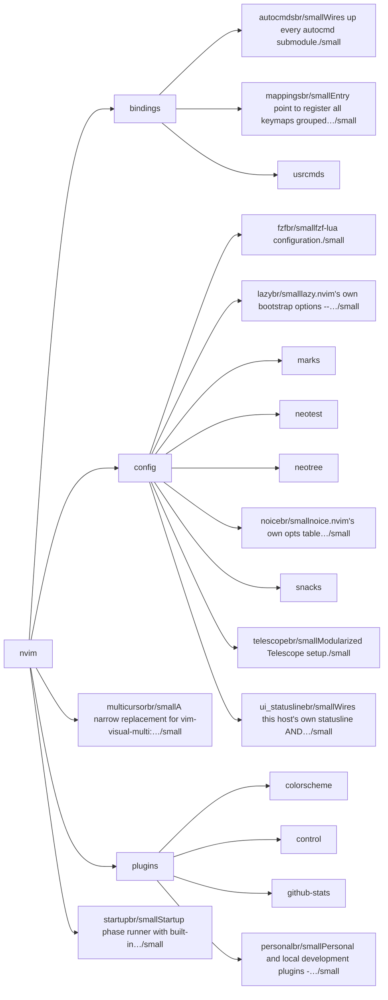
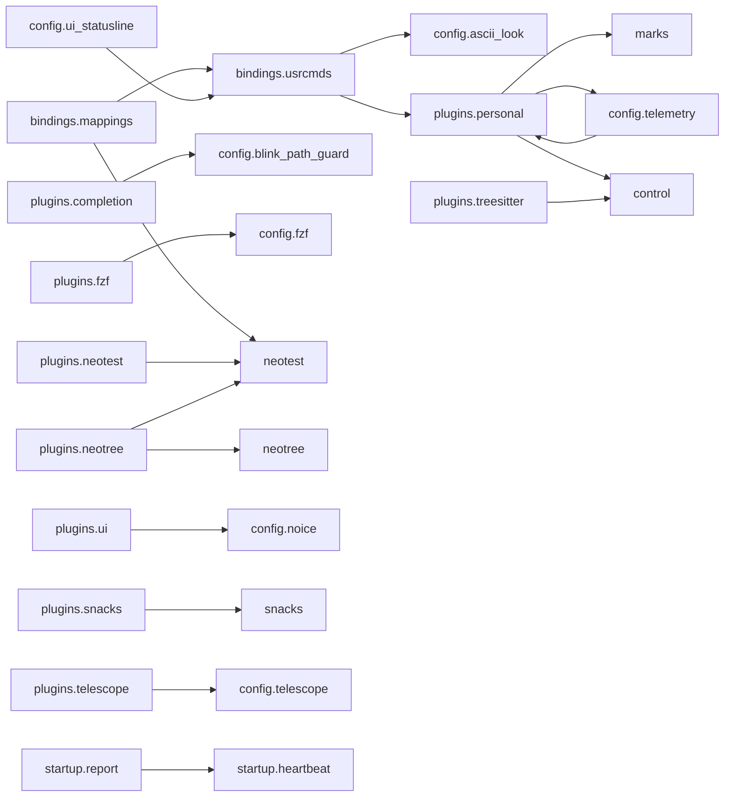

# nvim — module map

> **Generated** by `docmap`. Do not edit by hand — run `:DocMap`
> (or `nvim --headless -l scripts/gen_map.lua`) to regenerate.

**41 modules** · 155 namespaces · 126 helper files

The [interactive map](index.html) has filtering, full descriptions and
source links; this page is the version the code host renders directly.

## Namespaces

## Dependencies

Which parts of the tree require which, rolled up to the second level.
The [interactive map](index.html)'s **Deps** view has this per module,
in both directions, with load-time and lazy requires told apart.

## Modules

| Module | Description | Fns | Docs |
|---|---|---|---|
| `bindings` |  |  |  |
| &nbsp;&nbsp;`bindings.autocmds` | Wires up every autocmd submodule. |  | [README](../../lua/bindings/autocmds/README.md) · [src](../../lua/bindings/autocmds/init.lua) |
| &nbsp;&nbsp;&nbsp;&nbsp;`bindings.autocmds.general` | Centralized, toggleable autocmd suite with safe defaults and idempotent setup. | 1 | [README](../../lua/bindings/autocmds/general/README.md) · [src](../../lua/bindings/autocmds/general/init.lua) |
| &nbsp;&nbsp;&nbsp;&nbsp;`bindings.autocmds.git` | Orchestrates all Git-related autocommands by delegating to submodules. | 1 | [README](../../lua/bindings/autocmds/git/README.md) · [src](../../lua/bindings/autocmds/git/init.lua) |
| &nbsp;&nbsp;&nbsp;&nbsp;`bindings.autocmds.text` | Text-focused autocommands with feature flags. | 2 | [README](../../lua/bindings/autocmds/text/README.md) · [src](../../lua/bindings/autocmds/text/init.lua) |
| &nbsp;&nbsp;`bindings.mappings` | Entry point to register all keymaps grouped by topic. | 1 | [README](../../lua/bindings/mappings/README.md) · [src](../../lua/bindings/mappings/init.lua) |
| &nbsp;&nbsp;&nbsp;&nbsp;`utils` |  |  |  |
| &nbsp;&nbsp;&nbsp;&nbsp;&nbsp;&nbsp;`bindings.mappings.utils.window_zoom` | Toggle maximize current window and restore previous layout sizes. | 4 | [README](../../lua/bindings/mappings/utils/window_zoom/README.md) · [src](../../lua/bindings/mappings/utils/window_zoom/init.lua) |
| &nbsp;&nbsp;`bindings.usrcmds` |  |  | [README](../../lua/bindings/usrcmds/README.md) · [src](../../lua/bindings/usrcmds/init.lua) |
| &nbsp;&nbsp;&nbsp;&nbsp;`bindings.usrcmds.autocmd_docs` | `bindings/autocmd/` and `bindings/usercmd/` markdown from what `lib.nvim.bindings.autocmd` actually registered this session. | 2 | [src](../../lua/bindings/usrcmds/autocmd_docs/init.lua) |
| &nbsp;&nbsp;&nbsp;&nbsp;`bindings.usrcmds.bindings_audit` | `:LibKeymapConflicts` and `:BindingsRuntimeChecklist` — cross-registry checks over whatever this session actually loaded: keymap action vs. | 1 | [src](../../lua/bindings/usrcmds/bindings_audit/init.lua) |
| &nbsp;&nbsp;&nbsp;&nbsp;`bindings.usrcmds.bindings_explorer` | `:Bindings` — the composer verb + route table over the BINDINGS corpus (extern cheatsheets under docs/NOTES/ExternPlugins/Bindings + each personal plugin's… | 19 | [README](../../lua/bindings/usrcmds/bindings_explorer/README.md) · [src](../../lua/bindings/usrcmds/bindings_explorer/init.lua) |
| &nbsp;&nbsp;&nbsp;&nbsp;&nbsp;&nbsp;`doc` |  |  |  |
| &nbsp;&nbsp;&nbsp;&nbsp;&nbsp;&nbsp;`docs` |  |  |  |
| &nbsp;&nbsp;&nbsp;&nbsp;`bindings.usrcmds.cdx` | The templates live in `docs/NOTES/CDX/templates/PROMPT/` of this config and are pasted into Claude Code by hand all day, so this saves the detour through a… | 10 | [src](../../lua/bindings/usrcmds/cdx/init.lua) |
| &nbsp;&nbsp;&nbsp;&nbsp;`bindings.usrcmds.clipboard` | The report and handover folders under `docs/ROADMAP/` are pasted into Claude Code prompts, shells and file dialogs all day, so this saves the detour through a… | 9 | [src](../../lua/bindings/usrcmds/clipboard/init.lua) |
| &nbsp;&nbsp;&nbsp;&nbsp;`bindings.usrcmds.context_open` | `M-o` / `M-O` / `:ContextOpen` -- one dispatcher unifying "open the thing under the cursor" across gopath.nvim (gF), markdown.nvim (TableView), images.nvim,… | 5 | [README](../../lua/bindings/usrcmds/context_open/README.md) · [src](../../lua/bindings/usrcmds/context_open/init.lua) |
| &nbsp;&nbsp;&nbsp;&nbsp;`bindings.usrcmds.execute` | Text in a buffer is often a command: a note that says `` `:set wrap` ``, a README block with `git status`, a line of Lua. | 6 | [README](../../lua/bindings/usrcmds/execute/README.md) · [src](../../lua/bindings/usrcmds/execute/init.lua) |
| &nbsp;&nbsp;&nbsp;&nbsp;`bindings.usrcmds.git_hooks` | Front end for `scripts/git-hooks/install.sh` (the single source of truth for what a hook looks like): | 18 | [README](../../lua/bindings/usrcmds/git_hooks/README.md) · [src](../../lua/bindings/usrcmds/git_hooks/init.lua) |
| &nbsp;&nbsp;&nbsp;&nbsp;`bindings.usrcmds.learn_plan_viewer` | `:LearnPlanViewer [week N]` — standalone viewer for the CLI-Lernplan week pages (`docs/ROADMAP/CLI_Lernplan/week-NN.md`). | 6 | [src](../../lua/bindings/usrcmds/learn_plan_viewer/init.lua) |
| &nbsp;&nbsp;&nbsp;&nbsp;`bindings.usrcmds.native_repos` | Sister of `:MyPlugins` for the native apps (tasks-desktop, rules-desktop, hub-desktop, ai-desktop, takt, pult, streamtap, docmap-desktop, appkit; the list is… | 24 | [README](../../lua/bindings/usrcmds/native_repos/README.md) · [src](../../lua/bindings/usrcmds/native_repos/init.lua) |
| &nbsp;&nbsp;&nbsp;&nbsp;`bindings.usrcmds.plugin_repos` | source mode of the personal plugin list — plus an interactive picker, a dashboard and the wkdbook task commands. | 20 | [README](../../lua/bindings/usrcmds/plugin_repos/README.md) · [src](../../lua/bindings/usrcmds/plugin_repos/init.lua) |
| &nbsp;&nbsp;&nbsp;&nbsp;`bindings.usrcmds.profile` | Without an argument it shows the active profile and where it came from. | 1 | [src](../../lua/bindings/usrcmds/profile/init.lua) |
| &nbsp;&nbsp;&nbsp;&nbsp;`bindings.usrcmds.telemetry_nvim_config` | aliases for `:RATelemetry setup nvim-config` / `:RATelemetry full nvim-config`. | 1 | [README](../../lua/bindings/usrcmds/telemetry_nvim_config/README.md) · [src](../../lua/bindings/usrcmds/telemetry_nvim_config/init.lua) |
| &nbsp;&nbsp;&nbsp;&nbsp;`bindings.usrcmds.wkdbook_picker` | `:WKDBook [private\|tricentis]`: pick a note of a WKDBook repository. | 4 | [src](../../lua/bindings/usrcmds/wkdbook_picker/init.lua) |
| `config` |  |  |  |
| &nbsp;&nbsp;`config.fzf` | fzf-lua configuration. | 1 | [README](../../lua/config/fzf/README.md) · [src](../../lua/config/fzf/init.lua) |
| &nbsp;&nbsp;`config.lazy` | lazy.nvim's own bootstrap options -- `defaults.lazy = true`, plus a long comment on why remote-managed personal plugins need special handling (dir-mode… | 1 | [README](../../lua/config/lazy/README.md) · [src](../../lua/config/lazy/init.lua) |
| &nbsp;&nbsp;`marks` |  |  |  |
| &nbsp;&nbsp;`neotest` |  |  |  |
| &nbsp;&nbsp;&nbsp;&nbsp;`config.neotest.actions` | Centralized Neotest actions usable by keymaps, usercommands and menus. | 10 | [README](../../lua/config/neotest/actions/README.md) · [src](../../lua/config/neotest/actions/init.lua) |
| &nbsp;&nbsp;&nbsp;&nbsp;`adapters` |  |  |  |
| &nbsp;&nbsp;&nbsp;&nbsp;`autocmds` |  |  |  |
| &nbsp;&nbsp;&nbsp;&nbsp;`config.neotest.commands` | User commands for Neotest based on shared actions. | 1 | [README](../../lua/config/neotest/commands/README.md) · [src](../../lua/config/neotest/commands/init.lua) |
| &nbsp;&nbsp;&nbsp;&nbsp;`consumers` |  |  |  |
| &nbsp;&nbsp;&nbsp;&nbsp;`config.neotest.core` | Core configuration and utilities for neotest integration | 5 | [README](../../lua/config/neotest/core/README.md) · [src](../../lua/config/neotest/core/init.lua) |
| &nbsp;&nbsp;&nbsp;&nbsp;`docs` |  |  |  |
| &nbsp;&nbsp;&nbsp;&nbsp;`config.neotest.highlights` | Neotest highlight groups setup | 1 | [README](../../lua/config/neotest/highlights/README.md) · [src](../../lua/config/neotest/highlights/init.lua) |
| &nbsp;&nbsp;&nbsp;&nbsp;`init` |  |  |  |
| &nbsp;&nbsp;&nbsp;&nbsp;&nbsp;&nbsp;`checks` |  |  |  |
| &nbsp;&nbsp;&nbsp;&nbsp;`config.neotest.keymaps` | Neotest keymaps using centralized actions. | 1 | [README](../../lua/config/neotest/keymaps/README.md) · [src](../../lua/config/neotest/keymaps/init.lua) |
| &nbsp;&nbsp;&nbsp;&nbsp;`config.neotest.neotree` | Neo-tree integration for Neotest actions. | 3 | [README](../../lua/config/neotest/neotree/README.md) · [src](../../lua/config/neotest/neotree/init.lua) |
| &nbsp;&nbsp;&nbsp;&nbsp;`config.neotest.telescope` | Telescope picker for Neotest actions. | 1 | [README](../../lua/config/neotest/telescope/README.md) · [src](../../lua/config/neotest/telescope/init.lua) |
| &nbsp;&nbsp;&nbsp;&nbsp;`utils` |  |  |  |
| &nbsp;&nbsp;&nbsp;&nbsp;`config.neotest.whichkey` | which-key group label for the Neotest prefix. | 1 | [README](../../lua/config/neotest/whichkey/README.md) · [src](../../lua/config/neotest/whichkey/init.lua) |
| &nbsp;&nbsp;`neotree` |  |  | [README](../../lua/config/neotree/README.md) |
| &nbsp;&nbsp;&nbsp;&nbsp;`config.neotree.event_handlers` | Neo-tree unified event handlers configuration |  | [README](../../lua/config/neotree/event_handlers/README.md) · [src](../../lua/config/neotree/event_handlers/init.lua) |
| &nbsp;&nbsp;&nbsp;&nbsp;`config.neotree.keymaps` | Centralized, buffer-local Neo-tree keymaps that override defaults consistently. |  | [README](../../lua/config/neotree/keymaps/README.md) · [src](../../lua/config/neotree/keymaps/init.lua) |
| &nbsp;&nbsp;&nbsp;&nbsp;&nbsp;&nbsp;`config.neotree.keymaps.filesystem` | Entry point that merges all filesystem keymap modules into a single mapping table. |  | [README](../../lua/config/neotree/keymaps/filesystem/README.md) · [src](../../lua/config/neotree/keymaps/filesystem/init.lua) |
| &nbsp;&nbsp;`config.noice` | noice.nvim's own opts table (cmdline/lsp/messages/popupmenu/presets/ routes/views/notify), assembled here rather than inline in the plugin spec. |  | [README](../../lua/config/noice/README.md) · [src](../../lua/config/noice/init.lua) |
| &nbsp;&nbsp;`snacks` |  |  |  |
| &nbsp;&nbsp;&nbsp;&nbsp;`config.snacks.mappings` | Keymap definitions for folke/snacks.nvim. | 1 | [README](../../lua/config/snacks/mappings/README.md) · [src](../../lua/config/snacks/mappings/init.lua) |
| &nbsp;&nbsp;`config.telescope` | Modularized Telescope setup. | 4 | [README](../../lua/config/telescope/README.md) · [src](../../lua/config/telescope/init.lua) |
| &nbsp;&nbsp;&nbsp;&nbsp;`file_browser` |  |  |  |
| &nbsp;&nbsp;`config.ui_statusline` | Wires this host's own statusline AND tabline into ui.nvim, at UIReady. | 1 | [src](../../lua/config/ui_statusline/init.lua) |
| `multicursor` | A narrow replacement for vim-visual-multi: only the flow that was actually used. | 23 | [src](../../lua/multicursor/init.lua) |
| `plugins` |  |  |  |
| &nbsp;&nbsp;`colorscheme` |  |  |  |
| &nbsp;&nbsp;`control` |  |  |  |
| &nbsp;&nbsp;`github-stats` |  |  |  |
| &nbsp;&nbsp;&nbsp;&nbsp;`data` |  |  |  |
| &nbsp;&nbsp;&nbsp;&nbsp;&nbsp;&nbsp;`WKDSteve_buffer-ctx.nvim` |  |  |  |
| &nbsp;&nbsp;&nbsp;&nbsp;&nbsp;&nbsp;&nbsp;&nbsp;`clones` |  |  |  |
| &nbsp;&nbsp;&nbsp;&nbsp;&nbsp;&nbsp;&nbsp;&nbsp;`paths` |  |  |  |
| &nbsp;&nbsp;&nbsp;&nbsp;&nbsp;&nbsp;&nbsp;&nbsp;`referrers` |  |  |  |
| &nbsp;&nbsp;&nbsp;&nbsp;&nbsp;&nbsp;&nbsp;&nbsp;`views` |  |  |  |
| &nbsp;&nbsp;&nbsp;&nbsp;&nbsp;&nbsp;`WKDSteve_cascade.nvim` |  |  |  |
| &nbsp;&nbsp;&nbsp;&nbsp;&nbsp;&nbsp;&nbsp;&nbsp;`clones` |  |  |  |
| &nbsp;&nbsp;&nbsp;&nbsp;&nbsp;&nbsp;&nbsp;&nbsp;`paths` |  |  |  |
| &nbsp;&nbsp;&nbsp;&nbsp;&nbsp;&nbsp;&nbsp;&nbsp;`referrers` |  |  |  |
| &nbsp;&nbsp;&nbsp;&nbsp;&nbsp;&nbsp;&nbsp;&nbsp;`views` |  |  |  |
| &nbsp;&nbsp;&nbsp;&nbsp;&nbsp;&nbsp;`WKDSteve_cmdlog.nvim` |  |  |  |
| &nbsp;&nbsp;&nbsp;&nbsp;&nbsp;&nbsp;&nbsp;&nbsp;`clones` |  |  |  |
| &nbsp;&nbsp;&nbsp;&nbsp;&nbsp;&nbsp;&nbsp;&nbsp;`paths` |  |  |  |
| &nbsp;&nbsp;&nbsp;&nbsp;&nbsp;&nbsp;&nbsp;&nbsp;`referrers` |  |  |  |
| &nbsp;&nbsp;&nbsp;&nbsp;&nbsp;&nbsp;&nbsp;&nbsp;`views` |  |  |  |
| &nbsp;&nbsp;&nbsp;&nbsp;&nbsp;&nbsp;`WKDSteve_color_my_ascii.nvim` |  |  |  |
| &nbsp;&nbsp;&nbsp;&nbsp;&nbsp;&nbsp;&nbsp;&nbsp;`clones` |  |  |  |
| &nbsp;&nbsp;&nbsp;&nbsp;&nbsp;&nbsp;&nbsp;&nbsp;`paths` |  |  |  |
| &nbsp;&nbsp;&nbsp;&nbsp;&nbsp;&nbsp;&nbsp;&nbsp;`referrers` |  |  |  |
| &nbsp;&nbsp;&nbsp;&nbsp;&nbsp;&nbsp;&nbsp;&nbsp;`views` |  |  |  |
| &nbsp;&nbsp;&nbsp;&nbsp;&nbsp;&nbsp;`WKDSteve_debugging.nvim` |  |  |  |
| &nbsp;&nbsp;&nbsp;&nbsp;&nbsp;&nbsp;&nbsp;&nbsp;`clones` |  |  |  |
| &nbsp;&nbsp;&nbsp;&nbsp;&nbsp;&nbsp;&nbsp;&nbsp;`paths` |  |  |  |
| &nbsp;&nbsp;&nbsp;&nbsp;&nbsp;&nbsp;&nbsp;&nbsp;`referrers` |  |  |  |
| &nbsp;&nbsp;&nbsp;&nbsp;&nbsp;&nbsp;&nbsp;&nbsp;`views` |  |  |  |
| &nbsp;&nbsp;&nbsp;&nbsp;&nbsp;&nbsp;`WKDSteve_diff.nvim` |  |  |  |
| &nbsp;&nbsp;&nbsp;&nbsp;&nbsp;&nbsp;&nbsp;&nbsp;`clones` |  |  |  |
| &nbsp;&nbsp;&nbsp;&nbsp;&nbsp;&nbsp;&nbsp;&nbsp;`paths` |  |  |  |
| &nbsp;&nbsp;&nbsp;&nbsp;&nbsp;&nbsp;&nbsp;&nbsp;`referrers` |  |  |  |
| &nbsp;&nbsp;&nbsp;&nbsp;&nbsp;&nbsp;&nbsp;&nbsp;`views` |  |  |  |
| &nbsp;&nbsp;&nbsp;&nbsp;&nbsp;&nbsp;`WKDSteve_docmap.nvim` |  |  |  |
| &nbsp;&nbsp;&nbsp;&nbsp;&nbsp;&nbsp;&nbsp;&nbsp;`clones` |  |  |  |
| &nbsp;&nbsp;&nbsp;&nbsp;&nbsp;&nbsp;&nbsp;&nbsp;`paths` |  |  |  |
| &nbsp;&nbsp;&nbsp;&nbsp;&nbsp;&nbsp;&nbsp;&nbsp;`referrers` |  |  |  |
| &nbsp;&nbsp;&nbsp;&nbsp;&nbsp;&nbsp;&nbsp;&nbsp;`views` |  |  |  |
| &nbsp;&nbsp;&nbsp;&nbsp;&nbsp;&nbsp;`WKDSteve_emojis.nvim` |  |  |  |
| &nbsp;&nbsp;&nbsp;&nbsp;&nbsp;&nbsp;&nbsp;&nbsp;`clones` |  |  |  |
| &nbsp;&nbsp;&nbsp;&nbsp;&nbsp;&nbsp;&nbsp;&nbsp;`paths` |  |  |  |
| &nbsp;&nbsp;&nbsp;&nbsp;&nbsp;&nbsp;&nbsp;&nbsp;`referrers` |  |  |  |
| &nbsp;&nbsp;&nbsp;&nbsp;&nbsp;&nbsp;&nbsp;&nbsp;`views` |  |  |  |
| &nbsp;&nbsp;&nbsp;&nbsp;&nbsp;&nbsp;`WKDSteve_fileops.nvim` |  |  |  |
| &nbsp;&nbsp;&nbsp;&nbsp;&nbsp;&nbsp;&nbsp;&nbsp;`clones` |  |  |  |
| &nbsp;&nbsp;&nbsp;&nbsp;&nbsp;&nbsp;&nbsp;&nbsp;`paths` |  |  |  |
| &nbsp;&nbsp;&nbsp;&nbsp;&nbsp;&nbsp;&nbsp;&nbsp;`referrers` |  |  |  |
| &nbsp;&nbsp;&nbsp;&nbsp;&nbsp;&nbsp;&nbsp;&nbsp;`views` |  |  |  |
| &nbsp;&nbsp;&nbsp;&nbsp;&nbsp;&nbsp;`WKDSteve_filetree.nvim` |  |  |  |
| &nbsp;&nbsp;&nbsp;&nbsp;&nbsp;&nbsp;&nbsp;&nbsp;`clones` |  |  |  |
| &nbsp;&nbsp;&nbsp;&nbsp;&nbsp;&nbsp;&nbsp;&nbsp;`paths` |  |  |  |
| &nbsp;&nbsp;&nbsp;&nbsp;&nbsp;&nbsp;&nbsp;&nbsp;`referrers` |  |  |  |
| &nbsp;&nbsp;&nbsp;&nbsp;&nbsp;&nbsp;&nbsp;&nbsp;`views` |  |  |  |
| &nbsp;&nbsp;&nbsp;&nbsp;&nbsp;&nbsp;`WKDSteve_github_stats.nvim` |  |  |  |
| &nbsp;&nbsp;&nbsp;&nbsp;&nbsp;&nbsp;&nbsp;&nbsp;`clones` |  |  |  |
| &nbsp;&nbsp;&nbsp;&nbsp;&nbsp;&nbsp;&nbsp;&nbsp;`paths` |  |  |  |
| &nbsp;&nbsp;&nbsp;&nbsp;&nbsp;&nbsp;&nbsp;&nbsp;`referrers` |  |  |  |
| &nbsp;&nbsp;&nbsp;&nbsp;&nbsp;&nbsp;&nbsp;&nbsp;`views` |  |  |  |
| &nbsp;&nbsp;&nbsp;&nbsp;&nbsp;&nbsp;`WKDSteve_gopath.nvim` |  |  |  |
| &nbsp;&nbsp;&nbsp;&nbsp;&nbsp;&nbsp;&nbsp;&nbsp;`clones` |  |  |  |
| &nbsp;&nbsp;&nbsp;&nbsp;&nbsp;&nbsp;&nbsp;&nbsp;`paths` |  |  |  |
| &nbsp;&nbsp;&nbsp;&nbsp;&nbsp;&nbsp;&nbsp;&nbsp;`referrers` |  |  |  |
| &nbsp;&nbsp;&nbsp;&nbsp;&nbsp;&nbsp;&nbsp;&nbsp;`views` |  |  |  |
| &nbsp;&nbsp;&nbsp;&nbsp;&nbsp;&nbsp;`WKDSteve_hover.nvim` |  |  |  |
| &nbsp;&nbsp;&nbsp;&nbsp;&nbsp;&nbsp;&nbsp;&nbsp;`clones` |  |  |  |
| &nbsp;&nbsp;&nbsp;&nbsp;&nbsp;&nbsp;&nbsp;&nbsp;`paths` |  |  |  |
| &nbsp;&nbsp;&nbsp;&nbsp;&nbsp;&nbsp;&nbsp;&nbsp;`referrers` |  |  |  |
| &nbsp;&nbsp;&nbsp;&nbsp;&nbsp;&nbsp;&nbsp;&nbsp;`views` |  |  |  |
| &nbsp;&nbsp;&nbsp;&nbsp;&nbsp;&nbsp;`WKDSteve_insights.nvim` |  |  |  |
| &nbsp;&nbsp;&nbsp;&nbsp;&nbsp;&nbsp;&nbsp;&nbsp;`clones` |  |  |  |
| &nbsp;&nbsp;&nbsp;&nbsp;&nbsp;&nbsp;&nbsp;&nbsp;`paths` |  |  |  |
| &nbsp;&nbsp;&nbsp;&nbsp;&nbsp;&nbsp;&nbsp;&nbsp;`referrers` |  |  |  |
| &nbsp;&nbsp;&nbsp;&nbsp;&nbsp;&nbsp;&nbsp;&nbsp;`views` |  |  |  |
| &nbsp;&nbsp;&nbsp;&nbsp;&nbsp;&nbsp;`WKDSteve_language.nvim` |  |  |  |
| &nbsp;&nbsp;&nbsp;&nbsp;&nbsp;&nbsp;&nbsp;&nbsp;`clones` |  |  |  |
| &nbsp;&nbsp;&nbsp;&nbsp;&nbsp;&nbsp;&nbsp;&nbsp;`paths` |  |  |  |
| &nbsp;&nbsp;&nbsp;&nbsp;&nbsp;&nbsp;&nbsp;&nbsp;`referrers` |  |  |  |
| &nbsp;&nbsp;&nbsp;&nbsp;&nbsp;&nbsp;&nbsp;&nbsp;`views` |  |  |  |
| &nbsp;&nbsp;&nbsp;&nbsp;&nbsp;&nbsp;`WKDSteve_lib.nvim` |  |  |  |
| &nbsp;&nbsp;&nbsp;&nbsp;&nbsp;&nbsp;&nbsp;&nbsp;`clones` |  |  |  |
| &nbsp;&nbsp;&nbsp;&nbsp;&nbsp;&nbsp;&nbsp;&nbsp;`paths` |  |  |  |
| &nbsp;&nbsp;&nbsp;&nbsp;&nbsp;&nbsp;&nbsp;&nbsp;`referrers` |  |  |  |
| &nbsp;&nbsp;&nbsp;&nbsp;&nbsp;&nbsp;&nbsp;&nbsp;`views` |  |  |  |
| &nbsp;&nbsp;&nbsp;&nbsp;&nbsp;&nbsp;`WKDSteve_lsp.nvim` |  |  |  |
| &nbsp;&nbsp;&nbsp;&nbsp;&nbsp;&nbsp;&nbsp;&nbsp;`clones` |  |  |  |
| &nbsp;&nbsp;&nbsp;&nbsp;&nbsp;&nbsp;&nbsp;&nbsp;`paths` |  |  |  |
| &nbsp;&nbsp;&nbsp;&nbsp;&nbsp;&nbsp;&nbsp;&nbsp;`referrers` |  |  |  |
| &nbsp;&nbsp;&nbsp;&nbsp;&nbsp;&nbsp;&nbsp;&nbsp;`views` |  |  |  |
| &nbsp;&nbsp;&nbsp;&nbsp;&nbsp;&nbsp;`WKDSteve_markdown.nvim` |  |  |  |
| &nbsp;&nbsp;&nbsp;&nbsp;&nbsp;&nbsp;&nbsp;&nbsp;`clones` |  |  |  |
| &nbsp;&nbsp;&nbsp;&nbsp;&nbsp;&nbsp;&nbsp;&nbsp;`paths` |  |  |  |
| &nbsp;&nbsp;&nbsp;&nbsp;&nbsp;&nbsp;&nbsp;&nbsp;`referrers` |  |  |  |
| &nbsp;&nbsp;&nbsp;&nbsp;&nbsp;&nbsp;&nbsp;&nbsp;`views` |  |  |  |
| &nbsp;&nbsp;&nbsp;&nbsp;&nbsp;&nbsp;`WKDSteve_mdview.nvim` |  |  |  |
| &nbsp;&nbsp;&nbsp;&nbsp;&nbsp;&nbsp;&nbsp;&nbsp;`clones` |  |  |  |
| &nbsp;&nbsp;&nbsp;&nbsp;&nbsp;&nbsp;&nbsp;&nbsp;`paths` |  |  |  |
| &nbsp;&nbsp;&nbsp;&nbsp;&nbsp;&nbsp;&nbsp;&nbsp;`referrers` |  |  |  |
| &nbsp;&nbsp;&nbsp;&nbsp;&nbsp;&nbsp;&nbsp;&nbsp;`views` |  |  |  |
| &nbsp;&nbsp;&nbsp;&nbsp;&nbsp;&nbsp;`WKDSteve_open.nvim` |  |  |  |
| &nbsp;&nbsp;&nbsp;&nbsp;&nbsp;&nbsp;&nbsp;&nbsp;`clones` |  |  |  |
| &nbsp;&nbsp;&nbsp;&nbsp;&nbsp;&nbsp;&nbsp;&nbsp;`paths` |  |  |  |
| &nbsp;&nbsp;&nbsp;&nbsp;&nbsp;&nbsp;&nbsp;&nbsp;`referrers` |  |  |  |
| &nbsp;&nbsp;&nbsp;&nbsp;&nbsp;&nbsp;&nbsp;&nbsp;`views` |  |  |  |
| &nbsp;&nbsp;&nbsp;&nbsp;&nbsp;&nbsp;`WKDSteve_pdfport.nvim` |  |  |  |
| &nbsp;&nbsp;&nbsp;&nbsp;&nbsp;&nbsp;&nbsp;&nbsp;`clones` |  |  |  |
| &nbsp;&nbsp;&nbsp;&nbsp;&nbsp;&nbsp;&nbsp;&nbsp;`paths` |  |  |  |
| &nbsp;&nbsp;&nbsp;&nbsp;&nbsp;&nbsp;&nbsp;&nbsp;`referrers` |  |  |  |
| &nbsp;&nbsp;&nbsp;&nbsp;&nbsp;&nbsp;&nbsp;&nbsp;`views` |  |  |  |
| &nbsp;&nbsp;&nbsp;&nbsp;&nbsp;&nbsp;`WKDSteve_pickers.nvim` |  |  |  |
| &nbsp;&nbsp;&nbsp;&nbsp;&nbsp;&nbsp;&nbsp;&nbsp;`clones` |  |  |  |
| &nbsp;&nbsp;&nbsp;&nbsp;&nbsp;&nbsp;&nbsp;&nbsp;`paths` |  |  |  |
| &nbsp;&nbsp;&nbsp;&nbsp;&nbsp;&nbsp;&nbsp;&nbsp;`referrers` |  |  |  |
| &nbsp;&nbsp;&nbsp;&nbsp;&nbsp;&nbsp;&nbsp;&nbsp;`views` |  |  |  |
| &nbsp;&nbsp;&nbsp;&nbsp;&nbsp;&nbsp;`WKDSteve_recommender.nvim` |  |  |  |
| &nbsp;&nbsp;&nbsp;&nbsp;&nbsp;&nbsp;&nbsp;&nbsp;`clones` |  |  |  |
| &nbsp;&nbsp;&nbsp;&nbsp;&nbsp;&nbsp;&nbsp;&nbsp;`paths` |  |  |  |
| &nbsp;&nbsp;&nbsp;&nbsp;&nbsp;&nbsp;&nbsp;&nbsp;`referrers` |  |  |  |
| &nbsp;&nbsp;&nbsp;&nbsp;&nbsp;&nbsp;&nbsp;&nbsp;`views` |  |  |  |
| &nbsp;&nbsp;&nbsp;&nbsp;&nbsp;&nbsp;`WKDSteve_replacer.nvim` |  |  |  |
| &nbsp;&nbsp;&nbsp;&nbsp;&nbsp;&nbsp;&nbsp;&nbsp;`clones` |  |  |  |
| &nbsp;&nbsp;&nbsp;&nbsp;&nbsp;&nbsp;&nbsp;&nbsp;`paths` |  |  |  |
| &nbsp;&nbsp;&nbsp;&nbsp;&nbsp;&nbsp;&nbsp;&nbsp;`referrers` |  |  |  |
| &nbsp;&nbsp;&nbsp;&nbsp;&nbsp;&nbsp;&nbsp;&nbsp;`views` |  |  |  |
| &nbsp;&nbsp;&nbsp;&nbsp;&nbsp;&nbsp;`WKDSteve_reposcope.nvim` |  |  |  |
| &nbsp;&nbsp;&nbsp;&nbsp;&nbsp;&nbsp;&nbsp;&nbsp;`clones` |  |  |  |
| &nbsp;&nbsp;&nbsp;&nbsp;&nbsp;&nbsp;&nbsp;&nbsp;`paths` |  |  |  |
| &nbsp;&nbsp;&nbsp;&nbsp;&nbsp;&nbsp;&nbsp;&nbsp;`referrers` |  |  |  |
| &nbsp;&nbsp;&nbsp;&nbsp;&nbsp;&nbsp;&nbsp;&nbsp;`views` |  |  |  |
| &nbsp;&nbsp;&nbsp;&nbsp;&nbsp;&nbsp;`WKDSteve_sandbox.nvim` |  |  |  |
| &nbsp;&nbsp;&nbsp;&nbsp;&nbsp;&nbsp;&nbsp;&nbsp;`clones` |  |  |  |
| &nbsp;&nbsp;&nbsp;&nbsp;&nbsp;&nbsp;&nbsp;&nbsp;`paths` |  |  |  |
| &nbsp;&nbsp;&nbsp;&nbsp;&nbsp;&nbsp;&nbsp;&nbsp;`referrers` |  |  |  |
| &nbsp;&nbsp;&nbsp;&nbsp;&nbsp;&nbsp;&nbsp;&nbsp;`views` |  |  |  |
| &nbsp;&nbsp;`plugins.personal` | Personal and local development plugins - the SPEC ENTRY POINT. |  | [README](../../lua/plugins/personal/README.md) · [src](../../lua/plugins/personal/init.lua) |
| &nbsp;&nbsp;&nbsp;&nbsp;`core` |  |  |  |
| &nbsp;&nbsp;&nbsp;&nbsp;`specs` |  |  |  |
| `startup` | Startup phase runner with built-in measurement. | 9 | [README](../../lua/startup/README.md) · [src](../../lua/startup/init.lua) |

## Drift

0 errors · 63 warnings · 40 info

| Severity | Check | Message |
|---|---|---|
| warn | `dead-readme-link` | PerformancePrüfung_6Gruppen.md links to 'E:/repos/tasks-vault/ALL/Performance-Pruefung-Orchestrator-Brief.md' which does not exist |
| warn | `dead-readme-link` | docs/ROADMAP/CLI_Lernplan/Lernplan_CLI.md links to 'LONG_RUN/learn-cli.nvim.md' which does not exist |
| warn | `dead-readme-link` | docs/ROADMAP/CLI_Lernplan/Lernplan_CLI.md links to 'CLI_Lernplan/week-01.md' which does not exist |
| warn | `dead-readme-link` | docs/ROADMAP/Rust-Apps-Lernplan.md links to 'Kompetenzmatrix.md' which does not exist |
| warn | `dead-readme-link` | docs/ROADMAP/Rust-Apps-Lernplan.md links to 'Lernplan.md' which does not exist |
| warn | `dead-readme-link` | docs/ROADMAP/reports/design-pattern-index-2026-10-31.md links to 'value' which does not exist |
| warn | `dead-readme-link` | docs/ROADMAP/reports/design-pattern-index-2026-10-31.md links to 'ctx' which does not exist |
| warn | `dead-readme-link` | docs/ROADMAP/reports/startup/startup-und-config-optimierung-analyse-konzept-2026-09-26.md links to '../../NOTES/ARCHITECTURE/startup.md' which does not exist |
| warn | `dead-readme-link` | docs/ROADMAP/reports/startup/startup-und-config-optimierung-analyse-konzept-2026-09-26.md links to '../../../scripts/startup-probe/README.md' which does not exist |
| warn | `dead-readme-link` | lua/bindings/usrcmds/plugin_repos/README.md links to '../../../../TESTS/tasks/tasks_dash_picker_spec.lua' which does not exist |
| warn | `dead-readme-link` | lua/bindings/usrcmds/plugin_repos/README.md links to '../../../../TESTS/tasks/tasks_frecency_spec.lua' which does not exist |
| warn | `dead-readme-link` | lua/bindings/usrcmds/plugin_repos/README.md links to '../../../../TESTS/tasks/tasks_dash_refresh_spec.lua' which does not exist |
| warn | `dead-readme-link` | lua/bindings/usrcmds/plugin_repos/README.md links to '../../../../TESTS/tasks/tasks_dash_watch_spec.lua' which does not exist |
| warn | `dead-readme-link` | lua/bindings/usrcmds/plugin_repos/README.md links to '../../../../TESTS/tasks/tasks_dash_spec.lua' which does not exist |
| warn | `dead-readme-link` | lua/bindings/usrcmds/plugin_repos/README.md links to '../../../../TESTS/tasks/tasks_routes_spec.lua' which does not exist |
| warn | `doc-references-missing` | docs/BINDINGS.md:189 references 'bindings.mappings.terminal', but bindings.mappings has no 'terminal' |
| warn | `doc-references-missing` | docs/NOTES/ExternPlugins/Bindings/Keymaps/NeoTree.md:312 references 'config.neotree.keymaps.tests', but config.neotree.keymaps has no 'tests' |
| warn | `missing-summary` | lua/bindings/autocmds/general/defaults.lua has no description line |
| warn | `missing-summary` | lua/bindings/autocmds/git/defaults.lua has no description line |
| warn | `missing-summary` | lua/bindings/autocmds/text/defaults.lua has no description line |
| warn | `missing-summary` | lua/bindings/usrcmds/init.lua has no description line |
| warn | `placeholder-readme-link` | docs/LearningPaths/Kompetenzmatrix.md links to '$REPOS_DIR/Literatur/Beschaffungsliste.md', which starts with the placeholder $REPOS_DIR: no Markdown viewer expands it |
| warn | `placeholder-readme-link` | docs/NOTES/ExternPlugins/Bindings/Autocmds/Noice.md links to '$REPOS_DIR/lib.nvim/lua/lib/nvim/bindings/autocmd/init.lua', which starts with the placeholder $REPOS_DIR: no Markdown viewer expands it |
| warn | `placeholder-readme-link` | docs/NOTES/ExternPlugins/Bindings/Keymaps/Conform.md links to '$REPOS_DIR/lsp.nvim/lua/lsp/languages/documentation/markdown.lua', which starts with the placeholder $REPOS_DIR: no Markdown viewer expands it |
| warn | `placeholder-readme-link` | docs/NOTES/ExternPlugins/Bindings/Keymaps/Conform.md links to '$REPOS_DIR/filetree.nvim/lua/filetree/features/ui/context_menu/init.lua', which starts with the placeholder $REPOS_DIR: no Markdown viewer expands it |
| warn | `placeholder-readme-link` | docs/NOTES/ExternPlugins/Bindings/Keymaps/Conform.md links to '$REPOS_DIR/lsp.nvim/lua/lsp/languages/webdev/astro/keymaps.lua', which starts with the placeholder $REPOS_DIR: no Markdown viewer expands it |
| warn | `placeholder-readme-link` | docs/NOTES/ExternPlugins/Bindings/Keymaps/Gitsigns.md links to '$REPOS_DIR/tasks-vault/my.nvim/FEATURES.md', which starts with the placeholder $REPOS_DIR: no Markdown viewer expands it |
| warn | `placeholder-readme-link` | docs/NOTES/ExternPlugins/Bindings/Keymaps/Gitsigns.md links to '$REPOS_DIR/diff.nvim/lua/diff/features/gitsigns_peek.lua', which starts with the placeholder $REPOS_DIR: no Markdown viewer expands it |
| warn | `placeholder-readme-link` | docs/NOTES/ExternPlugins/Bindings/Keymaps/IncRename.md links to '$REPOS_DIR/lsp.nvim/lua/lsp/integrations/inc_rename/setup.lua', which starts with the placeholder $REPOS_DIR: no Markdown viewer expands it |
| warn | `placeholder-readme-link` | docs/NOTES/ExternPlugins/Bindings/Keymaps/IncRename.md links to '$REPOS_DIR/lsp.nvim/lua/lsp/pack/ui.lua', which starts with the placeholder $REPOS_DIR: no Markdown viewer expands it |
| warn | `placeholder-readme-link` | docs/NOTES/ExternPlugins/Bindings/Keymaps/NeoTree.md links to '$REPOS_DIR/filetree.nvim/lua/filetree/adapter/neotree.lua', which starts with the placeholder $REPOS_DIR: no Markdown viewer expands it |
| warn | `placeholder-readme-link` | docs/NOTES/ExternPlugins/Bindings/Keymaps/Trouble.md links to '$REPOS_DIR/lsp.nvim/lua/lsp/pack/ui.lua', which starts with the placeholder $REPOS_DIR: no Markdown viewer expands it |
| warn | `placeholder-readme-link` | docs/NOTES/ExternPlugins/Bindings/Keymaps/Trouble.md links to '$REPOS_DIR/lsp.nvim/lua/lsp/integrations/trouble.lua', which starts with the placeholder $REPOS_DIR: no Markdown viewer expands it |
| warn | `placeholder-readme-link` | docs/NOTES/ExternPlugins/Bindings/Usercmds/Conform.md links to '$REPOS_DIR/lsp.nvim/lua/lsp/formatter/conform.lua', which starts with the placeholder $REPOS_DIR: no Markdown viewer expands it |
| warn | `placeholder-readme-link` | docs/NOTES/ExternPlugins/Bindings/Usercmds/Conform.md links to '$REPOS_DIR/lsp.nvim/lua/lsp/init.lua', which starts with the placeholder $REPOS_DIR: no Markdown viewer expands it |
| warn | `placeholder-readme-link` | docs/NOTES/ExternPlugins/Bindings/Usercmds/Conform.md links to '$REPOS_DIR/lsp.nvim/lua/lsp/formatter/init.lua', which starts with the placeholder $REPOS_DIR: no Markdown viewer expands it |
| warn | `placeholder-readme-link` | docs/NOTES/ExternPlugins/Bindings/Usercmds/Conform.md links to '$REPOS_DIR/lsp.nvim/lua/lsp/pack/core.lua', which starts with the placeholder $REPOS_DIR: no Markdown viewer expands it |
| warn | `placeholder-readme-link` | docs/NOTES/ExternPlugins/Bindings/Usercmds/Conform.md links to '$REPOS_DIR/lsp.nvim/lua/lsp/usercmds/formatter.lua', which starts with the placeholder $REPOS_DIR: no Markdown viewer expands it |
| warn | `placeholder-readme-link` | docs/NOTES/ExternPlugins/Bindings/Usercmds/Conform.md links to '$REPOS_DIR/lsp.nvim/lua/lsp/languages/documentation/markdown.lua', which starts with the placeholder $REPOS_DIR: no Markdown viewer expands it |
| warn | `placeholder-readme-link` | docs/NOTES/ExternPlugins/Bindings/Usercmds/Puppeteer.md links to '$REPOS_DIR/cascade.nvim/docs/FEATURES/STRINGS.md', which starts with the placeholder $REPOS_DIR: no Markdown viewer expands it |
| warn | `placeholder-readme-link` | docs/NOTES/ExternPlugins/Bindings/Usercmds/WorkspaceDiagnostics.md links to '$REPOS_DIR/lsp.nvim/lua/lsp/init.lua', which starts with the placeholder $REPOS_DIR: no Markdown viewer expands it |
| warn | `placeholder-readme-link` | docs/NOTES/ExternPlugins/Bindings/Usercmds/WorkspaceDiagnostics.md links to '$REPOS_DIR/lsp.nvim/lua/lsp/core/workspace_diagnostics.lua', which starts with the placeholder $REPOS_DIR: no Markdown viewer expands it |
| warn | `placeholder-readme-link` | docs/NOTES/ExternPlugins/Bindings/Usercmds/WorkspaceDiagnostics.md links to '$REPOS_DIR/lsp.nvim/lua/lsp/usercmds/workspace_diagnostics.lua', which starts with the placeholder $REPOS_DIR: no Markdown viewer expands it |
| warn | `placeholder-readme-link` | docs/ROADMAP/00_ROADMAP.md links to '$REPOS_DIR/takt', which starts with the placeholder $REPOS_DIR: no Markdown viewer expands it |
| warn | `placeholder-readme-link` | docs/ROADMAP/00_ROADMAP.md links to '$NVIM_CONFIG_DIR/docs/ROADMAP/Final_Checks/Checks-Blocker_0610.md', which starts with the placeholder $NVIM_CONFIG_DIR: no Markdown viewer expands it |
| warn | `placeholder-readme-link` | docs/ROADMAP/Final_Checks/PLUGIN_ROADMAPS_TESTPLAN.md links to '$REPOS_DIR/tasks-vault/ALL/Backlog/FEATURES/ROADMAPS/PLUGIN_ROADMAPS_FINISHED.md', which starts with the placeholder $REPOS_DIR: no Markdown viewer expands it |
| warn | `placeholder-readme-link` | docs/ROADMAP/Final_Checks/PLUGIN_ROADMAPS_TESTPLAN.md links to '$REPOS_DIR/tasks-vault/ALL/Backlog/FEATURES/ROADMAPS/PLUGIN_ROADMAPS.md', which starts with the placeholder $REPOS_DIR: no Markdown viewer expands it |
| warn | `placeholder-readme-link` | docs/ROADMAP/Final_Checks/ai/live-testing-plan.md links to '$REPOS_DIR/ai.nvim/lua/ai/providers/ollama.lua', which starts with the placeholder $REPOS_DIR: no Markdown viewer expands it |
| warn | `placeholder-readme-link` | docs/ROADMAP/Final_Checks/bild-viewport-zen-live-tests-2026-10-20.md links to '$NVIM_CONFIG_DIR/docs/ROADMAP/Final_Checks/assets/bild-viewport-zen-live-tests-2026-10-20-1792582929.png', which starts with the placeholder $NVIM_CONFIG_DIR: no Markdown viewer expands it |
| warn | `placeholder-readme-link` | docs/ROADMAP/IDEAS/IDEAS/_Analyse.md links to '$REPOS_DIR/dap.nvim/README.md', which starts with the placeholder $REPOS_DIR: no Markdown viewer expands it |
| warn | `placeholder-readme-link` | docs/ROADMAP/IDEAS/IDEAS/_Analyse.md links to '$NVIM_CONFIG_DIR/after', which starts with the placeholder $NVIM_CONFIG_DIR: no Markdown viewer expands it |
| warn | `placeholder-readme-link` | docs/ROADMAP/IDEAS/IDEAS/_Analyse.md links to '$NVIM_CONFIG_DIR/lua/plugins/git.lua', which starts with the placeholder $NVIM_CONFIG_DIR: no Markdown viewer expands it |
| warn | `placeholder-readme-link` | docs/ROADMAP/IDEAS/IDEAS/_Analyse.md links to '$REPOS_DIR/ui.nvim/lua/ui/tabline', which starts with the placeholder $REPOS_DIR: no Markdown viewer expands it |
| warn | `placeholder-readme-link` | docs/ROADMAP/IDEAS/IDEAS/_Analyse.md links to '$REPOS_DIR/buffer-ctx.nvim/docs/FEATURES/MARK.md', which starts with the placeholder $REPOS_DIR: no Markdown viewer expands it |
| warn | `placeholder-readme-link` | docs/ROADMAP/IDEAS/IDEAS/_Analyse.md links to '$REPOS_DIR/gitsuite.nvim', which starts with the placeholder $REPOS_DIR: no Markdown viewer expands it |
| warn | `placeholder-readme-link` | docs/ROADMAP/IDEAS/IDEAS/_Analyse.md links to '$REPOS_DIR/insights.nvim/README.md', which starts with the placeholder $REPOS_DIR: no Markdown viewer expands it |
| warn | `placeholder-readme-link` | docs/ROADMAP/IDEAS/IDEAS/_Analyse.md links to '$NVIM_CONFIG_DIR/lua/autocmds/git', which starts with the placeholder $NVIM_CONFIG_DIR: no Markdown viewer expands it |
| warn | `placeholder-readme-link` | docs/ROADMAP/IDEAS/IDEAS/blueprint.nvim.md links to '$RULES_VAULT/rulesets/lua/archiv/Arch&Coding-Regeln.md', which starts with the placeholder $RULES_VAULT: no Markdown viewer expands it |
| warn | `placeholder-readme-link` | docs/ROADMAP/IDEAS/IDEAS/blueprint.nvim.md links to '$RULES_VAULT/rulesets/lua/archiv/Checklist.md', which starts with the placeholder $RULES_VAULT: no Markdown viewer expands it |
| warn | `placeholder-readme-link` | docs/ROADMAP/IDEAS/IDEAS/blueprint.nvim.md links to '$RULES_VAULT/rulesets/lua/archiv/Zentrale-Prinzipien.md', which starts with the placeholder $RULES_VAULT: no Markdown viewer expands it |
| warn | `placeholder-readme-link` | docs/ROADMAP/IDEAS/IDEAS/blueprint.nvim.md links to '$RULES_VAULT/rulesets/lua/gates/NEW_PROJECT.md', which starts with the placeholder $RULES_VAULT: no Markdown viewer expands it |
| warn | `test-references-missing` | TESTS/native_repos/workstation_spec.lua:50 references 'runner._terminal', but bindings.usrcmds.plugin_repos.runner has no '_terminal' |
| warn | `test-references-missing` | TESTS/ui_open/debug_export_spec.lua:41 references 'M._orig_open', but config.ui_open has no '_orig_open' |

40 informational findings

| Check | Message |
|---|---|
| `missing-readme` | lua/config/ui_statusline has no README.md |
| `missing-readme` | lua/multicursor has no README.md |
| `param-name-mismatch` | bmap: @param #2 is documented as 'lhs' but the signature declares 'rhs' at that position |
| `param-name-mismatch` | bmap: @param #1 is documented as 'mode' but the signature declares 'lhs' at that position |
| `undocumented-param` | recheck_when_settled has 1 parameter(s) but only 0 @param line(s) |
| `unreferenced-module` | bindings.autocmds is required by no other file in the tree |
| `unreferenced-module` | bindings.autocmds.explorer-singleton.smoke is required by no other file in the tree |
| `unreferenced-module` | bindings.mappings is required by no other file in the tree |
| `unreferenced-module` | bindings.usrcmds is required by no other file in the tree |
| `unreferenced-module` | bindings.usrcmds.git_hooks is required by no other file in the tree |
| `unreferenced-module` | bindings.usrcmds.native_repos is required by no other file in the tree |
| `unreferenced-module` | bindings.usrcmds.plugin_repos is required by no other file in the tree |
| `unreferenced-module` | config.lazy is required by no other file in the tree |
| `unreferenced-module` | config.neotest.autocmds.auto_discovery is required by no other file in the tree |
| `unreferenced-module` | config.neotest.init.checks.adapter is required by no other file in the tree |
| `unreferenced-module` | config.repo_backup is required by no other file in the tree |
| `unreferenced-module` | config.ui_open is required by no other file in the tree |
| `unreferenced-module` | config.ui_statusline is required by no other file in the tree |
| `unreferenced-module` | machine_once is required by no other file in the tree |
| `unreferenced-module` | plugins.colorscheme.tokyonight is required by no other file in the tree |
| `unreferenced-module` | plugins.completion is required by no other file in the tree |
| `unreferenced-module` | plugins.editing is required by no other file in the tree |
| `unreferenced-module` | plugins.essentials is required by no other file in the tree |
| `unreferenced-module` | plugins.fzf is required by no other file in the tree |
| `unreferenced-module` | plugins.git is required by no other file in the tree |
| `unreferenced-module` | plugins.neotest is required by no other file in the tree |
| `unreferenced-module` | plugins.neotree is required by no other file in the tree |
| `unreferenced-module` | plugins.personal.specs.ai is required by no other file in the tree |
| `unreferenced-module` | plugins.personal.specs.edit is required by no other file in the tree |
| `unreferenced-module` | plugins.personal.specs.foundation is required by no other file in the tree |
| `unreferenced-module` | plugins.personal.specs.inspect is required by no other file in the tree |
| `unreferenced-module` | plugins.personal.specs.navigate is required by no other file in the tree |
| `unreferenced-module` | plugins.personal.specs.project is required by no other file in the tree |
| `unreferenced-module` | plugins.personal.specs.view is required by no other file in the tree |
| `unreferenced-module` | plugins.snacks is required by no other file in the tree |
| `unreferenced-module` | plugins.telescope is required by no other file in the tree |
| `unreferenced-module` | plugins.textobjects is required by no other file in the tree |
| `unreferenced-module` | plugins.treesitter is required by no other file in the tree |
| `unreferenced-module` | plugins.ui is required by no other file in the tree |
| `unreferenced-module` | plugins.ui_icons is required by no other file in the tree |

